# Church Times Nigeria: Backend Manual

For the owner and the people who run the system: editors in chief, admins and a technical helper. Plain language, numbered steps. Boxes marked **Developer detail** are for the technical helper and can be skipped by everyone else.

"Backend" here means three things: the **CMS admin** (the back office, built on Payload), the **newsroom app** (where staff write and publish) and **running the servers** (deploy, backups, mail, payments, security).

**What this manual does not repeat.** Two companion manuals already cover the daily work and the public site. This one links to them instead of copying them:

- [Staff Manual](staff-manual.md): logging in, writing, reviewing, publishing, live coverage, comments, ads, redirects, staff accounts (with pictures).
- [Public Website (Front-End) Manual](frontend-manual.md): everything readers see and every switch that controls it.

**How this manual was made.** Every statement was checked against the program code on the branch `agent/w12-manual-be` (it contains the whole wave 1-2 sprint, "wave12", which is still in a pull request that is not merged yet, plus the finished front-end manual) or against the existing documents named in the text. New screen pictures were taken from a practice copy (the "local demo") with invented people and stories. Pictures that already exist in the other two manuals are linked, not re-taken. Anything we could not check is listed in section 14 (**Not verified**), and anything that looks like a fault or a contradiction between documents is listed in section 15.

**Free-only rule.** Nothing in this system calls a paid per-use service by default. Features that send mail or take money are **off** until you switch them on, and each has a hard cap or a safety switch.

## Contents

1. The system on one page (architecture)
2. Roles, permissions and the story workflow
3. The newsroom app, screen by screen
4. The CMS admin, screen by screen
5. Money: Paystack setup, going live, reconciliation, refunds, erasure
6. Newsletter: Brevo or Resend, caps, dry run, test send, unsubscribe
7. Operations: environment variables, deploy, migrations, backups, health, reindex, redirects and cutover
8. The WordPress import and rehearsal (4,343 articles) and the uploads download
9. Logs, CI, release flow and the testing guide
10. Rate limits, Turnstile and the security model
11. Data protection (NDPA) summary
12. Troubleshooting table
13. Glossary
14. Not verified
15. Things that look like faults or contradictions
16. Owner go-live checklist
17. Where every other document fits (index)

---

## 1. The system on one page

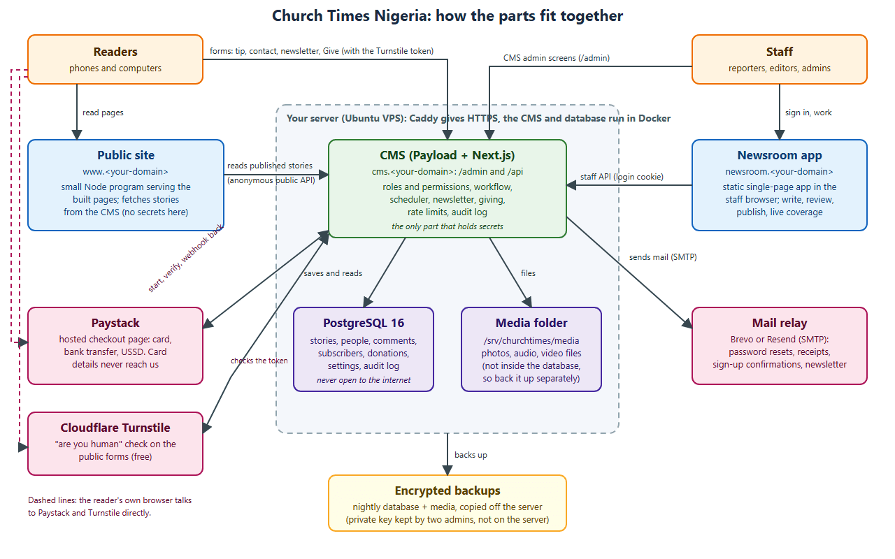

**What talks to what**

| From | To | What is sent | Notes |
| --- | --- | --- | --- |
| Reader's browser | Public site | Page requests | The public site is a small Node program serving prebuilt pages. It holds no secrets. |
| Public site | CMS | Anonymous reads of published stories, sections, authors, topics, search, redirects | `PUBLIC_CMS_URL` on the public host must equal the CMS `CMS_PUBLIC_URL`, otherwise images silently disappear. |
| Reader's browser | CMS | Story tip, contact, newsletter sign-up, Give form | Each carries a Turnstile token. Allowed only from the origins in `PUBLIC_SUBMISSION_ORIGINS`. |
| Reader's browser | Paystack | Card or bank details | Typed only on Paystack's page. This system never sees them. |
| Staff browser | Newsroom app | Sign-in and daily work | A static single-page app. Same account as the CMS. |
| Newsroom app | CMS | The staff API with a login cookie (`payload-token`, HttpOnly, SameSite=Lax) | The newsroom and CMS hosts must share a registrable domain (for example `newsroom.example.org` and `cms.example.org`). |
| CMS | PostgreSQL | Everything except files | Stories, users, comments, subscribers, donations, settings, audit log. |
| CMS | Media folder | Uploaded photos, audio, video | A folder on the server disk, **not** in the database dump. |
| CMS | Mail relay | Password resets, confirmations, receipts, newsletter | Plain SMTP. |
| CMS | Paystack | Start a payment, verify it; Paystack calls back with a signed webhook | Off until a key is set and giving is enabled. |
| CMS | Cloudflare Turnstile | Checks each token | If Cloudflare is unreachable the forms refuse (fail closed). |
| Server | Backups | Database dump plus media archive | Encrypted, copied off the server. |

**Where data lives**

| Data | Where | Backed up by |
| --- | --- | --- |
| Stories, users, comments, subscribers, donations, settings, audit log | PostgreSQL 16 (Docker volume `pgdata`) | `backup.sh` (database dump) |
| Photos, audio, video | `/srv/churchtimes/media` on the host | `backup.sh` (media archive) |
| Secrets and settings | `/etc/churchtimes/cms.env` (mode 600) and `/etc/churchtimes/secrets/postgres_password` | Your password manager. Never in GitHub, never in the backup. |
| Public site pages | `dist` folder of the public host | Rebuilt from Git |
| Redirect map (optional private file) | `PUBLIC_REDIRECTS_FILE` on the public host | Keep a copy privately |

> **Developer detail.** The production stack in `apps/cms/docker-compose.production.yml` runs only two containers: `postgres` (postgres:16-bookworm, no published port, internal network) and `cms` (image pinned by digest, user 1000:1000, read-only root, all capabilities dropped, bound to `127.0.0.1:3000`, memory limit 1280 MB). A one-off `migrate` service (profile `ops`) runs migrations and admin scripts. Caddy runs on the host, not in a container. The public host (`tools/public-host.mjs`, unit `deploy/public-host/churchtimes-public.service`, Caddyfile `deploy/public-host/Caddyfile`) and the newsroom static files are deployed separately. Details: [operations.md](operations.md) sections 2 and 3.2, [public-host-production.md](../../../docs/public-host-production.md).

---

## 2. Roles, permissions and the story workflow

### 2.1 The five roles

An admin gives each account one role (**Users** in the CMS admin). Section editors and trusted publishers also get **Sections** (categories), and their powers apply only there. The rules below are enforced **by the CMS on the server**; the newsroom app only hides buttons as a convenience (`apps/newsroom/src/permissions.js` says so itself).

The everyday table (who can write, review, publish) is in the [Staff Manual, section 3](staff-manual.md#3-roles-and-what-each-person-can-do). This section adds the back-office rights, taken from the access rules in `apps/cms/src/collections/*.ts` and `apps/cms/src/globals/*.ts`.

| Back-office area | Reporter | Trusted publisher | Section editor | Editor in chief | Admin |
| --- | --- | --- | --- | --- | --- |
| Open the CMS admin | Yes | Yes | Yes | Yes | Yes |
| Articles: create | Yes | Yes | Yes | Yes | Yes |
| Articles: delete | No | No | No | Yes | Yes |
| Media: upload | Yes | Yes | Yes | Yes | Yes |
| Media: delete | No | No | No | Yes | Yes |
| Categories: create, change, delete | No | No | No | Yes | Yes |
| Authors and Topics: create, change | No | No | Yes | Yes | Yes |
| Authors and Topics: delete | No | No | No | Yes | Yes |
| Site trust pages: read | Yes | Yes | Yes | Yes | Yes |
| Site trust pages: change | No | No | No | Yes | Yes |
| Submissions (story tips): read and triage | No | No | Yes | Yes | Yes |
| Contact messages | No | No | No | Yes | Yes |
| Live events: delete | No | No | No | Yes | Yes |
| Advertisers, Ad campaigns, Redirects | No | No | No | Yes | Yes |
| Audit logs (read only) | No | No | No | Yes | Yes |
| Legacy comments: hide, restore | No | No | Their sections | Yes | Yes |
| Legacy comments: delete | No | No | No | No | Yes |
| Users: create, change roles, unlock, set passwords | No | No | No | See below | Yes |
| Subscribers: read, change status, export, erase | No | No | No | No | Yes |
| Newsletter settings: read | No | No | Yes | Yes | Yes |
| Newsletter settings: change | No | No | No | Yes | Yes |
| Newsletter issues: read | No | No | Yes | Yes | Yes |
| Newsletter issues: change subject (draft only) or delete (draft or failed only) | No | No | No | Yes | Yes |
| Run digest dry run or test send | No | No | Yes | Yes | Yes |
| Giving settings: read | No | No | No | Yes | Yes |
| Giving settings: change | No | No | No | No | Yes |
| Donations: read the ledger (no names or e-mails) | No | No | No | Yes | Yes |
| Donations: see names, e-mails, provider reference; CSV with them; redact; delete a row | No | No | No | No | Yes |

*Users.* Only an admin can create users, unlock accounts and change roles. The editor in chief can read the user list. Reporters and others see only their own record.

**Admin two-person rule (recommended house rule, from the security checklist).** No more than two people should hold the admin role, and any change to a role or section is agreed by both. Remove accounts of people who leave on the same day.

> **Developer detail.** Role names in code are `admin`, `editor-in-chief`, `section-editor`, `trusted-publisher`, `reporter` (`apps/cms/src/access/roles.ts`). "Editor in scope" means admin or editor in chief for everything, a section editor for the categories in their `sections`. Donation personal fields (`name`, `email`, `providerRef`) are field-level admin only. Every donation, newsletter issue and subscriber action writes an audit row.

### 2.2 The story workflow

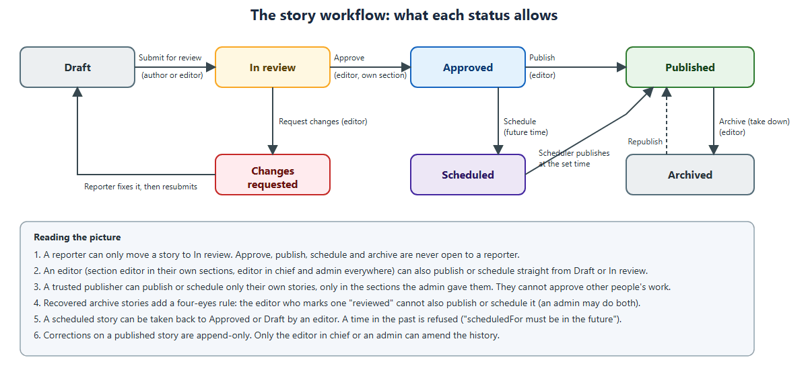

The seven statuses are `draft`, `in_review` (shown as In Review), `changes_requested`, `approved`, `scheduled`, `published`, `archived`. The allowed moves (from `apps/cms/src/workflow/articleWorkflow.ts`):

| From | To | Who |
| --- | --- | --- |
| Draft | In review | The author, or an editor in scope |
| Draft, In review, Approved | Published or Scheduled | An editor in scope, or a trusted publisher for their **own** story in their sections |
| In review | Changes requested, Approved | An editor in scope |
| Changes requested | In review or Draft | The author, or an editor in scope |
| Approved | In review | An editor in scope |
| Scheduled | Published, Approved, Draft | An editor in scope (the scheduler itself may move Scheduled to Published) |
| Published | Archived | An editor in scope |
| Archived | Published | An editor in scope |

Anything else is refused ("Invalid transition"). A reporter can never reach Approved, Published, Scheduled, Archived or Changes requested.

**Who may edit the text.** An editor in scope: always. A trusted publisher: their own story in their sections at any status. Everyone else: only their own story while it is Draft or Changes requested (not while In review).

**Four-eyes rule: what is really enforced**

1. Reporters never publish, so a second person always publishes a reporter's story.
2. Recovered archive stories (imported from the old site, marked with an import batch) cannot be published or scheduled until an editor sets their review status to "reviewed". The editor who sets "reviewed" is recorded by the server, and **that person cannot also publish or schedule it** (error 409). An admin may do both. This also covers bulk actions, version restore and the scheduler.
3. For ordinary stories an editor who approves **may** also publish. A stricter habit is a house rule, not a locked button.

### 2.3 Scheduled publishing

1. An editor or trusted publisher (own story) chooses **Schedule** and a date and time (see the [Staff Manual, "Schedule a story"](staff-manual.md#6-the-workflow-and-scheduling)).
2. The CMS refuses a time that is not in the future ("scheduledFor must be in the future.") and refuses to schedule without one.
3. A loop **inside the CMS process** checks every `SCHEDULER_INTERVAL_SECONDS` (default 60) and publishes what is due. It handles up to 100 stories per pass.
4. Exactly **one** CMS instance may run the loop (`SCHEDULER_ENABLED=true` on the `cms` service, `false` on `migrate`). Never scale the `cms` service to two, or both will try to publish.
5. The same loop also runs the daily newsletter digest check (section 6) on its own guard, so a slow mail run never delays publishing.
6. If the CMS is stopped over the scheduled time, the story goes out when it starts again (the next loop pass finds it due). **Not verified** on a live server.

### 2.4 Corrections

Corrections are a public, **append-only** list on a published story (the "Corrections" box in the story, shown on the article and in the public corrections log).

- Anyone who may edit the story can **add** a correction. The date is set by the server and cannot be back-dated.
- Existing entries cannot be changed, reordered or removed. Only the editor in chief or an admin can amend history, and the change is audited as `correction.amend` with the old values.
- Changing the **Story type** of a published story (for example away from Sponsored) requires a new correction note in the same save, so a label never disappears quietly.
- Restoring an old version of a story overwrites the whole document (admin or editor in chief only). It can remove corrections added after that version. The audit log keeps the `article.restore` entry. Warn the newsroom before doing it.

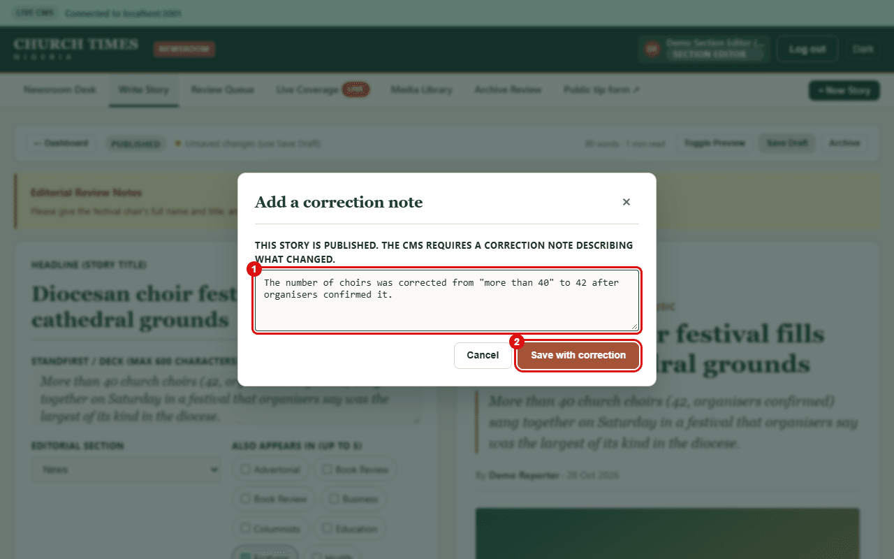

---

## 3. The newsroom app, screen by screen

The step-by-step instructions for each screen live in the [Staff Manual](staff-manual.md). This section is a map: what each screen is for, which role sees it, and where the picture is.

| Screen | Who | What it is for | Picture and steps |
| --- | --- | --- | --- |
| Staff sign-in | Everyone | Email and password (12+ characters). 5 wrong tries lock the account for 10 minutes. A session lasts 8 hours and is extended while you work. | [Staff Manual section 2](staff-manual.md#2-logging-in-and-the-screens), 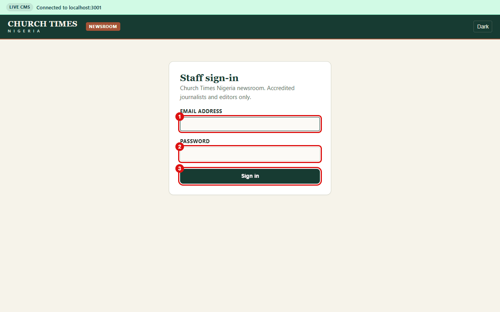 |
| Newsroom Desk | Everyone | Six counters (Drafts, In Review, Revisions, Approved, Published, Reader Tips) and the Story Pipeline list. | 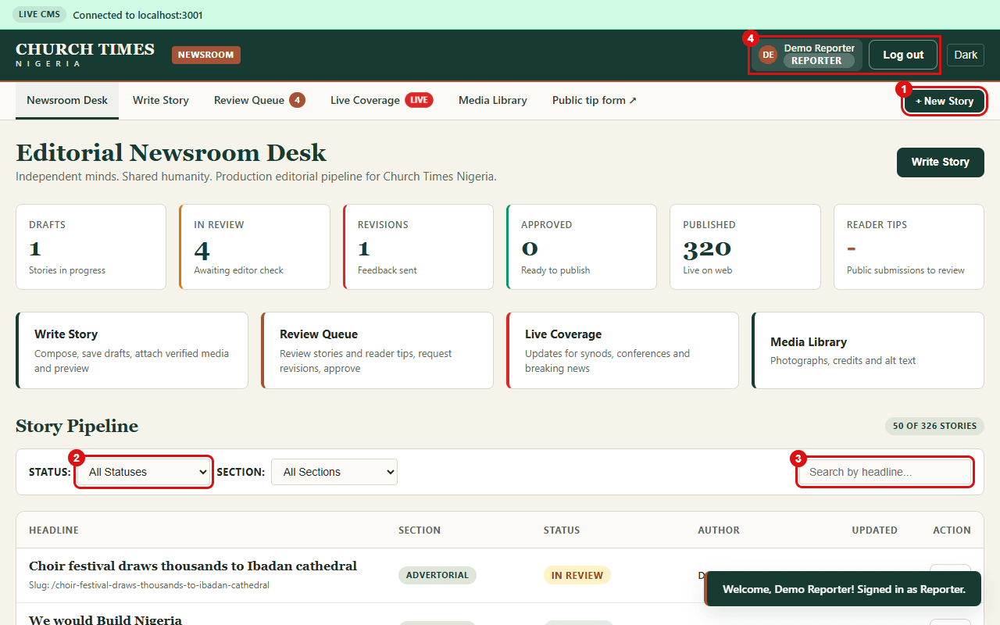 |
| Write Story (editor) | Everyone | Headline, section, body, photos, audio and video, details, save and submit. Autosaves; shows an offline banner and warns when someone else changed the story. | 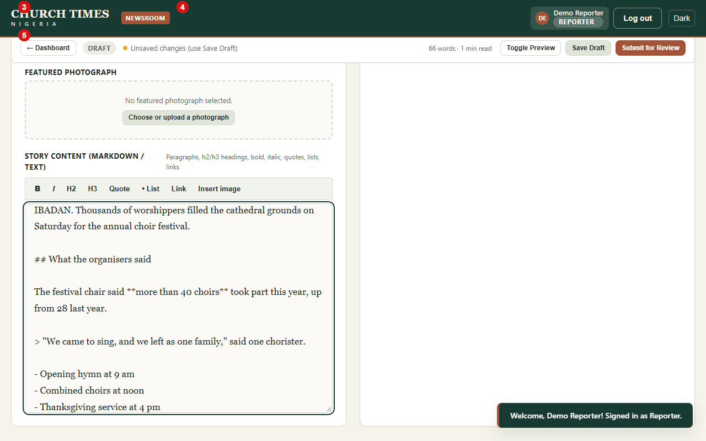 |
| Story details box | Everyone (reporters only while Draft or Changes requested) | Kicker (60 characters), Story type, Author profile, "Updated" date, Key points, Topics. | 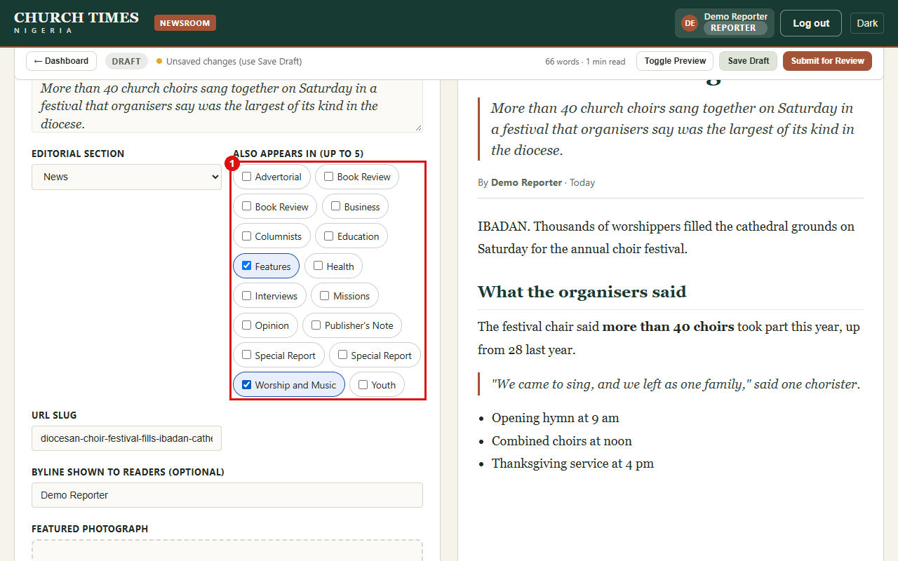 |
| Key points | Same | The "What you need to know" box: one per line, at most 5, at most 200 characters each. | [Staff Manual](staff-manual.md#story-details-kicker-story-type-key-points-updated-topics-and-author-profile); public result:  |
| Pull quote | Same | Button **Pull quote** inserts `>> exact words -- Speaker`; up to 400 characters, plain text. | public result: 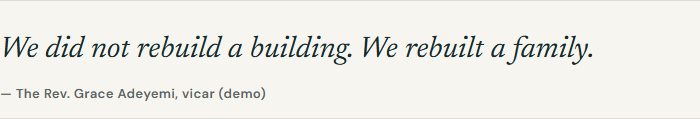 |
| Gallery lines | Same | Button **Gallery image** inserts `[gallery](media:12)`; up to 12 photos, each needs alt text. Per-photo captions are added in the CMS admin; a story whose gallery has captions opens read-only in the newsroom (a notice says so). | 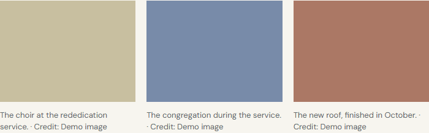 |
| Topic chips | Same | Tick up to 10 topics. A topic marked "(not public)" is never shown to readers. | [Staff Manual](staff-manual.md#story-details-kicker-story-type-key-points-updated-topics-and-author-profile) |
| Author profile | Same | Links the byline to a public author page. "None" keeps the text byline. | public result: ; admin side: 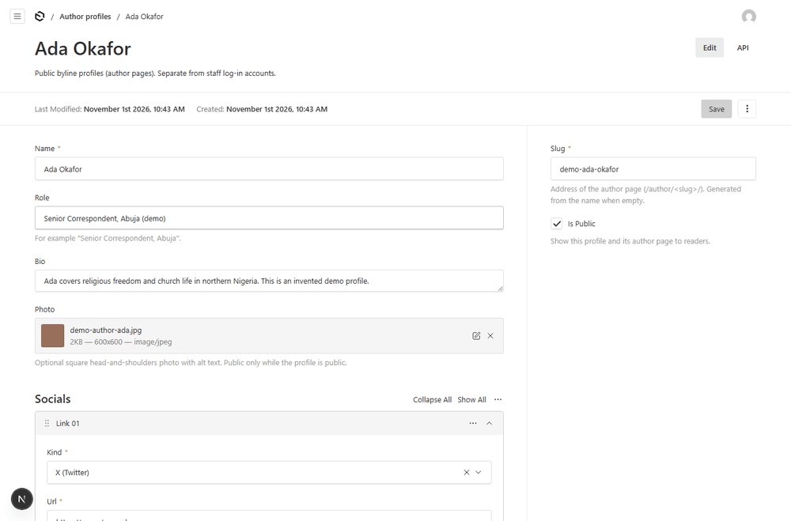 |
| Review Queue | Editors | Stories waiting for a decision; inspect, Request Changes, Approve, open in full editor. | 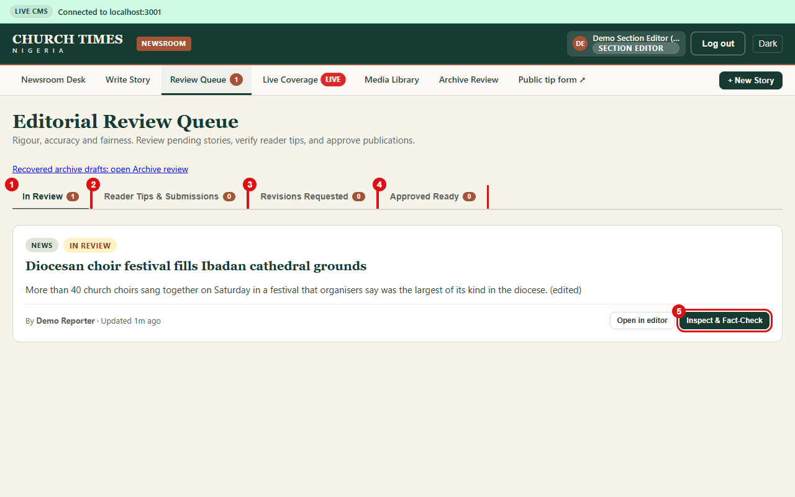 |
| Revisions and Approved tabs | Everyone (own) | Reporter sees editor notes; approved stories are read-only for the reporter. | 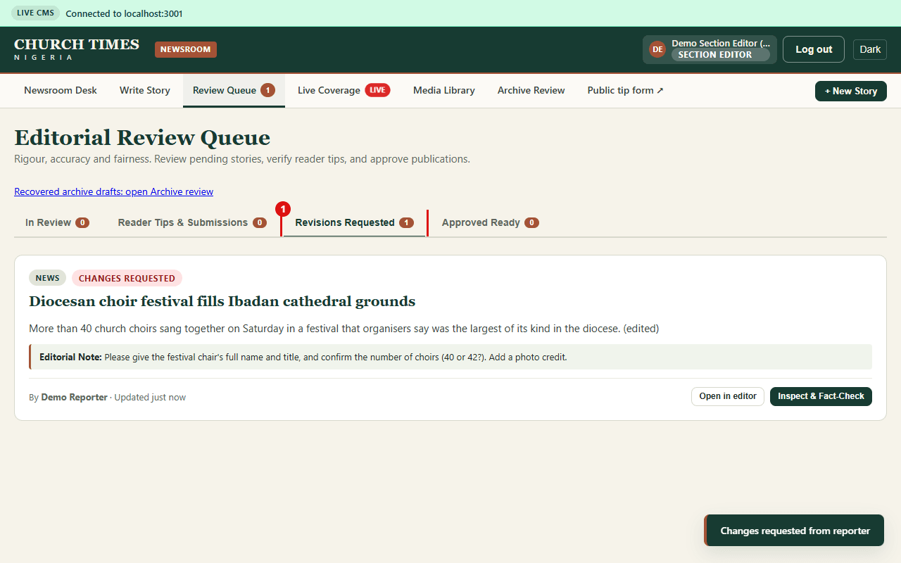 |
| Schedule panel | Editors, trusted publishers | Pick a future time. | 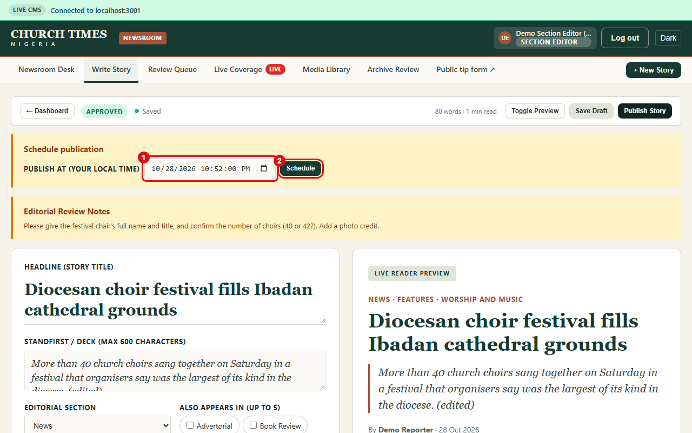 |
| Publish, Archive (take down) | Editors in scope | Confirm dialogs. | 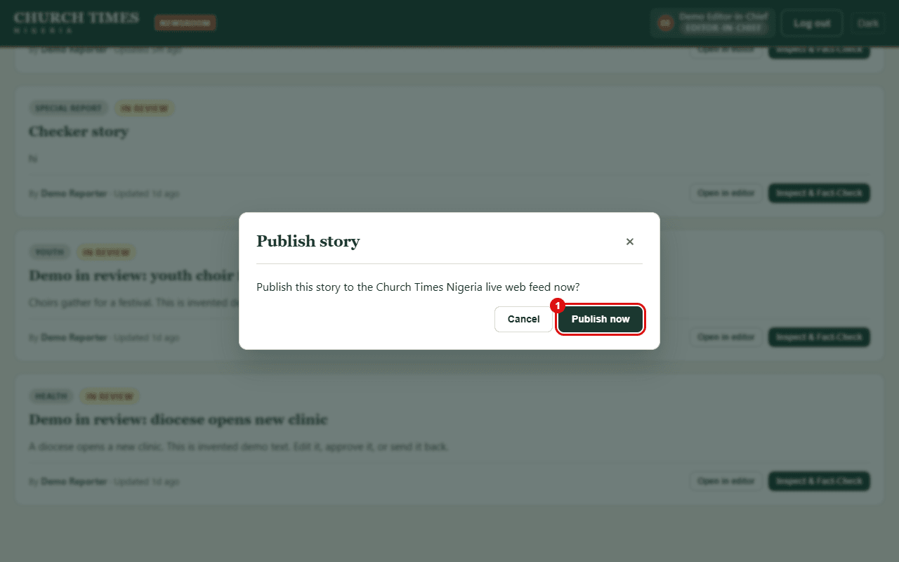 |
| Live Coverage | Reporters post (need approval); editors and trusted publishers run events | Events and timed updates with photos. | 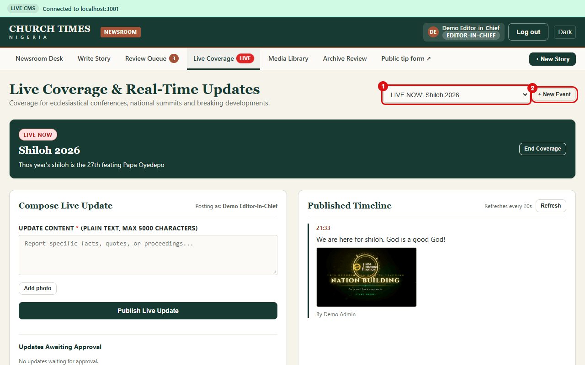 |
| Media Library | Everyone | Upload and pick photos, alt text, credit. | 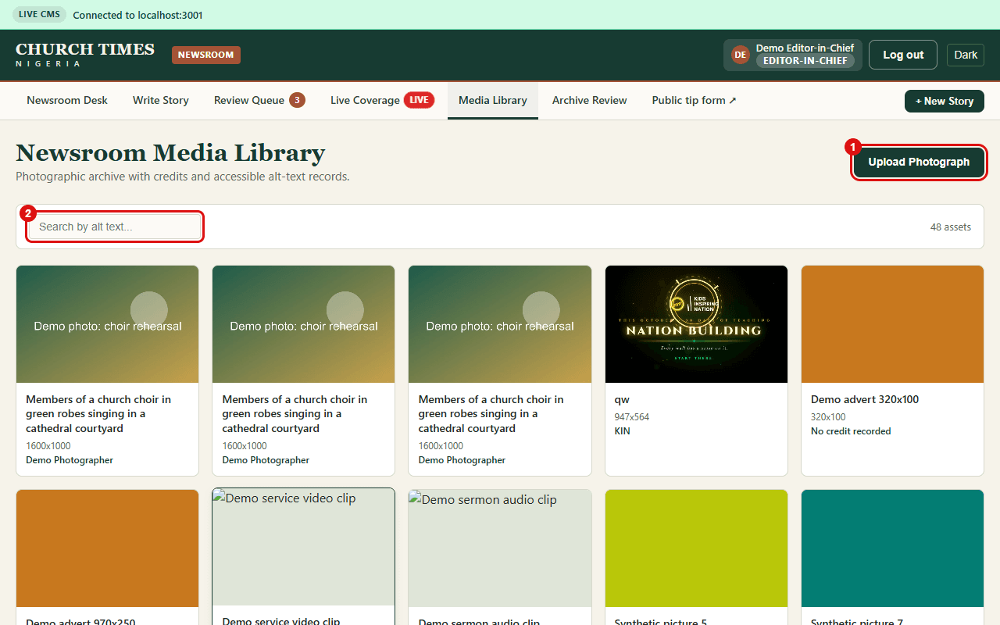 |
| Archive Review | Editors | Recovered old stories: check links and text, mark reviewed. Outbound links are shown as plain text with unknown hosts flagged. | 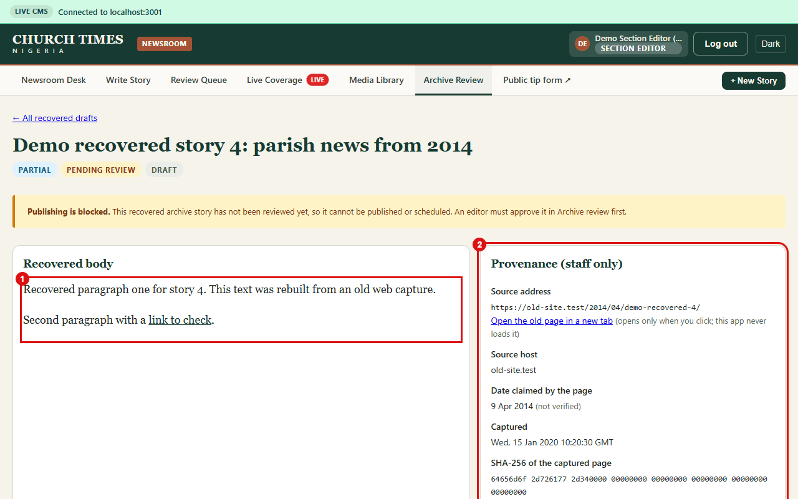 |
| Reader tips | Editors | Public story tips with Turnstile and consent. | 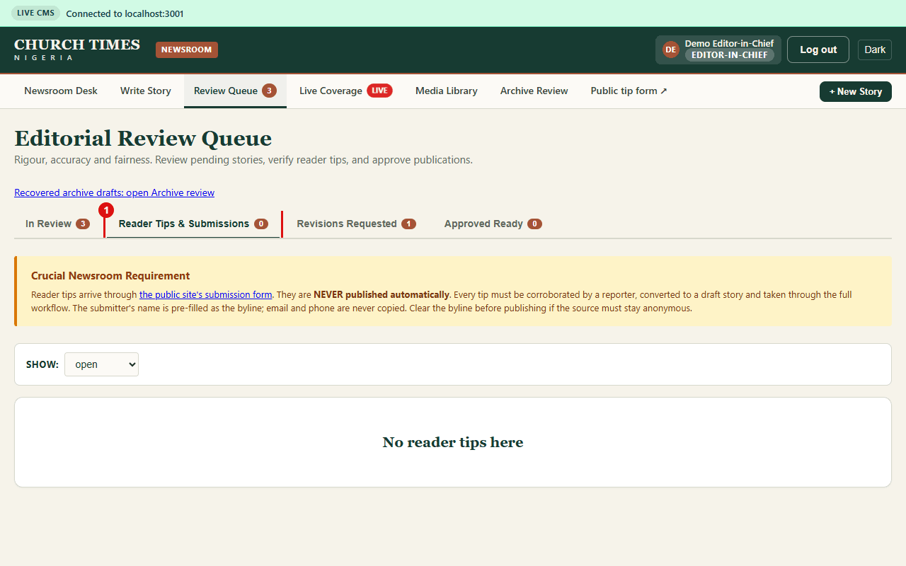 |

> **Developer detail.** The newsroom is a Vite single-page app in `apps/newsroom`. Build setting: `VITE_CMS_URL` (CMS origin; leave empty only if the CMS is reverse-proxied under `/api` on the same origin), optional `VITE_PUBLIC_SITE_URL`, optional `VITE_KNOWN_LINK_HOSTS`. It ships a Content-Security-Policy meta tag built from `VITE_CMS_URL` (`apps/newsroom/csp.js`): `script-src 'self'`, no objects, no framing of other origins. `npm run dev:newsroom:mock` runs it against fake data with no CMS. Newsroom server checks the story-detail limits too: the CMS validates kicker (60), key points (5 x 200), content type, "Updated" (a real date, not in the future).

---

## 4. The CMS admin, screen by screen

Open `https://cms.<your-domain>/admin` and sign in with the same email and password. The left menu shows only what your role may open. The [Staff Manual section 10](staff-manual.md#10-comments-ads-redirects-staff-accounts-and-the-other-admin-tasks) already has step-by-step pictures for **Legacy comments, Advertisers and Ad campaigns, Redirects, Users, password help, Contact messages, Subscribers and Audit logs**. Below, each screen has one paragraph and a pointer. New pictures are shown where the other manuals have none.

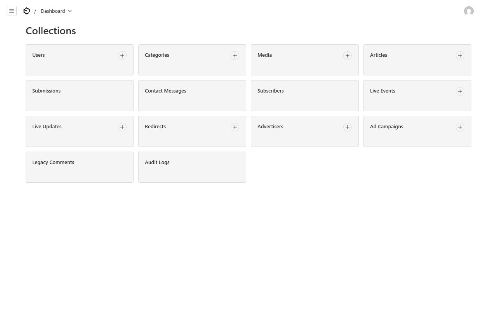

### 4.1 Articles

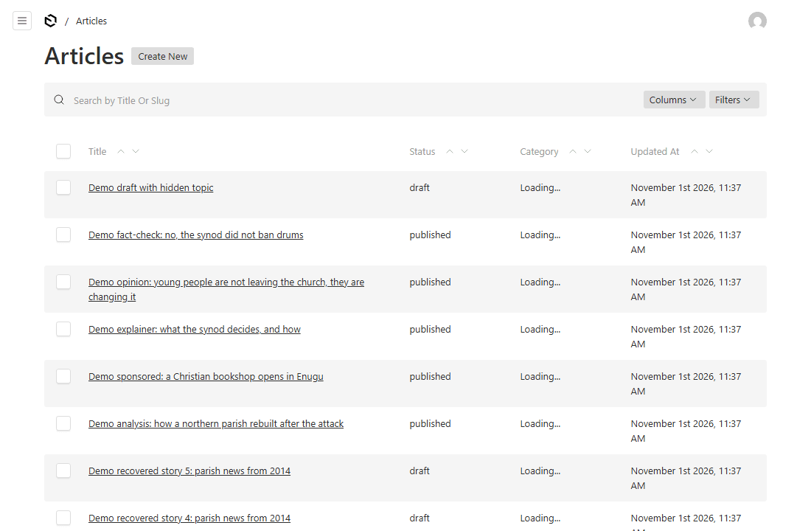

The full editor for every story, for people who need more than the newsroom offers (gallery captions, corrections history, versions, SEO fields, provenance of recovered stories). Search by title or slug. Each story keeps **Versions** (top right). Slug changes on a published story create a redirect automatically (audited as `article.slug-change`).

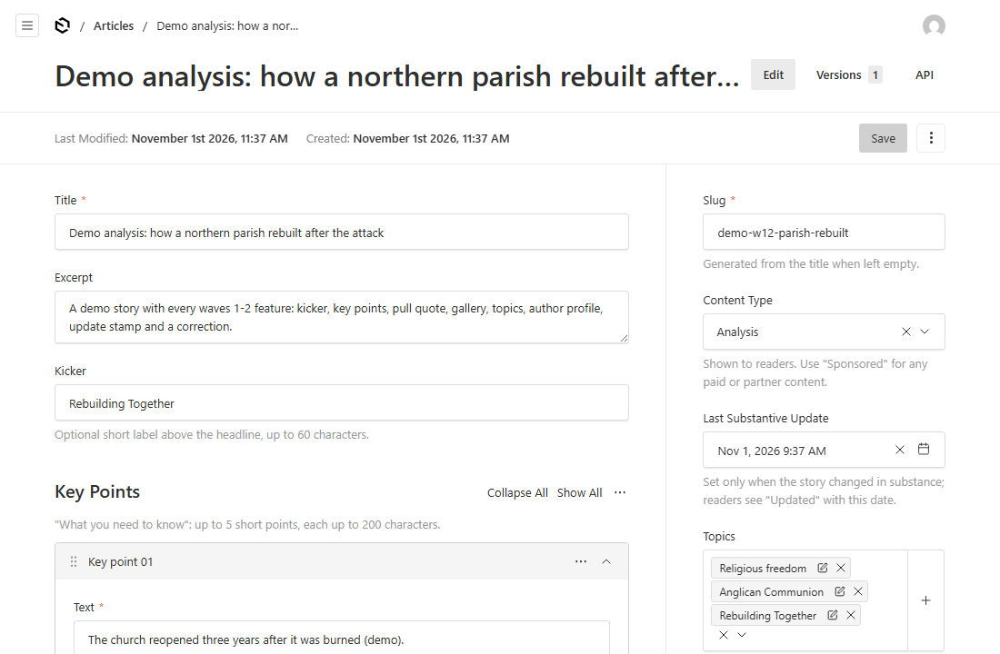

Waves 1-2 fields: **Kicker**, **Content Type** (News is the default; Analysis, Opinion, Sponsored, Explainer, Fact-check), **Last Substantive Update** (editor-set, never automatic), **Key Points**, **Topics**, **Byline author** (an Authors profile; the text byline stays as fallback). The body has two extra blocks: **Pull quote** and **Gallery** (up to 12 photos with alt text and caption). See the [front-end manual](frontend-manual.md) for how they look to readers, and the picture of the same story's key-points box: 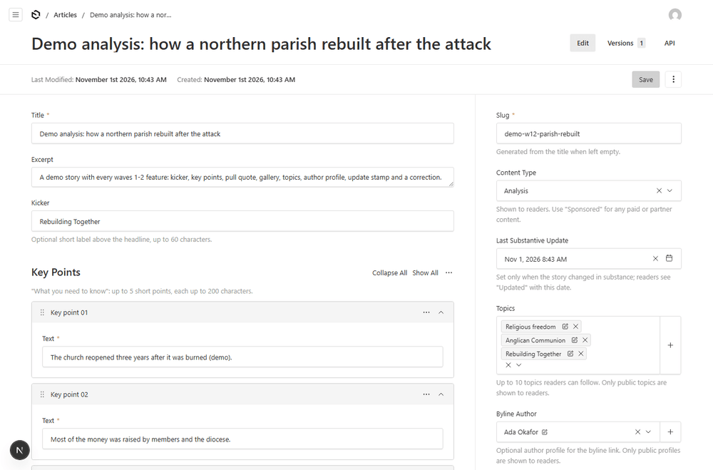

### 4.2 Media

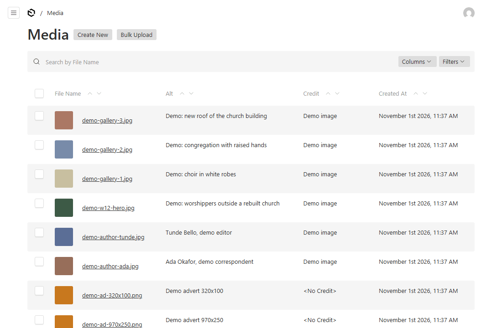

What the rules are (from `apps/cms/src/collections/Media.ts` and `lib/mediaLimits.ts`):

| Rule | Value |
| --- | --- |
| Allowed image types | JPEG, PNG, WebP. SVG and HTML are refused. |
| Largest image | 25 MB by default. Set `MEDIA_IMAGE_MAX_MB` (whole MB, 1 to 50). Rebuild and restart after changing it. |
| Largest audio or video | 100 MB by default (`MEDIA_AV_MAX_MB`, maximum 500). Types: mp4, m4v, webm, mp3, m4a, ogg. |
| Biggest pixel count | 40 megapixels. Uploads are re-encoded, so stored originals carry no EXIF or GPS data. |
| Sizes made automatically | `thumbnail` 400 px, `card` 800 px, `hero` 1600 px (WebP), plus `cardAvif` 800 px and `heroAvif` 1600 px (AVIF, quality 55). An AVIF cannot be uploaded; AVIF exists only as these generated sizes. |
| Blur placeholder (`lqip`) | A tiny blurred copy (16 px on the long side, stored as a small text value, at most 1,500 characters) made on every new image. The public site shows it while the real picture loads. It follows the file: replacing the picture re-makes it. |
| Old pictures | Run `npm run media:lqip-backfill` once on the server to make placeholders for pictures uploaded before the sprint. |
| Who can see a file | Staff always. The public only sees pictures used in a **published** story (or an approved live update). Drafts are private, except through a signed preview link. |
| Reverse proxy limit | The proxy must allow **28 MB** on the `/api/media` location (image cap 25 MB plus overhead). Raise it if you raise the cap. |

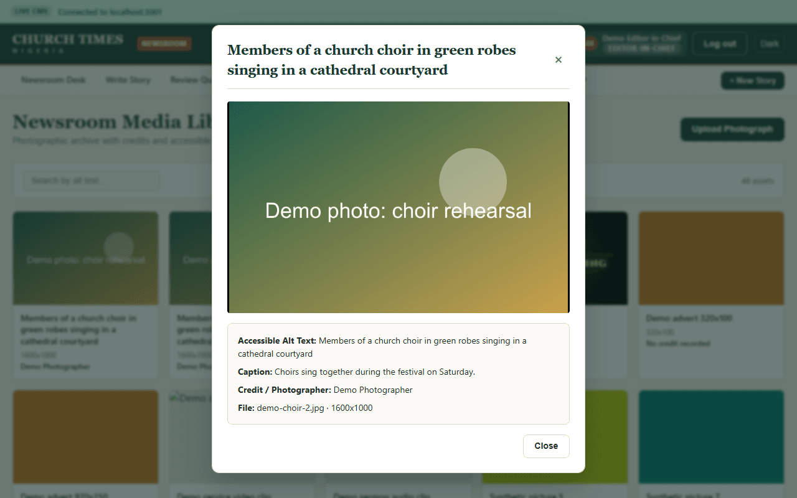

### 4.3 Categories

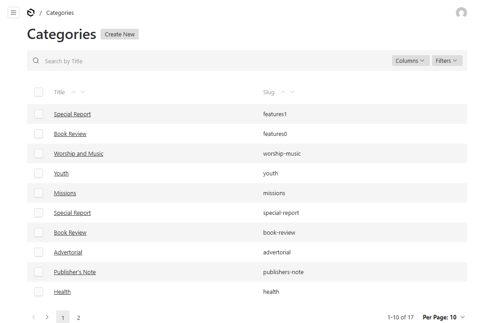

The sections of the site (News, Opinion, Features, ...). Reading is public. Only the editor in chief or an admin creates, changes or deletes. Section editors and trusted publishers are tied to categories through **Sections** on their user record. The importer and the demo create 15.

### 4.4 Authors

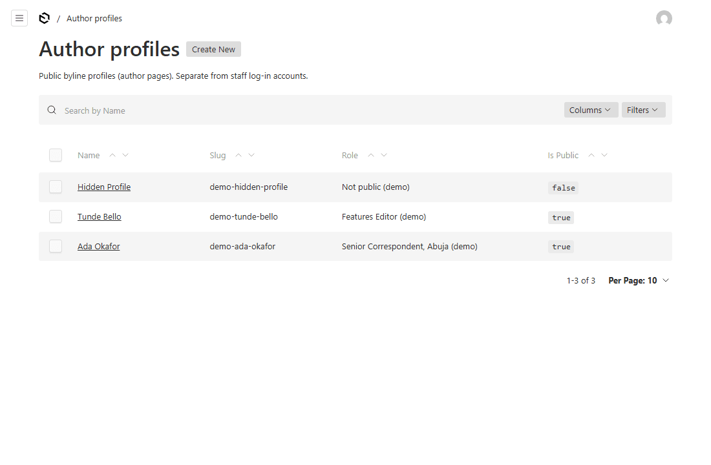

Public byline pages (`/author/<slug>/`). Separate from login accounts. Up to 600 characters of bio, links, a photo (alt text, a picture the person agreed to publish). Tick **isPublic** to show it; until then it is hidden everywhere. Section editors and above create and change; only the editor in chief or admin deletes. See the [Staff Manual](staff-manual.md#author-profiles-and-topics-editors) and .

### 4.5 Topics

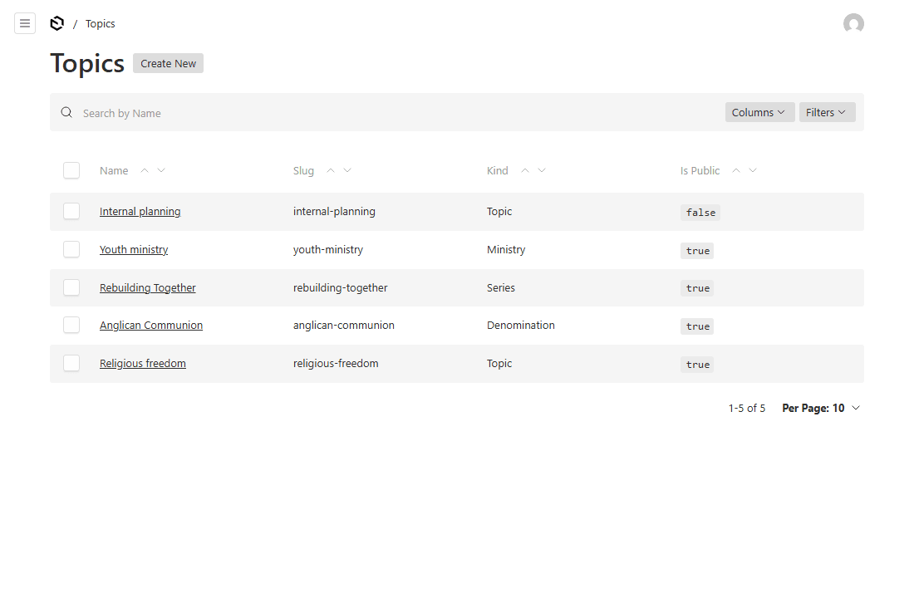

What readers follow (`/topic/<slug>/`). Same rules as Authors. Deleting a topic removes it from every story.

### 4.6 Subscribers (admin only)

The list of newsletter sign-ups ([picture](staff-manual/img/97-cms-subscribers.png)). People confirm themselves by e-mail (double opt-in), so staff cannot add addresses by hand. An admin can mark someone unsubscribed or bounced. Admin-only actions, each audited: export to CSV (`GET /api/subscribers/export`), per-person data export (`/api/subscribers/:id/subject-data`) and **erase** (`POST /api/subscribers/:id/erase`, replaces the address with a one-way hash so a re-import cannot bring it back). Subscribers can never be deleted outright.

### 4.7 Newsletter settings and issues

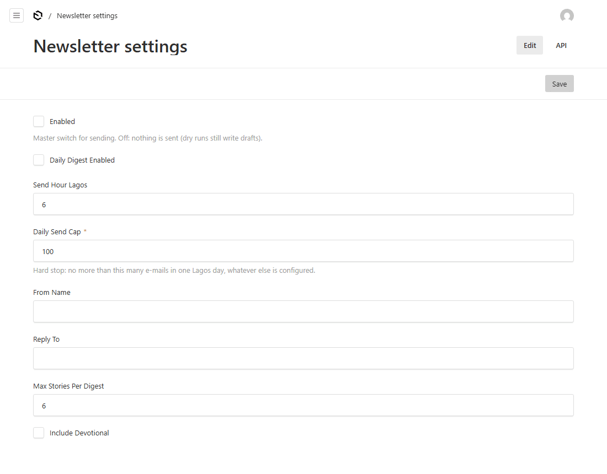

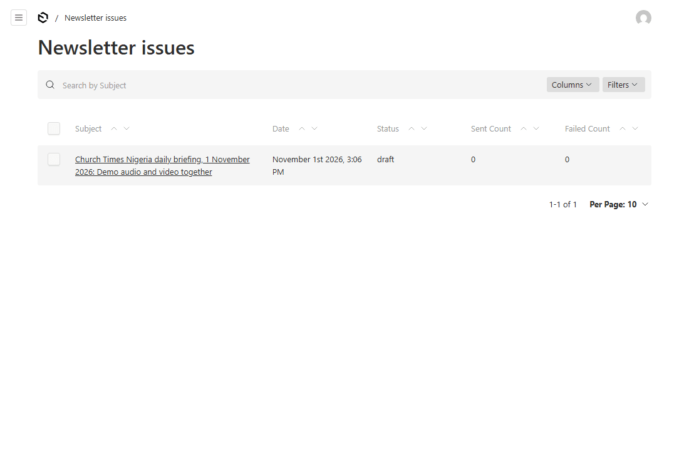

Everything about sending is in section 6. In short: **Enabled** is the master switch (off: nothing is sent), **Daily Digest Enabled** turns on the daily schedule, **Send Hour Lagos** (0 to 23, default 6), **Daily Send Cap** (default 100, a hard stop per Lagos day), **Max Stories Per Digest** (default 6). Issues are written by the system; staff can only change the **subject**, and only while it is a draft.

### 4.8 Giving settings and Donations

Giving settings: 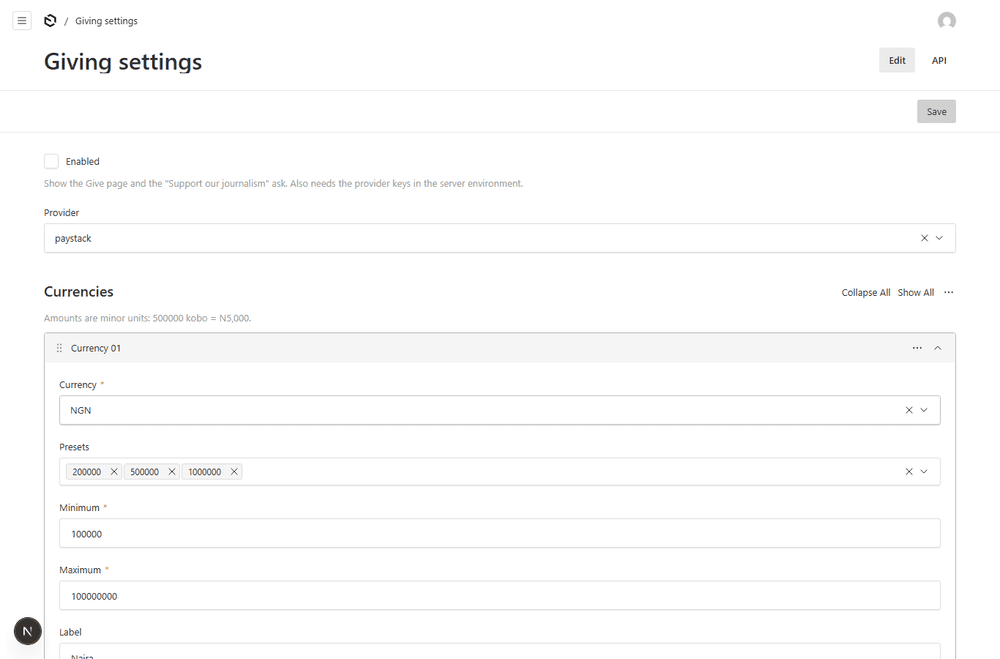

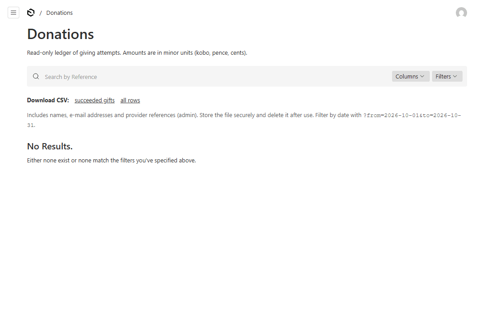

- **Giving settings** (admin changes; the editor in chief can read): the **Enabled** tick, provider (only `paystack` is built), currencies (amounts typed in **minor units**: 500000 kobo = N5,000), presets, minimum, maximum, causes, thank-you note, bank-transfer note. Giving needs both this tick and the server key (section 5).
- **Donations**: a read-only ledger. Nobody can create or edit a row. Statuses: pending, succeeded, failed, abandoned. The links above the list download a CSV (`GET /api/donations/export?status=succeeded&from=2026-10-01&to=2026-10-31`). The CSV holds reference, dates, status, provider, currency, amount in minor units and in major units, cause, channel, anonymous flag, consent time and version, receipt time. **Only an admin's download also contains name, e-mail and provider reference.** At most 50,000 rows per file (narrow the dates otherwise). The cells are protected against spreadsheet formula tricks. Store the file securely and delete it after use. Every export is audited (counts and filters, never personal data).
- **Redaction** (data-subject request): see section 5.8.

### 4.9 Site trust

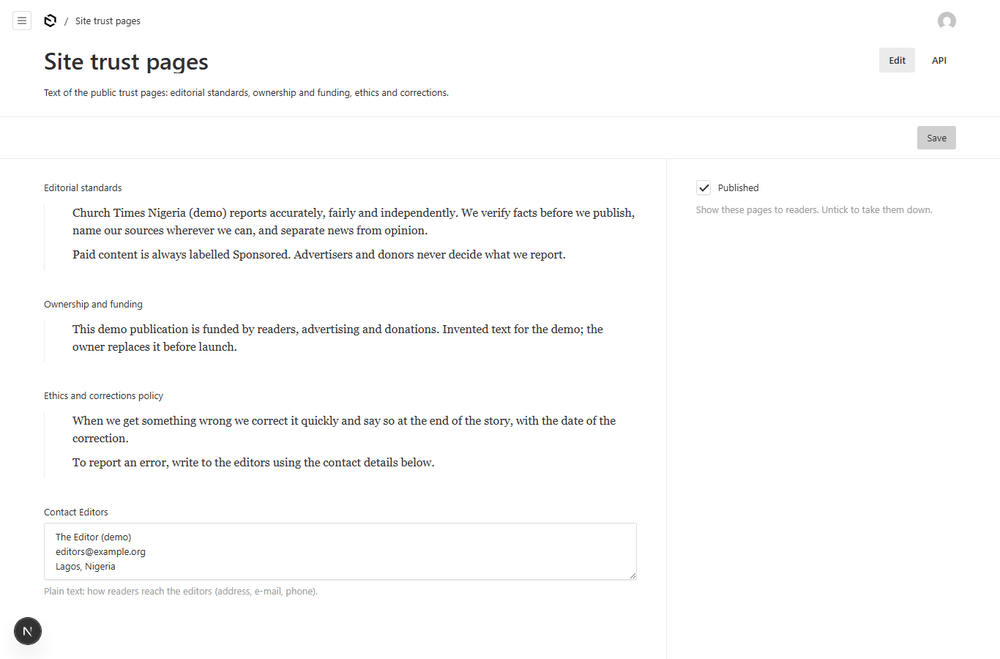

The text of three public trust pages plus a contact line. Editor in chief or admin changes it. Tick **published** to show the pages. Headings, paragraphs, lists and links only. The corrections log on `/corrections/` is built automatically from story corrections. **Owner action:** write the real text before go-live (the demo shows sample text).

### 4.10 Ads

[Advertisers](staff-manual/img/94-cms-advertisers.png) and [Ad campaigns](staff-manual/img/92-cms-ad-campaigns.png) (editor in chief and admin). An ad shows only when it is approved, paid or waived, and inside its dates. `ADS_REQUIRE_PAYMENT=true` is the default: only the literal `false` lets unpaid ads run. Pictures: JPEG, PNG or WebP, at most 500 KB, not animated, exact sizes per placement. The CMS never serves an AdSense script or publisher id; `PUBLIC_ADSENSE_ENABLED` and `PUBLIC_ADSENSE_REVIEWED` are only flags it reports.

### 4.11 Live events

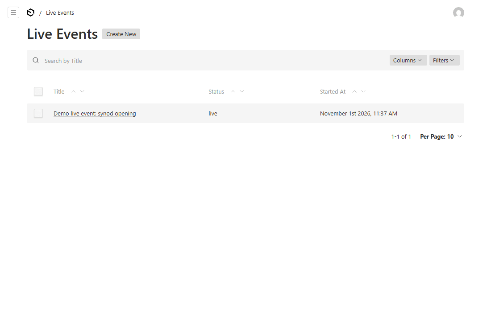

The CMS-side list of live coverage events and their updates (Live Updates is a separate list). Daily operation is in the newsroom ([Staff Manual section 9](staff-manual.md#9-live-coverage)). Updates from reporters wait for approval; approved updates get a sequence number; clients poll every 15 to 30 seconds. Only the editor in chief or admin deletes events or updates.

### 4.12 Legacy comments

[List](staff-manual/img/80-cms-legacy-comments.png) and [hide/restore steps](staff-manual/img/82-cms-comment-set-hidden.png). These are archived comments from the old site: **name and text only, no e-mail address is stored**. Read-only on the public site. No new comments are accepted. Hiding and restoring is audited (`legacy-comment.hide`, `legacy-comment.restore`).

### 4.13 Redirects

[List](staff-manual/img/90-cms-redirects.png). 301, 302 or 410 rules from old to new paths; the system refuses loops and chains. See section 7.9 for the cutover use.

### 4.14 Audit logs

[List](staff-manual/img/96-cms-audit-logs.png). Read-only, editor in chief and admin. Nobody can edit or delete a row. Actions you will see include `status-change`, `correction`, `article.slug-change`, `article.restore`, `ad-campaign.*`, `redirect.*`, `user.role-change`, `user.password-change`, `subscriber.*`, `donation.export`, `donation.redact`, `newsletter.digest-draft`, `newsletter.digest-send`, `newsletter.digest-test-send`, `import.article`, `import.rollback`. Rows hold ids and counts, not personal data. The actor id is kept even if the user is deleted later.

### 4.15 Submissions (story tips)

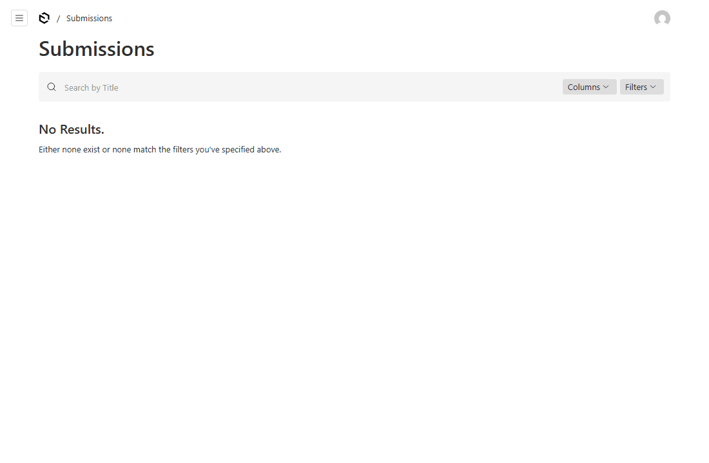

Story tips from the public form. Editors (section editors included) can read **all** of them, including the sender's name, e-mail and phone (a known limitation, section 10.4). A tip never publishes by itself; an editor converts it to a draft.

---

## 5. Money: Paystack, end to end

This section is the owner's checklist. The full technical reference, with every source link, is [w12/giving.md](w12/giving.md). **Re-check Paystack's current pages before you go live** (see "Verification caveats" below).

### 5.1 How a gift flows

1. A reader chooses an amount on `/give/`, ticks the consent box and passes Turnstile.
2. The CMS checks the amount against **Giving settings**, saves a `pending` row with a server-made reference (`CTG-` plus 32 random hex characters) and asks Paystack for a checkout link.
3. The reader pays on Paystack's own page (card, bank transfer or USSD). Card details never touch our servers.
4. Paystack tells the CMS by a **signed webhook**. The CMS **verifies the payment again directly with Paystack** before marking it `succeeded`, and only if the amount and currency match.
5. One plain-text receipt e-mail is sent (reference, amount, date, cause; never card details).
6. The reader returns to `/give/thanks/`, which asks the CMS for the status.

### 5.2 Set it up (owner, step by step)

1. Create a Paystack business account at dashboard.paystack.com, complete the business verification for the company and add the Nigerian naira settlement bank account.
2. Dashboard, **Settings, API Keys & Webhooks**: copy the **test secret key** (`sk_test_...`).
3. Put it **on the server only**: in `/etc/churchtimes/cms.env` set `PAYSTACK_SECRET_KEY=sk_test_...` (optional `GIVING_PROVIDER=paystack`). **Never** in a `VITE_` variable, never in GitHub, never in chat.
4. On the same dashboard page set the **Test Webhook URL** to `https://<CMS host>/api/public/giving/webhook/paystack`. The callback URL can stay empty (the CMS sends one per payment: `<PUBLIC_SITE_URL>/give/thanks/`, or `GIVING_RETURN_URL` if set).
5. Make sure the CMS also has: `PUBLIC_SITE_URL` (https), SMTP (for receipts), Turnstile, and `PUBLIC_SUBMISSION_ORIGINS` containing the public site origin. If you set `TURNSTILE_EXPECTED_ACTION`, add `giving-init` to the list.
6. CMS admin, **Giving settings**: add currencies (NGN first), presets in kobo (200000 = N2,000), minimum, maximum, causes, thank-you note, bank-transfer note, then tick **Enabled**.
7. Build the public site with `VITE_PUBLIC_GIVING_URL=https://<CMS host>/api/public/giving` and the Turnstile site key. The Give page is `/give/`; the ask shows at the end of articles and in the footer.
8. Test with Paystack test cards (success, decline, bank transfer). Check the receipt, the row in **Giving > Donations**, and run `npm run giving:reconcile`.

Pictures of what the reader sees: [Give page](frontend-manual/img/122-give-page.png), [form](frontend-manual/img/123-give-form.png), [thank-you](frontend-manual/img/125-give-thanks.png).

### 5.3 Going-live checklist (money)

- [ ] Paystack business activated and the settlement account verified.
- [ ] If you want diaspora gifts in USD: international payments approved by Paystack and a USD payout account added. Otherwise list **NGN only**.
- [ ] Live secret key set (`sk_live_...`), **Live Webhook URL** set to the same path, test key removed from the server.
- [ ] One real small gift end to end (card), then one bank transfer. The receipt arrives and `giving:reconcile` shows no issues.
- [ ] Optional: `PAYSTACK_WEBHOOK_IPS=52.31.139.75,52.49.173.169,52.214.14.220` (only with `TRUST_PROXY=true` and a correct client-IP header, otherwise every webhook is refused).
- [ ] The privacy policy mentions donations, Paystack as processor and your retention period.
- [ ] A named person owns refunds, chargebacks and the weekly reconcile.

### 5.4 Supported currencies and fees (with caveats)

| Topic | What the documents say | Caveat |
| --- | --- | --- |
| Currencies Paystack can charge | NGN, USD, GHS, ZAR, KES. **No GBP, no EUR.** A GBP or EUR row in Giving settings is ignored (not shown, init refused). | Checked 30 Oct 2026 against Paystack's open-source API specification and support pages, because paystack.com refuses automated reads. Confirm on the dashboard. |
| USD | Only for businesses registered in Nigeria or Kenya, after Paystack approves international payments, and with a USD domiciliary payout account. | Approval is Paystack's decision. |
| Minimums | NGN 50.00 and USD 2.00 per payment (a floor; your settings can only raise it). | Confirm on Paystack's currency table. |
| Fees (Nigeria) | Local: 1.5% + N100 (the N100 waived under N2,500), capped at N2,000. International cards: 3.9% + N100 (4.5% American Express). USD: 3.9% (4.5% Amex). | From Paystack's support pricing page. **Prices change: check current.** |
| Diaspora in GBP or EUR | Not possible with Paystack. Readers abroad can pay NGN with an international card (their bank converts; you pay the international fee). A second provider such as Flutterwave would be needed and is not built. | The Give page says so under the currency choice. |
| Recurring (monthly) giving | Not built. | Would need its own consent wording and a cancel link. |

### 5.5 Reconciliation

Weekly (and after any outage): on the server, in `apps/cms`, run `npm run giving:reconcile -- --days 7`. It is **read-only** and prints no personal data. It lists, by reference: payments Paystack has that we have not recorded (a status check or webhook retry will settle them), recorded successes Paystack does not have, reversed payments, amount or currency mismatches, our payments with no row, and rows pending over 24 hours, plus totals per currency. Exit code 0 means clean, 2 means issues, 1 means it could not run. A mismatched row stays `pending` on purpose (money may have moved) until a person settles it in the Paystack dashboard.

### 5.6 Refunds and chargebacks

Done in the Paystack dashboard (Transactions, Refund; Disputes). The CMS **does not act on refund or dispute webhooks** (they are acknowledged and ignored). A refunded gift therefore stays `succeeded` in the CMS, and the reconcile report flags it as reversed. Note the refund by hand in your records. Answer a dispute within Paystack's deadline with the receipt and the reference.

### 5.7 Retention

Donation rows are financial records. The suggestion in the documents, **for the owner to confirm with the accountant**: keep succeeded rows for the statutory book-keeping period (commonly 6 to 7 years); an admin may delete `pending`, `abandoned` and `failed` rows older than 90 days; blank the e-mail and name earlier on request. **Nothing deletes donation rows automatically.** This is an open owner decision (section 16).

### 5.8 Erasure on a data-subject request

Donation rows cannot be edited. The only way to remove a giver's details is **redaction**, which blanks `email` and `name` and nothing else (reference, amount, dates, cause and consent record stay for the books). It is safe to repeat. Either:

1. **On the server** (in `apps/cms`): `npm run giving:redact -- CTG-<reference>`. Audited as `cli`.
2. **As a signed-in admin**: send `POST /api/donations/<id>/redact`. The editor in chief and everyone else get 403.

Deleting a whole row is admin-only and audited, but prefer redaction for succeeded gifts so the books stay complete.

> **Developer detail.** Safety rules, all tested (see giving.md section 2): the browser sends only amount, currency, cause, e-mail, optional name, anonymous, consent and Turnstile token (unknown fields such as `status` are refused); webhook signature is HMAC-SHA512 over the raw body with the secret key, compared in constant time, body capped at 64 KB; every state change is one conditional update so duplicate deliveries and polls cannot double-record; replays answer 200 without work; if Paystack cannot be reached the webhook answers 503 so Paystack retries; one receipt is claimed atomically and retried (status check, webhook redelivery, and a sweep every 10 minutes for gifts paid in the last 48 hours); logs carry the reference and an outcome code only; money is integers end to end; rate limit `GIVING_RATE_LIMIT` 10 per `GIVING_RATE_WINDOW_SECONDS` 900 per IP on init, 4 KB body cap. Offline testing uses `apps/cms/scripts/fake-paystack.mjs` (loopback only, `sk_test_` keys only, refused in production).

---

## 6. Newsletter

Full reference: [w12/growth.md](w12/growth.md). Everything is **off by default**.

### 6.1 Choose a mail relay (SMTP)

The CMS sends through plain SMTP. There is no provider software and no paid per-use service. Both providers below have a free tier. **The free limits change: check current limits on the provider's page before relying on them.**

| Setting | Brevo | Resend |
| --- | --- | --- |
| `SMTP_HOST` | `smtp-relay.brevo.com` (confirm on Brevo's "SMTP & API" page) | `smtp.resend.com` |
| `SMTP_PORT` and `SMTP_SECURE` | `587` and `false` (STARTTLS; 2525 is an alternative). Or `465` and `true`. | `587` and `false` (also 25, 2587). Or `465` and `true` (also 2465). |
| `SMTP_USER` | The SMTP **login** shown on that page | `resend` |
| `SMTP_PASS` | An **SMTP key** made on that page (not your password) | A Resend **API key** |
| Free limit (as written 30 Oct 2026; check current) | 300 e-mails per day | 100 e-mails per day, 3,000 per month |

Production requires STARTTLS on 587 unless `SMTP_SECURE=true`. Passwords containing `$` must be single-quoted in `cms.env`.

Before the first real send, on the provider's dashboard: verify your sending domain, publish the SPF and DKIM records it gives you, add a DMARC record (start with `p=none`), and set `EMAIL_FROM_ADDRESS` to an address on that domain. Read the provider's rules on bulk mail through their SMTP relay.

### 6.2 Caps: keep them under your plan

Two caps must both be at or below the provider's daily free limit: **Daily Send Cap** in Newsletter settings (hard stop per Lagos day, default 100) and `MAIL_HTML_DAILY_CAP` (per process, all HTML mail, default **300**). For Resend free, set both to at most 100. The default `MAIL_HTML_DAILY_CAP` of 300 is **above** Resend's free limit, so lower it.

### 6.3 Dry run, test send, live send

1. **Dry run.** `POST /api/newsletter/digest/dry-run` (editors and admins, 10 per hour; this is an API call, no button in the admin was found), or on the server `npm run newsletter:digest`. It writes today's issue as a **draft** in Newsletter issues and sends **nothing**. Read the draft.
2. **Test send.** `POST /api/newsletter/digest/test-send` (5 per hour) or on the server `npm run newsletter:digest -- --test-send <your staff e-mail>`. Sends today's issue, subject starting `[TEST]`, to **your own address only**. Read it on a phone.
3. **Schedule.** Tick **Enabled** and **Daily Digest Enabled** in Newsletter settings. Until the server variable `NEWSLETTER_DIGEST_SEND=true` is set, every scheduled run is a **dry run**.
4. **Go live.** Leave it a day in dry-run mode, read the draft, then set `NEWSLETTER_DIGEST_SEND=true` and restart. Live sending also needs `SMTP_HOST`, `PUBLIC_SITE_URL`, `NEWSLETTER_TOKEN_SECRET` and an https `CMS_PUBLIC_URL`.

What the digest does: top published stories since the last sent issue (never more than 7 days back), at most **Max Stories Per Digest**, newest first, no AI. Only **confirmed** subscribers are mailed, one message each, paged 50 at a time. One issue per Lagos day (a database lock stops two processes both sending). A `sending` or `failed` issue is **never resumed automatically** (it could mail people twice): the editor in chief or admin deletes a failed draft or failed issue in the admin and a new one can go within about 10 minutes. Five relay errors in a row stop a run. A killed run leaves its issue `sending`, and that day gets no further issue.

### 6.4 Unsubscribe

Every digest has an unsubscribe link and the standard one-click header (`List-Unsubscribe` with `List-Unsubscribe-Post`), which Gmail, Yahoo and Apple Mail use. Unsubscribing is honoured **at once**, is safe to repeat and writes one audit row, nothing else. The one-click address (`CMS_PUBLIC_URL/api/public/newsletter/one-click?token=...`) only changes anything for a valid signed token, and opening it in a browser changes nothing (it redirects to the public unsubscribe page, because mail scanners pre-open links). Changing `NEWSLETTER_TOKEN_SECRET` breaks every unsubscribe link already sent.

### 6.5 NDPA for the newsletter

Sign-up is double opt-in with consent text and a stored consent time. Imported lists without proof of consent must be re-confirmed (`npm run newsletter:reconfirm`) and unconfirmed rows purged after a deadline (`npm run newsletter:purge-unconfirmed`), each with a dry run first. Erase on request (section 4.6). Suggested retention is in [operations.md section 11](operations.md#newsletter-subscriber-data-retention-suggestions-owner-to-decide); nothing runs on a schedule except by your decision. Where the sign-up looks on the public site: 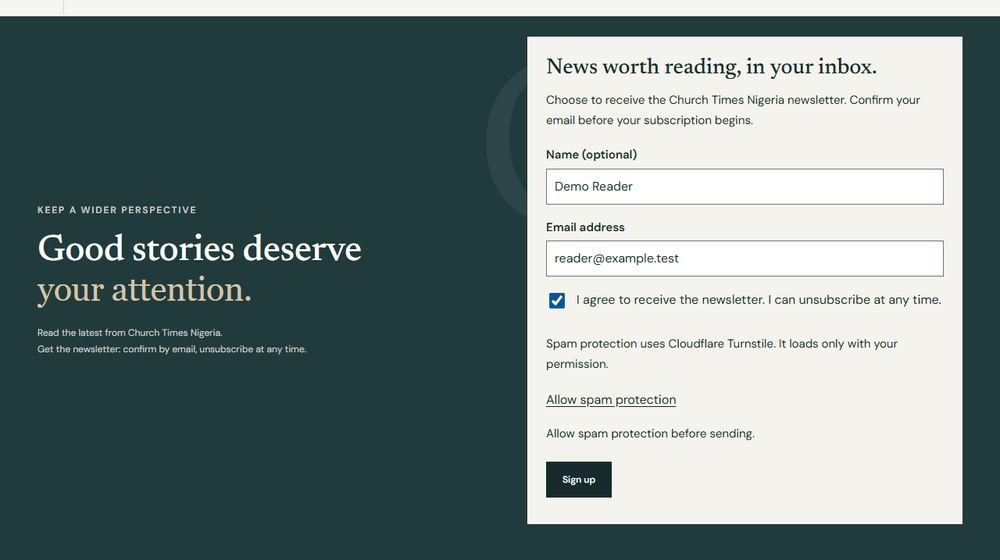.

---

## 7. Operations

### 7.1 Environment variables

All variables are read by the **CMS** (set in `/etc/churchtimes/cms.env`) unless the Where column says otherwise. **Secret = yes** means it must never be committed, pasted into chat or put in a browser build. Startup in production refuses to boot and lists every problem when a required value is missing or malformed. "New" means introduced by the wave 1-2 sprint (waves12). Sources: the three `.env.example` files, [operations.md section 4](operations.md#4-environment-variables) and the public host docs.

**Core and security**

| Name | Where | Default | Secret | What it does |
| --- | --- | --- | --- | --- |
| `DATABASE_URL` | CMS | local demo value | **yes** | PostgreSQL connection. In production the host is `postgres` (compose network), same password as the secret file. |
| `PG_POOL_MAX` | CMS | 10 | no | Database connections per process. |
| `PAYLOAD_SECRET` | CMS | none | **yes** | Signs login tokens (32+ characters). Changing it signs everyone out. |
| `PREVIEW_SECRET` | CMS | none | **yes** | Signs preview links (32+, different from the above). |
| `NEWSLETTER_TOKEN_SECRET` | CMS | none | **yes** | Signs confirm and unsubscribe links (32+, different from the other two). |
| `IP_HASH_SALT` | CMS | none | **yes** | Salt for hashing IPs and erased addresses (16+). Keep it stable. |
| `NODE_ENV` | CMS | set by image | no | `production` turns on Secure cookies, HSTS and startup validation. |
| `CMS_PUBLIC_URL` | CMS | local | no | Public https origin of the CMS, no trailing slash. |
| `CMS_CORS_ORIGINS` | CMS | local | no | Browser origins allowed to call the API. Explicit https only. |
| `CMS_CSRF_ORIGINS` | CMS | local | no | Origins allowed to send cookie-authenticated requests. |
| `PUBLIC_SUBMISSION_ORIGINS` | CMS | local | no | Origins allowed to post public forms. Required in production. |
| `TRUST_PROXY` | CMS | false | no | Must be `true` in production. |
| `TRUST_PROXY_HOPS` | CMS | 1 | no | Number of trusted proxies (1 to 10). |
| `CLIENT_IP_HEADER` | CMS | unset | no | One header carrying the client address (`cf-connecting-ip`, `x-real-ip`). Only if your proxy overwrites it. |
| `TURNSTILE_SECRET_KEY` | CMS | test key in dev | **yes** | Cloudflare secret. Real value required in production. |
| `TURNSTILE_ALLOWED_HOSTNAMES` | CMS | unset | no | Required in production. Hostnames the widget runs on. |
| `TURNSTILE_EXPECTED_ACTION` | CMS | unset | no | Required in production. `submit-story,contact-message,newsletter-subscribe`, plus **`giving-init` when giving is on**. |
| `ALLOW_FIRST_REGISTER` | CMS | unset | no | Leave unset. Create the first admin with `admin:create`. |
| `CMS_ALLOW_NO_SMTP` | CMS | false | no | Explicit opt-out of mail in production. |
| `CMS_ALLOW_INSECURE_LOCAL_STAGING` | CMS | unset | no | Disposable loopback staging only. |
| `PAYLOAD_DB_PUSH` | CMS | false | no | Must stay `false` in production (schema changes only by migration). |
| `SCHEDULER_ENABLED` | CMS | true | no | `true` on exactly one instance; `false` on `migrate`. |
| `SCHEDULER_INTERVAL_SECONDS` | CMS | 60 | no | How often the scheduler looks. |
| `SEED_DEMO_USERS`, `SEED_DEMO_PASSWORD` | CMS dev only | false | password yes | Local development demo users. Never in production. |
| `LOCAL_PG_PORT` | dev | 54329 | no | Local embedded database port. |

**Mail**

| Name | Where | Default | Secret | What it does |
| --- | --- | --- | --- | --- |
| `SMTP_HOST`, `SMTP_PORT`, `SMTP_USER`, `SMTP_SECURE` | CMS | unset | no | Mail server. Required in production unless `CMS_ALLOW_NO_SMTP=true`. |
| `SMTP_PASS` | CMS | unset | **yes** | Mail password or key. |
| `EMAIL_FROM_ADDRESS`, `EMAIL_FROM_NAME` | CMS | unset | no | Sender of all mail. Use a verified domain. |
| `PUBLIC_SITE_URL` | CMS and public host | unset | no | Public site origin (links in mail, giving return). |
| `CONTACT_NOTIFY_TO` | CMS | unset | no | Staff addresses (max 10) notified of contact messages. |
| `MAIL_HTML_DAILY_CAP` (new) | CMS | 300 | no | Per-process, per-Lagos-day ceiling on HTML mail. 0 blocks all. |
| `NEWSLETTER_DIGEST_SEND` (new) | CMS | false | no | Only the exact word `true` makes scheduled digests really send. |
| `NEWSLETTER_DIGEST_THROTTLE_MS` (new) | CMS | 250 | no | Pause between two digest mails. |
| `NEWSLETTER_DIGEST_SCHEDULER` (new) | CMS | true | no | `false` stops only the digest check. |
| `NEWSLETTER_ONE_CLICK_RATE_LIMIT` (new) | CMS | 600 | no | Per-IP budget per 15 minutes for the one-click unsubscribe. |
| `NEWSLETTER_RATE_LIMIT`, `NEWSLETTER_RATE_WINDOW_SECONDS` | CMS | 5, 900 | no | Sign-ups per IP per window (per address: 3 per hour). |
| `NEWSLETTER_TOKEN_RATE_LIMIT` | CMS | 20 | no | Confirm and unsubscribe link limit per IP. |
| `NEWSLETTER_RESEND_COOLDOWN_SECONDS` | CMS | 600 | no | No second confirmation mail within this time. |
| `NEWSLETTER_MAX_CONFIRM_MAILS_PER_DAY` | CMS | 5 | no | Confirmation mails per address per 24 hours. |

**Giving**

| Name | Where | Default | Secret | What it does |
| --- | --- | --- | --- | --- |
| `PAYSTACK_SECRET_KEY` (new) | CMS | unset | **yes** | Turns giving on (with the settings tick). `sk_test_` then `sk_live_`. Also signs webhooks. |
| `GIVING_PROVIDER` (new) | CMS | paystack | no | Only `paystack` exists. |
| `GIVING_RETURN_URL` (new) | CMS | `<PUBLIC_SITE_URL>/give/thanks/` | no | Where Paystack sends the reader back. |
| `PAYSTACK_WEBHOOK_IPS` (new) | CMS | unset | no | Optional allow-list of Paystack's source addresses. |
| `GIVING_RATE_LIMIT`, `GIVING_RATE_WINDOW_SECONDS` (new) | CMS | 10, 900 | no | Gift starts per IP. |
| `GIVING_STATUS_RATE_LIMIT`, `GIVING_STATUS_RATE_WINDOW_SECONDS` (new) | CMS | 120, 900 | no | Status and settings reads per IP. |
| `PAYSTACK_API_BASE` (new) | CMS | unset | no | Local fake server only. Ignored in production and for non-loopback hosts. |
| `VITE_PUBLIC_GIVING_URL` (new) | public build | empty | no | CMS giving API base. Empty means no Give page in that build. |

**Content, media, search, ads, redirects**

| Name | Where | Default | Secret | What it does |
| --- | --- | --- | --- | --- |
| `MEDIA_IMAGE_MAX_MB` | CMS | 25 | no | Largest image (1 to 50). Rebuild and restart after changing. |
| `MEDIA_AV_MAX_MB`, `MEDIA_UPLOAD_MAX_MB` | CMS | 100, derived | no | Audio and video cap (max 500); optional explicit request-limit override. |
| `SEARCH_MAX_LIMIT`, `SEARCH_COUNT_CAP` | CMS | 20, 1000 | no | Bounds on one search request. |
| `SEARCH_RATE_LIMIT`, `SEARCH_RATE_WINDOW_SECONDS` | CMS | 60, 60 | no | Searches per IP per window. |
| `PUBLIC_READ_RATE_LIMIT`, `PUBLIC_READ_RATE_WINDOW_SECONDS` (new) | CMS | 120, 60 | no | Author, topic, trust and corrections reads per IP. |
| `STAFF_RELATED_RATE_LIMIT`, `STAFF_RELATED_RATE_WINDOW_SECONDS` | CMS | 30, 60 | no | Related-articles per staff user. |
| `SUBMISSION_RATE_LIMIT`, `SUBMISSION_RATE_WINDOW_SECONDS` | CMS | 5, 900 | no | Story tips per IP. |
| `SUBMISSION_EMAIL_RATE_LIMIT`, `SUBMISSION_EMAIL_RATE_WINDOW_SECONDS` | CMS | 3, 3600 | no | Story tips per e-mail. |
| `SUBMISSION_DUPLICATE_WINDOW_HOURS` | CMS | 72 | no | Identical tips refused (409) inside this window. |
| `SUBMISSIONS_REQUIRE_CONSENT` | CMS | false | no | `true` makes consent mandatory on tips. |
| `CONTACT_RATE_LIMIT`, `CONTACT_RATE_WINDOW_SECONDS` | CMS | 5, 900 | no | Contact messages per IP (per address: 3 per hour). |
| `AUTH_LOGIN_RATE_LIMIT`, `AUTH_FORGOT_RATE_LIMIT`, `AUTH_RESET_RATE_LIMIT`, `AUTH_RATE_WINDOW_SECONDS` | CMS | 10, 5, 10, 900 | no | Login, forgot and reset per IP. |
| `PUBLIC_ARTICLE_PATH_TEMPLATE` | CMS and public host | `/{slug}/` | no | Article address shape (decision D1). Must be identical on both. |
| `REDIRECT_ALLOWED_HOSTS` | CMS | unset | no | Hosts a redirect may point to. Must equal the public host's list. |
| `LEGACY_SITE_HOSTS` | CMS and public host | `churchtimesnigeria.net,www...` | no | Old hosts accepted on `legacyUrl`; on the public host, old hosts redirected to the new site. |
| `ADS_REQUIRE_PAYMENT` | CMS | true | no | Only `false` lets unpaid ads run. |
| `PUBLIC_ADSENSE_ENABLED`, `PUBLIC_ADSENSE_REVIEWED` | CMS | false | no | Flags reported to the public site; no script is served. |
| `SHARE_CARDS_ENABLED` (new) | CMS | false | no | The share-picture endpoint answers 404 unless exactly `true`. |
| `SHARE_CARD_RATE_LIMIT`, `SHARE_CARD_RATE_WINDOW_SECONDS`, `SHARE_CARD_MAX_CONCURRENT`, `SHARE_CARD_CACHE_MAX`, `SHARE_CARD_FONT_DIR` (new) | CMS | 60, 60, 2, 50, built-in font | no | Limits and font path for share cards. |
| `WHATSAPP_GROUP_URL` (new) | CMS | built-in link | no | Overrides the group invite used by `whatsapp:brief`. |

**Public host (not the CMS)** (`deploy/public-host/public-host.env.example`)

| Name | Default | Secret | What it does |
| --- | --- | --- | --- |
| `HOST`, `PORT` | `127.0.0.1`, `5373` | no | Loopback listener behind Caddy. |
| `PUBLIC_DIST` | `dist` | no | The complete built site. |
| `PUBLIC_SITE_URL` | required | no | Canonical https origin. |
| `PUBLIC_CMS_URL` | unset | no | CMS origin for anonymous reads. Must equal the CMS `CMS_PUBLIC_URL`. |
| `PUBLIC_BASE_PATH` | `/` | no | Mount prefix (keep `/` for newsletter links). |
| `PUBLIC_INDEXABLE` | not true | no | Only the exact word `true` lets search engines index. Owner approval needed. |
| `PUBLIC_ARTICLE_PATH_TEMPLATE` | `/{slug}/` | no | Same as the CMS. |
| `PUBLIC_REDIRECTS_FILE` or `PUBLIC_REDIRECTS_URL` | unset | no | Private redirect map file (wins) or the CMS endpoint. |
| `PUBLIC_REDIRECT_ALLOWED_HOSTS` | unset | no | Must agree with the CMS `REDIRECT_ALLOWED_HOSTS`. |
| `PUBLIC_REDIRECT_PATTERNS` | unset | no | Optional approved templates (category, tag, author, AMP). While unset, an old `/?p=N` address serves the home page with status 200, not a redirect. Cutover decision. |
| `PUBLIC_HOST_SHUTDOWN_MS` | 10000 | no | Graceful shutdown deadline. |
| `PUBLIC_SHARE_CARDS` (new) | `fallback` | no | `fallback` (only stories without a picture) or `always`. Must match the CMS `SHARE_CARDS_ENABLED=true` or tags point at a 404. |
| `PUBLIC_ADS_TXT_LINE`, `PUBLIC_SEARCH_CONSOLE_VERIFICATION` | unset | no | Owner-reviewed values only. |
| `PUBLIC_HOST_ALLOW_LOOPBACK_CMS` | never | no | **Must never be set in production.** |

**Browser builds (public, never secrets)**: `VITE_PUBLIC_CMS_URL`, `VITE_PUBLIC_SUBMISSIONS_URL`, `VITE_PUBLIC_CONTACT_URL`, `VITE_TURNSTILE_SITE_KEY` (the public site key), `VITE_TURNSTILE_ACTION` (default `submit-story`), `VITE_PUBLIC_SITE_URL`, `VITE_PUBLIC_GIVING_URL` (new). Newsroom build: `VITE_CMS_URL`, `VITE_PUBLIC_SITE_URL`, `VITE_KNOWN_LINK_HOSTS`.

**Compose-level** (set in the shell or `apps/cms/.env`, not `cms.env`): `CMS_IMAGE`, `CMS_MIGRATOR_IMAGE` (digest-pinned images, required), `CMS_IMPORTER_IMAGE` (import only), `CMS_ENV_FILE` (default `/etc/churchtimes/cms.env`), `CMS_MEDIA_DIR` (default `/srv/churchtimes/media`), and for the importer override `IMPORT_EXPORT_FILE`, `IMPORT_UPLOADS_DIR`, `IMPORT_PRIVATE_DIR`.

**Rules for the env file.** Compose reads it, not a shell: single-quote any value containing `$`; use a hex or base64url database password (`openssl rand -hex 24`) because it sits inside a URL; mode 600, owned by root, never in Git.

### 7.2 Deploy with the production compose

Read [operations.md section 3.2](operations.md#32-production-deployment-docker-host-caddy) in full the first time. In summary (the technical helper does this; the owner checks):

1. **Host once:** Ubuntu 24.04 (2 vCPU, 4 GB RAM, 40 GB SSD minimum), Docker with the compose plugin, Caddy on the host, 2 GB swap, Docker log rotation, a firewall allowing only ports 22, 80 and 443, SSH by key only. See [owner-security-hardening.md](owner-security-hardening.md).
2. **Files:** `/etc/churchtimes/cms.env` (mode 600), `/etc/churchtimes/secrets/postgres_password`, media folder `/srv/churchtimes/media` owned by uid and gid 1000 (mode 750), a checkout of the repository at `/srv/churchtimes/app` (only for the compose file; nothing is built on the server).
3. **First administrator** before Caddy exposes the site: start `postgres`, run `migrate`, then `admin:create` with a throw-away passphrase through the `migrate` service. Sign in and change it at once.
4. **Release:** take the two image digests from the CI "publish" job summary; note the current ones for rollback; take a verified encrypted backup; pull and run `migrate`; start `cms`; read `docker compose logs`; check `/api/health/ready`.
5. **Run exactly one `cms` container.** Never `--scale cms=2`.
6. **Rollback:** code only (the migration only added things): set `CMS_IMAGE` back to the previous digest. Schema problem: stop `cms`, restore the pre-deploy dump into a **new** database, check it, rename databases, start the old image. Never `pg_restore --clean` into the live database. Content written after the dump is lost, so tell the newsroom first.

### 7.3 Migrations

Schema changes happen **only** through migrations (`PAYLOAD_DB_PUSH=false`). The one-off `migrate` service runs `npm run migrate` before the new `cms` starts and never runs the scheduler. Wave 1-2 adds one schema migration (new article fields, authors, topics, donations, newsletter issues, globals, media `lqip` and AVIF sizes) and `20261031_120000_giving_consent_version` (adds the consent version to donations, back-filling `giving-v1`). Migrations must be **expand-then-contract**: a release only adds; drops come in a later release, so a rollback to the previous image still works.

### 7.4 Backups and the restore drill

Scripts: `apps/cms/scripts/backup.sh`, `restore.sh`, `verify-backup.sh`, `restore-drill.sh`. Full text: [operations.md section 6](operations.md#6-backups-and-restore) and [owner-migration-runbook.md section 8](owner-migration-runbook.md#8-backups-and-the-restore-test).

1. **What:** a database dump (`pg_dump -Fc`) **and** a tar of the media folder, with checksums and a per-file manifest. The media is not in the dump.
2. **How (run as root on the server):** `backup.sh --out /var/backups/churchtimes/daily --media /srv/churchtimes/media --keep-days 14 --encrypt age`, with `PG_EXEC` set to run the Postgres client inside the container and `AGE_RECIPIENT` set to the public key. The **private key never lives on the server**: keep it in the password managers of two administrators.
3. **When:** nightly (a systemd timer is documented), plus before every deploy (`predeploy`, 30 days).
4. **Keep (3-2-1):** daily 14 days, weekly 8 weeks, monthly 12 months; a copy on a second medium at a different provider that the production server **cannot delete from**. Encrypt before the data leaves the server.
5. **Alert** when a backup exits non-zero and when no new backup directory appears for more than 26 hours.
6. **Restore drill (monthly and before the cutover):** fetch the newest backup **from the off-site copy**; run `verify-backup.sh --backup <dir>` (must print `VERIFIED`); run `restore.sh --backup <dir> --target-db churchtimes_drill --media-target <empty folder>` (every count row must say ok); open five media files; start a CMS against the drill database, run `migrate` (nothing to apply), check `GET /api/categories` and a staff login; record date, name, time and result; delete the drill database, media copy and any decrypted files.
7. **Automatic drill in CI:** the workflow `restore-drill.yml` ("CMS restore drill") runs nightly at 02:43 UTC and on demand. It builds the images, starts the real production compose, seeds synthetic data, backs up, verifies and restores. It needs no repository secrets.

### 7.5 Health endpoint and monitoring

- `GET /api/health/live` returns 200 `{"status":"ok"}` (the Node process is serving; used by the Docker health check).
- `GET /api/health/ready` returns 200 `{"status":"ready","database":true,"migrations":true,"media":true}`, or 503 with the failing flag false. It is cached 5 seconds and limited to 300 requests per minute per address. It never returns error text or versions.
- Suggested monitors (from operations.md section 9.1): liveness every minute, readiness every 1 to 5 minutes, a keyword check on the public home page, disk above 80%, certificate expiry under 14 days, and a heartbeat for backup freshness (no ping within 26 hours).
- The public host has its own cheap check: `node --env-file=<env> tools/public-host-health.mjs` (does not prove the CMS works).

### 7.6 Search reindex

Run `npm run search:reindex` **after deploying a release that changed search, and after every archive import**. It is safe to repeat. On Docker run it through the `migrate` service (the runtime image has no `tsx`). This is an open go-live item (section 16).

### 7.7 Recover a locked-out admin (break glass)

With shell access, through the `migrate` service on Docker: `ADMIN_EMAIL=... ADMIN_NEW_PASSWORD='<throw-away, 12+ chars>' npm run admin:set-password`. It applies the password policy, clears the lockout and ends that person's sessions. If no user exists, `admin:create` makes the first one. Rotating `PAYLOAD_SECRET` signs everyone out; `PREVIEW_SECRET` kills preview links; `IP_HASH_SALT` makes old IP hashes and erase hashes incomparable.

### 7.8 Reverse proxy limits

The Caddyfile (host) must cap request bodies at **28 MB** (`request_body max_size 28MB`; nginx `client_max_body_size 28m`) and overwrite `X-Forwarded-For`. The application also rejects declared sizes: 1 MB for JSON, 11 MB for anonymous requests, about 26 MB for staff media (the image cap plus 1 MB). HSTS is sent by the application, so the Caddyfile must **not** add a second one. The live server currently needs this 28 MB change (open item). Full block and test commands: [operations.md section 4.4](operations.md#44-reverse-proxy-tls-body-limits-client-address-compression).

### 7.9 Redirects and the cutover

Redirects are the bridge from the old WordPress addresses to the new ones. Because the new site keeps `/{slug}/` (decision D1), article links need almost no redirects; categories, dates, `?p=` ids and AMP do.

1. **Where rules come from:** the **Redirects** collection (manual rules), rules derived automatically from each imported article's `legacyUrl`, and an optional private map file on the public host (`PUBLIC_REDIRECTS_FILE`, or `PUBLIC_REDIRECTS_URL` pointing at the CMS `/api/public/redirects`). The old `.org`, `.com` and `www` hosts are answered by the public host itself with a 301 to the main host.
2. **Export and import:** `npm run export:redirects`, `npm run import:redirects`, `npm run check:redirects` (CMS); `npm run check:redirects -- --target <origin> --urls <private list> --rate 2 --quiet` (public repo, aggregate counts only).
3. **Limits:** one hop only, at most 20,000 rules or 5 MiB per map, loops and chains rejected as a whole. Refresh the running host with a reload (`systemctl reload churchtimes-public`, which sends SIGHUP); a change to the environment or a new build needs a **restart**.
4. **Cutover steps** (owner decides, technical helper executes): soft launch on a staging subdomain (no indexing), lower DNS TTL 48 hours before, final content refresh, pre-DNS redirect check against the final hostname, switch DNS (web records only, never mail or nameservers), then turn indexing on (`PUBLIC_INDEXABLE=true`), then watch for 72 hours. Rollback: switch DNS back and restart the previous release with its matching env file. Full text: [owner-migration-runbook.md section 6](owner-migration-runbook.md#6-cutover) and [public-cutover-runbook.md](../../../docs/public-cutover-runbook.md).
5. **Cutover decision still open:** whether to activate `PUBLIC_REDIRECT_PATTERNS` so old `/?p=N` addresses redirect (section 16).

---

## 8. The WordPress import and rehearsal

**Facts about the real export (from the project notes):** 4,343 published posts, 101 drafts, 1,348 approved comments, 485 pingbacks skipped, 6,142 attachments, 15 categories, one author (byline text only). 1,392 posts have no category. The strict rule puts them in News; an optional rules classifier (`--category-mode=rules`) is about 68% precise.

| Step | Command or document | Who | Notes |
| --- | --- | --- | --- |
| Take the export | WordPress Tools, Export (WXR) | Owner | [owner-migration-runbook.md section 2](owner-migration-runbook.md#2-taking-the-wordpress-export-safely) |
| Download the pictures | [uploads-download.md](uploads-download.md) | Owner on their own PC | See below |
| Read-only reports | `npm run import:wxr-report`, `import:inspect`, `import:link-audit`, `import:convert-wxr` | Technical helper | Nothing is written. Real export stays **outside** every Git folder. |
| Rehearsal on made-up data | `npm run import:rehearse -- --posts 1000 --images 60` | Technical helper | Throw-away database, large synthetic export: dry run, apply, second apply (must change nothing), update, rollback. Prints PASS or FAIL. A 1,000-post run took about 2 minutes on a laptop; a 4,346-post apply is roughly 8 minutes. |
| Rehearsal on the real export | [import.md, "Rehearsal against a real export"](import.md#rehearsal-against-a-real-export) | Technical helper | Dry run takes 3 to 5 minutes for a 100 MB export. |
| Dry run, then apply | `npm run import:wxr -- --file <export>` then add `--apply --manifest <new file>` | Technical helper | The default is a dry run. Keep the **manifest**: it is the only way to undo a run. |
| Undo | `npm run import:rollback -- --manifest <path>` (dry run first, then `--apply`) | Technical helper | A killed run needs `--allow-incomplete`; rows edited since need `--force` after reading the dry run. |
| On the server | `docker-compose.import.yml` (profile `import`, service `importer`) | Technical helper | Needs `IMPORT_EXPORT_FILE`, `IMPORT_UPLOADS_DIR`, `IMPORT_PRIVATE_DIR`. See import.md "Importing on the server". |
| After the import | `npm run search:reindex` | Technical helper | Section 7.6 |
| QA on staging | [owner-migration-runbook.md section 5](owner-migration-runbook.md#5-qa-checklist-on-staging) | Editor and owner | Counts, at least 50 articles by eye, redirect checks, comments privacy test. |
| Recovered archive pages | `npm run import:archive-candidates` | Technical helper | Draft-only. An editor reviews each in the newsroom **Archive Review** screen; four-eyes applies (section 2.2). |

**Uploads download, in one paragraph.** The old server was compromised in October 2026, so every file from it is untrusted. The owner makes a temporary read-only account, copies only the `uploads` folder (about 4.7 GB) to their own PC with rsync, tar over ssh or WinSCP, compares counts and fingerprints (this proves the copy is intact, **not** that the pictures are genuine), scans it with Windows Defender, runs `npm run import:uploads-check` (refuses anything that is not a real JPEG, PNG, WebP or allowed audio/video file), copies only the verified files to `uploads-verified`, and removes the temporary account. Folders must be outside every Git folder. Never open or run anything from the copy, and never paste a password into a chat. Step-by-step: [uploads-download.md](uploads-download.md).

**Old media addresses.** `npm run export:media-map` writes a private map of old picture addresses to new ones for the public host (dry run by default). See import.md "Legacy media map export".

---

## 9. Logs, CI, release flow and testing

### 9.1 Logs and what is never logged

- **Where:** CMS: `docker compose -f docker-compose.production.yml logs cms` (rotated: driver `local`, 10 MB x 5 files). Caddy: its default log location; keep at least 14 days. PostgreSQL: its container log. The older documents also mention `journalctl -u churchtimes-cms` for a non-Docker setup. No log shipping, metrics or error tracking is configured yet.
- **At startup** the CMS logs one line `[startup] self-check: N/M critical settings present` (counts only) plus any `[security]` warnings. Read them on a new server.
- **Never logged:** passwords, tokens, secret keys, card data, full webhook payloads, e-mail addresses, names or message text from contact, newsletter and giving code. Those code paths log only an error class and a short code (for example `DrizzleQueryError (23505)`) because database errors otherwise contain the data. Giving logs carry the reference and an outcome code only. Rate-limit keys use hashed or truncated addresses. The audit log holds ids and counts, never personal data.
- **Never in this repository or in a screenshot:** real passwords, the demo login file, real exports, private URL lists.

### 9.2 CI and the required checks

Workflows live in `.github/workflows/`: `ci.yml` ("Website checks": job `verify`), `cms.yml` ("CMS checks": typecheck, unit and build; integration in 3 shards; the security regression suite), `cms-docker.yml` ("CMS Docker smoke": builds the three images, checks non-root and no secrets baked in, starts the real production compose, smoke tests; on pushes to `feat/newsroom-mvp` a `publish` job pushes the images and prints their digests), `newsroom.yml`, `public-quality.yml` and the other public-site workflows, `import-rehearsal.yml`, `restore-drill.yml`, `archive-recovery.yml`, `pages.yml`.

The docs name **three required checks**: `verify`, `docker-smoke` and `public-quality`. `docker-smoke` and `public-quality` only run when files under `apps/cms/**` change. A pull request that touches only the newsroom or only workflow files shows just `verify` and GitHub blocks the merge. Until the filters are widened, include one genuine change under `apps/cms/` (a documentation note is enough). `verify` also fails if any file contains a merge-conflict marker, and forbids feature PRs from committing the compiled `site/`, `index.html` or `OneSignalSDKWorker.js` (a dedicated `agent/rebuild-site*` PR does that once).

### 9.3 Release flow

1. Work happens on feature branches, merged into **`feat/newsroom-mvp`** (the integration branch). The wave 1-2 sprint lives on `agent/wave12-integration` in one draft pull request (#135) into `feat/newsroom-mvp`; it is **not merged** yet.
2. Only after the owner accepts `feat/newsroom-mvp` (staging checks, restore drill, go-live checklist) is it merged into **`main`**. Nothing is deployed from a pull request.
3. CI builds and publishes the images from `feat/newsroom-mvp`; production pulls them **by digest**.
4. Rule for agents and helpers: merge a pull request only on the owner's explicit say-so for that pull request.

### 9.4 Testing guide: what each script does

Run from the repository root unless noted. "Timed" means measured on this branch on a heavily loaded laptop; the others are **not timed here**.

| Command | What it does | How long |
| --- | --- | --- |
| `npm run test:unit` | Public-site unit tests (`node --test unit-tests/*.test.js`), 274 tests | Timed: about 27 seconds |
| `npm run test:newsroom-unit` | Newsroom helper tests, 135 tests | Timed: under 5 seconds |
| `npm run check:reader-budget` | Checks the built public site stays under the JavaScript and CSS size limits. **Needs `npm run build` first** (it reads `dist`). | Check itself seconds; build not timed |
| `npm run build` | Builds the public site | Not timed |
| `npm test` | Playwright browser tests of the public site | Not timed (minutes) |
| `npm run test:forms`, `test:advertising`, `test:giving`, `test:reader-trust`, `test:pwa` | Playwright suites for forms, ads, giving (desktop and mobile, includes accessibility), trust pages, offline and install | Not timed |
| `npm run test:newsroom`, `test:newsroom-app`, `test:newsroom-a11y` | Newsroom browser tests against a mock server, and accessibility | Not timed |
| `npm run test:cms` | Public site against a stub CMS | Not timed |
| `npm run test:quality` | Public-site quality journeys (the `public-quality` check) | Not timed |
| `npm run check:redirects` | Quiet redirect checker against a target origin | Depends on the list |
| `cd apps/cms` then `npm run typecheck` | TypeScript check | Not timed |
| `npm run test:unit` (in `apps/cms`) | CMS unit tests (Vitest), no database | Not timed |
| `npm run test:integration` | CMS tests against a real PostgreSQL (CI runs 3 shards) | Not timed |
| `npm run test:security` | The security regression suite; fails if a new route is missing from the route matrix | Not timed |
| `npm run test:e2e:api`, `test:e2e:browser`, `test:e2e:cross-app` | Disposable staging stack (`npm run staging:up`), API journeys, cookie login in a real browser, public + newsroom + CMS together | Not timed |
| `npm run import:rehearse` | Import rehearsal on synthetic data | Minutes (section 8) |
| `npm run load:test`, `perf:read` | Load and read-path timing (see [performance.md](performance.md)) | Not timed |
| `npm run giving:reconcile` | Not a test: the money reconciliation (section 5.5) | Seconds |

Never run `npm install` inside a worktree whose `node_modules` is a shortcut (junction) to another folder.

---

## 10. Rate limits, Turnstile and the security model

### 10.1 Rate limits (all per client IP unless stated)

| Endpoint | Default | Variables |
| --- | --- | --- |
| Story tips | 5 per 15 minutes; 3 per hour per e-mail; identical text refused for 72 hours | `SUBMISSION_*` |
| Contact | 5 per 15 minutes; 3 per hour per e-mail | `CONTACT_*` |
| Newsletter sign-up | 5 per 15 minutes; 3 per hour per e-mail; one confirmation mail per 10 minutes; 5 a day per address | `NEWSLETTER_*` |
| Confirm and unsubscribe links | 20 per window | `NEWSLETTER_TOKEN_RATE_LIMIT` |
| One-click unsubscribe | 600 per 15 minutes | `NEWSLETTER_ONE_CLICK_RATE_LIMIT` |
| Search | 60 per minute | `SEARCH_*` |
| Author, topic, trust, corrections | 120 per minute | `PUBLIC_READ_*` |
| Gift start | 10 per 15 minutes (and per address); status reads 120 per 15 minutes | `GIVING_*` |
| Share cards | 60 per minute, 2 at once | `SHARE_CARD_*` |
| Staff login, forgot, reset | 10, 5, 10 per 15 minutes; an account locks for 10 minutes after 5 wrong tries | `AUTH_*` |
| Digest tools | dry run 10 per hour, test send 5 per hour per staff user | fixed |
| Health ready | 300 per minute | fixed |

Limits are **in memory, per process**: they reset on restart and multiply if you ever run two CMS instances. Without `TRUST_PROXY=true` and a proxy that overwrites the forwarded address, every visitor shares one bucket.

### 10.2 Turnstile (free)

1. Cloudflare dashboard, **Turnstile, Add widget** (free). Hostnames: the public site hostname(s). Mode: Managed.
2. Copy the **site key** (public) into the public build (`VITE_TURNSTILE_SITE_KEY`) and the **secret key** only into the CMS env (`TURNSTILE_SECRET_KEY`).
3. Set `TURNSTILE_ALLOWED_HOSTNAMES` and `TURNSTILE_EXPECTED_ACTION` (`submit-story,contact-message,newsletter-subscribe`, plus `giving-init` if giving is on). Each endpoint pins its own action, so a token for one form is refused by another. If an action is missing from the list, that form answers 403 to everyone and startup prints a `[security]` warning.
4. Tokens are single use and expire after 5 minutes. If Cloudflare is unreachable the forms refuse (fail closed).
5. To rotate: create a new secret in the dashboard, update the env, restart.

### 10.3 Security model, in short

Staff sign in with a cookie (HttpOnly, Secure, SameSite=Lax); passwords need 12+ characters and common ones are refused; accounts lock after 5 wrong tries; permissions are enforced on the server; public contributors can never publish or set status; uploads are validated and re-encoded; public responses carry only published, public data; backups are encrypted; the CMS refuses to start in production with weak or missing settings; the container is non-root with a read-only filesystem. The newsroom ships a strict Content-Security-Policy. Details: [security.md](security.md) and [owner-security-hardening.md](owner-security-hardening.md).

### 10.4 Known gaps (from security.md section 4)

1. Rate limiters are in memory (single instance only).
2. Client address depends on the proxy overwriting the forwarded header; if the app were reachable around the proxy, a caller could choose their own bucket. Firewall the app port.
3. Lockout is per account, so someone who knows an e-mail can keep it locked (10-minute windows), and the message reveals the account exists.
4. **No two-factor sign-in** (not part of the CMS software). Mitigations: long passwords, lockout, short sessions, the admin two-person rule.
5. Duplicate-tip detection has a tiny race window.
6. Turnstile is a dependency (fail closed if Cloudflare is down).
7. Tip senders' e-mail addresses are not verified.
8. Password-reset e-mails need SMTP; otherwise use the break-glass script.
9. `legacyUrl` and `legacyId` are editable by anyone who can edit the story, and are public (a documented contract).
10. **No script Content-Security-Policy on the CMS admin** (Payload needs inline scripts); only frame protection is set.
11. Rejecting an already-approved live update does not remove it from readers who already loaded it until they reload.
12. Restoring a version is a whole-document overwrite (section 2.4).
13. Body-size limits rely on `Content-Length`; the 28 MB proxy limit is the backstop.
14. **`/admin` is reachable by anyone who can reach the host.** Login is rate limited, but consider an IP allow-list at the proxy or Cloudflare Access.
15. **Every editor role, section editors included, can read all story tips** with names, e-mails and phone numbers.
16. `CLIENT_IP_HEADER` is trusted blindly: firewall the app so only the proxy can connect.
17. A media file used only inside a story body (not as its featured image) can still be replaced by the non-editor who uploaded it.
18. The admin shows the "current password" box as plain text while typing (cleared on save).

---

## 11. Data protection (NDPA) summary

This is a plain-language summary, **not legal advice**. The Nigeria Data Protection Act 2023 makes the publisher the **data controller**. Take advice from a Nigerian data-protection lawyer.

| Personal data | Where | Why | Who can see it | Retention today | How to erase |
| --- | --- | --- | --- | --- | --- |
| Staff name, e-mail, role, password hash | Users | Sign-in | Admin (editor in chief reads the list) | While employed; disable the account the same day they leave | Admin deletes the user (audited) |
| Story tips: name, e-mail, phone, text, consent time and wording version, hashed IP, browser string | Submissions | Editorial tips | All editor roles | **No automatic deletion; owner decision** | Editor in chief or admin deletes the row |
| Contact messages: name, e-mail, message | Contact messages | Replies | Editor in chief, admin | **Owner decision** | Editor in chief or admin deletes; **erasing a subscriber does not touch these** |
| Newsletter subscribers: address, status, consent time and source | Subscribers | Newsletter | Admin | Until unsubscribed; owner to decide re-permission period | Erase (hash replaces address); one-click and link unsubscribe |
| Donations: e-mail, optional name (not stored if anonymous), consent time and version | Donations | Receipt and books | Editor in chief sees the ledger without names; admin sees all | Statutory book-keeping period (owner to confirm) | **Redaction** blanks e-mail and name (section 5.8) |
| Archived comments: commenter name and text (no e-mail) | Legacy comments | Archive | Public (approved ones), editors | Archive | Hide, or admin deletes |
| Audit log: user ids, actions, counts | Audit logs | Accountability | Editor in chief, admin | Keep | Not personal data |
| Card data | **Never stored** | | | | |

**On a request from a person (access or erasure)**

1. Confirm who they are (reply from the address in question).
2. Find their records in each row above. For subscribers use the per-person export (`/api/subscribers/:id/subject-data`) for an access request.
3. Erase or redact as shown. Note the date and what you did in your private log. Reply within the time your lawyer advises.
4. Remember the contact messages, story tips and giving rows are separate places.

**If personal data may have been exposed (breach)**

1. Write down the time you became aware. The Act expects notice to the Nigeria Data Protection Commission, normally within **72 hours** of becoming aware of a breach likely to risk people's rights, and to affected people without delay where the risk is high. Confirm the current rules and the channel with your lawyer **today**.
2. Contain it: rotate the secrets (section 7.1 list and [owner-security-hardening.md section 7](owner-security-hardening.md#7-secrets-rotation-list)), disable suspect accounts, keep an offline copy of logs.
3. Decide, with the lawyer, whether to notify the regulator and the people; write down the decision and the reasons, including a decision not to notify. A notice says what happened, when, what data, likely consequences, what you did and who to contact. Template table: [owner-security-hardening.md section 11](owner-security-hardening.md#11-if-personal-data-may-have-been-exposed-breach-notification-nigeria-ndpa).
4. The **old WordPress server** was compromised in October 2026 and held about 935 commenters' names and e-mails; treat that as possibly exposed. This decision is still the owner's (section 16).

---

## 12. Troubleshooting

| What you see | Most likely cause | What to do |
| --- | --- | --- |
| CMS container restarts or will not start | Startup validation found a missing or malformed setting | `docker compose logs cms` lists every problem at once. Fix `cms.env`. Do not work around it. |
| `/api/health/ready` returns 503 | A flag in the body is false: database, migrations or media | Database down: check the `postgres` container. Migrations false: run `migrate`. Media false: the media folder is not writable by uid 1000. |
| Photo upload fails with a permission error | Media folder not owned by 1000:1000 | `chown 1000:1000 /srv/churchtimes/media` (mode 750). |
| Upload fails or a big photo gives 413 | Proxy body limit too small, or file over the cap | Proxy 28 MB on `/api/media`; image cap 25 MB (`MEDIA_IMAGE_MAX_MB`). |
| "Not permitted" when moving a story | Role or section rule | Check the user's role and **Sections** (section 2). |
| A scheduled story did not appear | Scheduler off or two instances, or the time is in the future | Check `SCHEDULER_ENABLED` on the one `cms` service and the logs. |
| Cannot publish a recovered archive story | Not marked reviewed, or you approved it yourself | Another editor publishes it (an admin may do both). |
| Account locked | 5 wrong tries | Wait 10 minutes, or an admin clicks **Force Unlock**. |
| Nobody can sign in | Lost admin password or no e-mail | Break glass (section 7.7). |
| Reset e-mail never arrives | SMTP missing or sender domain not verified | Check `SMTP_*`, SPF/DKIM, spam folder; use break glass. |
| Public forms answer 403 for everyone | Turnstile action not in `TURNSTILE_EXPECTED_ACTION`, or hostname not allowed, or Cloudflare unreachable | Fix the list (add `giving-init` for gifts); check `TURNSTILE_ALLOWED_HOSTNAMES`. |
| Forms blocked from the browser | Public origin missing from `PUBLIC_SUBMISSION_ORIGINS` or `CMS_CORS_ORIGINS` | Add the exact https origin. This is an open go-live item. |
| Everybody hits rate limits | Proxy not trusted so everyone shares one address | `TRUST_PROXY=true`, correct hop count, proxy overwrites the header. |
| Public site shows no images | `PUBLIC_CMS_URL` differs from the CMS `CMS_PUBLIC_URL` | Make them identical. |
| Search finds old stories wrongly or nothing | Index not rebuilt | `npm run search:reindex`. |
| Give page says unavailable | Giving off, no key, no usable currency, or no `PUBLIC_SITE_URL` | Check Giving settings **Enabled**, `PAYSTACK_SECRET_KEY`, `GET /api/giving/stats` (`offReason`, editor in chief or admin). |
| Paystack webhook answers 401 | Test key on one side and live key on the other | Make dashboard mode and `PAYSTACK_SECRET_KEY` match. |
| Gift stuck `pending` | Webhook not delivered, or an amount mismatch | Run `giving:reconcile`; settle in the Paystack dashboard. |
| Log says `currency-not-enabled` | Paystack has not enabled that currency | Ask Paystack, or list NGN only. |
| No receipt e-mail | SMTP not configured at the time | It is retried (status check, webhook retry, 10-minute sweep for 48 hours). Fix SMTP. |
| Newsletter issue stuck `sending` or `failed` | A run was killed or errors stopped it | Never resumed on purpose. Editor in chief or admin deletes a failed issue to allow a new one. |
| Newsletter sends nothing | Settings off, still dry-run, or SMTP incomplete | Enabled and Daily Digest ticked, `NEWSLETTER_DIGEST_SEND=true`, SMTP and URLs set. |
| Sign-up answers 503 | `PUBLIC_SITE_URL` or SMTP missing in production | Set them. |
| An ad does not show | Not approved, not paid or waived, or outside its dates | Check all three (section 4.10). |
| A redirect does nothing | Public host has no map or an old build | Check `PUBLIC_REDIRECTS_FILE` or `_URL`, reload; env changes need a restart. |
| Restore drill fails | Backup incomplete, wrong key, or stale script | Run `verify-backup.sh`, read its output; use the off-site copy. |
| CI blocks a newsroom-only pull request | `docker-smoke` and `public-quality` did not run | Add a genuine note under `apps/cms/` (section 9.2). |

---

## 13. Glossary

| Word | Meaning |
| --- | --- |
| Admin | The role with every right, including staff accounts and subscribers. |
| Audit log | A read-only list of who did what and when. |
| Backup (3-2-1) | 3 copies, on 2 kinds of storage, 1 off the server. |
| Break glass | The emergency way to regain access (`admin:set-password`). |
| Caddy | The program that gives the site HTTPS and passes requests on. |
| CMS | Content management system: where stories and settings are stored (here Payload). |
| Compose | Docker Compose: the file that starts the database and CMS containers. |
| Controller (NDPA) | The organisation that decides why and how personal data is used. |
| CORS / CSRF | Browser protections; the settings say which websites may talk to the CMS. |
| Digest | The daily newsletter of new stories. |
| Digest (image) | A fixed fingerprint (`sha256:...`) that pins an exact software build. |
| Dry run | A pretend run that writes a draft or a report and changes nothing important. |
| Four eyes | Two different people look at something before it goes public. |
| Health endpoint | A web address that says if the CMS is up (`/api/health/live` and `/ready`). |
| Importer / WXR | The tool and file format used to bring in the WordPress stories. |
| Kobo | One hundred kobo make one naira. Amounts are stored as whole kobo. |
| lqip | A tiny blurred placeholder picture shown while the real one loads. |
| Manifest | The record an import writes so it can be undone. |
| Migration | A numbered, reviewed change to the database layout. |
| Minor units | The smallest coin: kobo, pence, cents. |
| NDPA | Nigeria Data Protection Act 2023. |
| Newsroom app | The staff writing and review tool. |
| One-click unsubscribe | The mail-program button that unsubscribes without opening a page. |
| Payload | The CMS software underneath. |
| Paystack | The payment company used for gifts. |
| Postgres | The database program (PostgreSQL). |
| Provenance | The record that a story was recovered from the old site and who reviewed it. |
| Rate limit | A cap on how often one visitor can use an endpoint. |
| Reconcile | Compare our payment records with Paystack's. |
| Redaction | Blanking a person's e-mail and name from a record while keeping the amounts. |
| Reverse proxy | The front door program (Caddy) in front of the CMS. |
| Scheduler | The loop that publishes stories at their set time. |
| SMTP | The standard way programs send e-mail. |
| Turnstile | Cloudflare's free "are you human" check. |
| VPS | A rented virtual server. |
| Webhook | A message a service (Paystack) sends to us when something happens. |

---

## 14. Not verified

These were **not** confirmed against the running system or a primary source. Please check them on your real system.

1. **Paystack facts** (currencies, minimums, fees, webhook retry timing, USD approval rules). Checked against open-source specifications and support pages on 30 Oct 2026 because Paystack's own site blocks automated reading; no live Paystack account was used. Re-check before going live.
2. **Brevo and Resend free limits and SMTP host names.** Copied from the sprint document (30 Oct 2026). Marked "check current".
3. **No real SMTP send, no real Paystack payment, no live Turnstile** were exercised in this work. In the demo, mail and payments are off.
4. **Donations list with data.** The practice copy has no gifts, so the picture shows an empty ledger. CSV download and redaction were read from code and tests, not clicked.
5. **The production Docker compose has never been run on a real server** (operations.md says production deployment was not performed). The CI job exercises it.
6. **The first real restore drill and off-site copy** have not been done on the live setup (operations.md status section). The automated CI drill is described from its workflow.
7. **How long most test commands take.** Only `test:unit` (about 27 s), `test:newsroom-unit` (under 5 s) were timed.
8. **Names of the required status checks** (`verify`, `docker-smoke`, `public-quality`) come from the documents; the GitHub branch-protection settings were not read.
9. **Hosting of the newsroom app** (a static site) has no deploy document or compose service; the layout in section 1 is inferred from the build settings.
10. **Scheduled publishing after downtime** (section 2.3 step 6) was read from the scheduler design, not tested on a server.
11. **Who the "technical helper" is,** and the contact details in the runbooks, are placeholders in the existing documents.
12. **The state of the Truehost rebuild** and the rotation of old passwords: no access to those systems.
13. **Legal points** in section 11 (72 hours, retention periods): a summary of the documents, not legal advice.
14. **Newsroom screens** were not re-photographed: pictures are the existing ones from the Staff and Front-End manuals.

---

## 15. Things that look like faults or contradictions (for the developers)

No code was changed. These are for someone to decide.

1. **Default article path in the public host doc.** `docs/public-host-production.md` says `PUBLIC_ARTICLE_PATH_TEMPLATE` defaults to `/reports/{slug}/`, but `tools/public-host.mjs` and `deploy/public-host/public-host.env.example` default to `/{slug}/` (decision D1, commit "Default the public host to /{slug}/").
2. **Who can read Subscribers.** The code (`collections/Subscribers.ts`, `endpoints/subscriberStaff.ts`) is admin only. `operations.md` section 11 says the subscriber list and `GET /api/subscribers/export` are for "admin and editor-in-chief" (and "refused for everyone else"). The Staff Manual says admin only.
3. **Turnstile action list in the go-live table.** `operations.md` section 3.2 lists `TURNSTILE_EXPECTED_ACTION` as `submit-story,contact-message,newsletter-subscribe`, which would make **every gift fail with 403**, because giving needs `giving-init` too (the `.env.example` says so).
4. **`MAIL_HTML_DAILY_CAP` default 300 is above Resend's free 100 per day.** The documents tell you to lower it, but nothing warns at startup if the cap exceeds the plan.
5. **Stale status text.** `operations.md` section 12 still says the restore test was "not yet performed" and production "not performed", while a nightly automated restore drill workflow now exists.
6. **Logs.** `operations.md` section 9 gives `journalctl -u churchtimes-cms` while the production setup is Docker (`docker compose logs`).
7. **Refunds are not reflected.** A refunded Paystack gift stays `succeeded` in the CMS (by design); only the reconcile report flags it. Anyone using the Donations list for income totals will overstate income until refunds are noted by hand.
8. **No retention automation** for donations, story tips and contact messages; the documents only suggest periods.
9. **Newsletter issue deletion** is limited to the editor in chief and admin and only for draft or failed issues, so a section editor who runs a dry run cannot clean up the draft.
10. **Required checks gap** (documented): newsroom-only and workflow-only pull requests are blocked until a CMS file changes.
11. **A stray `C:\c\...` folder** created by an earlier mistyped path still exists on this machine (outside the repository). Worth deleting.
12. **Webhook retry timing** for Paystack test mode is inconsistent between Paystack's own pages (the giving document notes this).

---

## 16. Owner go-live checklist

Tick each when done. "Helper" is your technical helper. Items marked **decision** need an answer from you; the written default applies if you do not answer.

**Servers and secrets**

- [ ] **Truehost rebuild.** Rebuild the server on a clean machine (the old one was compromised in October 2026), or move to a new host. Apply [owner-security-hardening.md](owner-security-hardening.md): SSH keys only, firewall (22, 80, 443), automatic updates, no control panel exposed, least-privilege accounts.
- [ ] **Passwords and secrets.** Rotate everything that ever lived on the old server (list in [owner-security-hardening.md section 7](owner-security-hardening.md#7-secrets-rotation-list)): CMS secrets (new `PAYLOAD_SECRET`, `PREVIEW_SECRET`, `IP_HASH_SALT`, `NEWSLETTER_TOKEN_SECRET`), every staff password, database, SMTP, Turnstile, registrar, DNS, Cloudflare, GitHub, WordPress admin. Turn on two-step sign-in on provider accounts.
- [ ] **No more than two admins**, named accounts, leavers disabled the same day.
- [ ] **Proxy limit 28 MB** on `/api/media` in the Caddyfile; no second HSTS header.
- [ ] **`PUBLIC_SUBMISSION_ORIGINS`** contains the public site origin (also `CMS_CORS_ORIGINS` and `CMS_CSRF_ORIGINS` list only your real https origins).
- [ ] **`PUBLIC_CMS_URL`** on the public host equals the CMS `CMS_PUBLIC_URL`; `PUBLIC_HOST_ALLOW_LOOPBACK_CMS` is not set.
- [ ] **Turnstile** widget created; secret on the server only; hostnames and actions set (add `giving-init`).
- [ ] **Health monitors** and the disk, certificate and backup-freshness alerts are set up.

**Data**

- [ ] **Fresh WordPress export (dump).** Take a new export on the day, and keep a verified copy of the database dump off the server (the last verified dump is from 15 Oct 2026).
- [ ] **Uploads copy.** Download, check and verify the uploads folder ([uploads-download.md](uploads-download.md)); run `import:uploads-check`.
- [ ] **Rehearsal** passes on a throw-away machine, then the real import on staging, then the QA checklist (counts, 50 articles, redirects, comments privacy).
- [ ] **Search reindex** after the import: `npm run search:reindex`.
- [ ] **Media placeholders:** `npm run media:lqip-backfill` for pictures that existed before the sprint.
- [ ] **Backups** running nightly, **off-site copy** proven, **restore drill** passed (and repeated monthly).

**Content and decisions**

- [ ] **Site trust content** written and published (editorial standards, ownership and funding, ethics and corrections, contact line).
- [ ] **Redirect cutover:** decide whether to activate `PUBLIC_REDIRECT_PATTERNS` (old `/?p=N` addresses); provision the private redirect map; run the pre-DNS check; lower DNS TTL 48 hours before; switch DNS (web records only); then `PUBLIC_INDEXABLE=true`.
- [ ] **Decisions D2 to D8** ([owner-migration-runbook.md section 1.2](owner-migration-runbook.md#12-decisions-d1-to-d8-and-their-defaults)): hosting with 301 support, comments archive read-only, ads (direct sponsors; AdSense only after you approve), newsletter audience, analytics consent, retire AMP, social posting after launch. D1 is settled (`/{slug}/`).
- [ ] **Retention decision (decision):** how long to keep story tips, contact messages, newsletter rows, donation rows and the old commenters' archive; write it into the privacy policy.
- [ ] **Bible licensing decision (decision):** the verse of the day and scripture cards use the bundled King James text, which is in the public domain in most places; confirm that choice, and decide whether any other translation is wanted before it is added (a licence is then needed). **Not verified:** the licence terms were not researched in this manual.
- [ ] **Competitor benchmark run:** run `node tools/benchmark-competitors.mjs --ours https://<your site>` (Lighthouse mobile on 8 Nigerian news front pages, one at a time, with a pause between sites; results go only to the git-ignored `private-reports/` folder; try `--dry-run` first; see [w12/speed.md](w12/speed.md)). It has not been run for this release. **Not verified:** the script was not executed here.
- [ ] **NDPA:** breach decision for the old server (notify or not, with your lawyer), privacy policy updated (donations and Paystack, newsletter, tips, retention).

**Money (only if you launch giving)**

- [ ] Paystack account activated, settlement account verified, **test keys on the server only** ([section 5](#5-money-paystack-end-to-end)).
- [ ] Webhook URL set (test, then live); Giving settings filled in; currencies NGN (USD only after Paystack approves).
- [ ] Test gifts with test cards; receipts arrive; `giving:reconcile` clean.
- [ ] Live key swapped in; one real small gift; a named person owns refunds, chargebacks and the weekly reconcile.

**Newsletter (only if you launch it)**

- [ ] Brevo or Resend account; sending domain verified (SPF, DKIM, DMARC); `SMTP_*` and `EMAIL_FROM_ADDRESS` set ([section 6](#6-newsletter)).
- [ ] Both caps (`dailySendCap` and `MAIL_HTML_DAILY_CAP`) at or below the plan's current free limit.
- [ ] Test send read on a phone; a day of dry-run drafts read; then `NEWSLETTER_DIGEST_SEND=true`.
- [ ] Any imported subscriber list re-confirmed (`newsletter:reconfirm`) before mailing.

**Staff**

- [ ] Real staff accounts created with roles and sections; practice accounts do not exist on the real server.
- [ ] Editors read the [Staff Manual](staff-manual.md); the owner reads the [Front-End Manual](frontend-manual.md) section 20 ("What controls what").

---

## 17. Where every other document fits

| Document | Use it for |
| --- | --- |
| [staff-manual.md](staff-manual.md) | Daily work in the newsroom and CMS admin, with pictures. |
| [frontend-manual.md](frontend-manual.md) | What readers see and every switch that controls it. |
| [local-demo.md](local-demo.md) | Running the throw-away practice copy (`npm run demo`; set `DEMO_DATA_DIR` and `DEMO_LOGINS_FILE` to keep older demo data and logins untouched). |
| [owner-migration-runbook.md](owner-migration-runbook.md) | WordPress to new site: decisions D1-D8, export, rehearsal, staging, QA, cutover, who does what. |
| [owner-security-hardening.md](owner-security-hardening.md) | Clean rebuild, SSH, firewall, updates, secrets rotation, breach notification. |
| [operations.md](operations.md) | The technical reference: hosting, deploy, env variables, proxy, backups, rollback, health, checklists. |
| [security.md](security.md) | Threat model, controls, known limitations, regression suite, newsroom CSP. |
| [api-contracts.md](api-contracts.md) | Every public and staff endpoint, field and error (developers). |
| [w12-plan.md](w12-plan.md) | The wave 1-2 build plan and budgets. |
| [w12/schema-contract.md](w12/schema-contract.md) | Exact fields and public JSON added by waves 1-2. |
| [w12/giving.md](w12/giving.md) | Paystack: facts with sources, safety rules, API, NDPA, owner setup, reconcile, tests. |
| [w12/growth.md](w12/growth.md) | Mail relay settings, digest, unsubscribe, share cards, search, WhatsApp. |
| [w12/reader.md](w12/reader.md), [w12/speed.md](w12/speed.md) | Reader features, trust pages, speed and offline features. |
| [import.md](import.md) | The importer: reports, loader, rollback, rehearsal, link audit, media map, archive candidates. |
| [uploads-download.md](uploads-download.md) | Safe copy of the old pictures. |
| [staging.md](staging.md) | The disposable staging stack and end-to-end tests. |
| [performance.md](performance.md) | Sizing, pool size, load and read-path results. |
| [../../../docs/public-cutover-runbook.md](../../../docs/public-cutover-runbook.md), [../../../docs/public-host-production.md](../../../docs/public-host-production.md), [../../../docs/public-redirects.md](../../../docs/public-redirects.md) | Public host kit, cutover and redirect behaviour. |
