# Church Times Nigeria: Staff Manual

For reporters, section editors, the editor-in-chief, admins and trusted publishers. You do not need to be technical. Each new word is explained the first time it appears, and there is a glossary at the end (section 12).

**How this manual was made.** Every screen picture and every step was captured by clicking through a practice copy of the real system (the "local demo", see section 1) with invented people and stories. The words on buttons are copied from the screen. Things we could not test are marked **Not verified** and are listed together in section 13.

**Practice names.** Names such as "Demo Reporter" and stories such as "Diocesan choir festival fills Ibadan cathedral grounds" are invented for training. Your real screens will show your own names, sections and web addresses.

## Contents

1. What the system is
2. Logging in and the screens
3. Roles, and what each person can do
4. Writing a story
5. Saving, autosave and the offline banner
6. The workflow and scheduling
7. For editors: review, approve, publish, correct, take down
8. Archive review (recovered old stories)
9. Live coverage
10. Comments, ads, redirects, staff accounts and the other admin tasks
11. What readers see on the public site
12. Glossary
13. Troubleshooting, who to call, and what is not verified
14. Quick-reference cards (one per role)

---

## 1. What the system is

Church Times Nigeria runs on three connected parts.

| Part | Who uses it | What it is for | Address (your IT person gives you the real ones) |
| --- | --- | --- | --- |
| **Newsroom app** | Everyone on staff | Write stories, review them, publish, run live coverage, manage photos. | `https://newsroom.<your-domain>` |
| **CMS admin** | Admins and editors, sometimes others | The back office. A **CMS** (content management system) is the place where all stories and files are stored. Use the admin for staff accounts, ads, redirects, comments, audio and video. | `https://cms.<your-domain>/admin` |
| **Public site** | Readers | What the public reads. | `https://www.<your-domain>` |

Good to know:

- A story you write in the newsroom app is stored in the CMS. Readers see it only after it is **published**.
- The newsroom app and the CMS admin use the **same account** (same email and password). You sign in to each one separately.
- Use a modern browser (Chrome, Edge, Firefox, Safari) on a computer or phone.
- At the top of every newsroom page a green bar says **LIVE CMS** and "Connected to" followed by the CMS address. That means you are working on the real system.
- **Dark** (top right) switches to a dark screen. The button then says **Light**.

### Trying it on your own computer (practice copy)

> **Practice box.** You can run a safe, throw-away copy with about 300 invented stories. Nothing you do touches the real website. Ask your technical helper to follow `apps/cms/docs/local-demo.md`. In short: open PowerShell in the `apps\cms` folder and run `npm run demo`. Wait for the words **DEMO IS READY**. It prints three addresses: the CMS admin, the newsroom app and the public site. There is one practice account for each role. The passwords are saved in a file on that computer and are never shown on screen. Stop the demo with Ctrl+C.

---

## 2. Logging in and the screens

### Log in to the newsroom app

1. Open `https://newsroom.<your-domain>` in your browser.
2. You see **Staff sign-in**.
3. Type your **Email address**.
4. Type your **Password**.
5. Click **Sign in**.
6. You see a green message "Welcome, <your name>! Signed in as <your role>." and the **Editorial Newsroom Desk**.

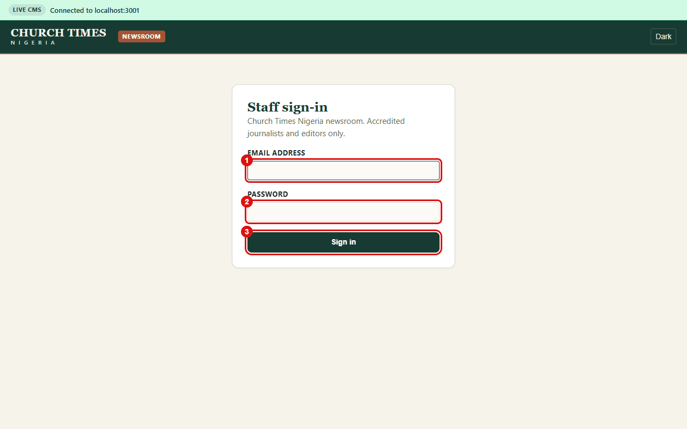

*Tip.* Passwords must have at least **12 characters**. Very common passwords are refused. A few words you can remember work well.

*Warning.* After **5 wrong tries** the account locks for **10 minutes**. Wait, or ask an admin to use **Force Unlock** (section 10).

*Good to know.* A sign-in lasts **8 hours**. While you type or click, the app quietly extends it. If you see "Your session has ended. Please sign in again.", sign in again. You return to the page you were on.

### Log out

Click **Log out** at the top right. You see "Logged out. Session cleared." Always log out on a shared computer.

### The Newsroom Desk

After sign-in you land on the Desk.

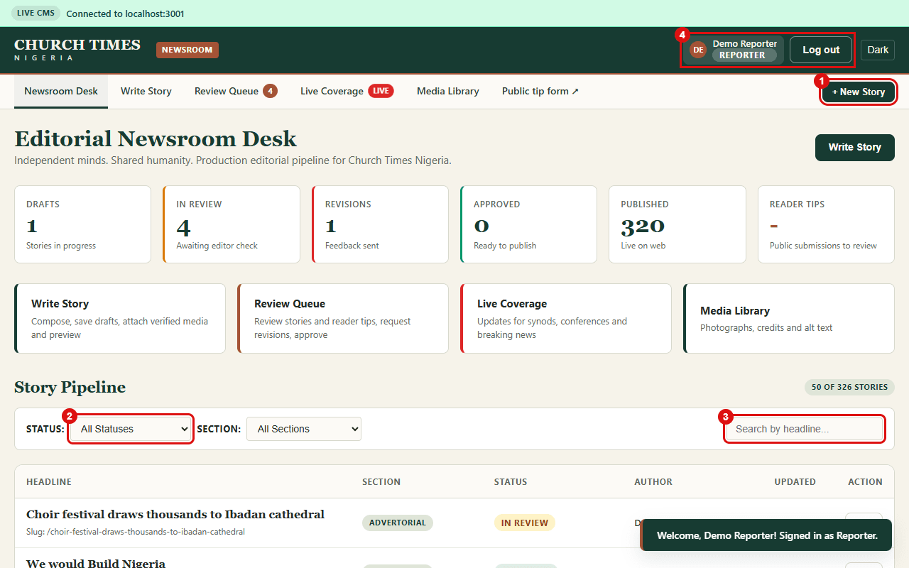

You will see:

- **Menu bar:** **Newsroom Desk**, **Write Story**, **Review Queue** (with a number for stories waiting), **Live Coverage**, **Media Library**, **Archive Review** (editors only), **Public tip form** (a link to the public site), and **+ New Story**.
- **Six counters:** Drafts, In Review, Revisions, Approved, Published, Reader Tips. Click a counter to filter the list below it.
- **Story Pipeline:** the list of stories. Use **Status**, **Section** and **Search by headline** to find one. Each row has **Open**. Editors also see **Inspect**. The editor-in-chief and admin also see **Delete**.

On a phone, a bar at the bottom shows Desk, Write, Review, Live and Media.

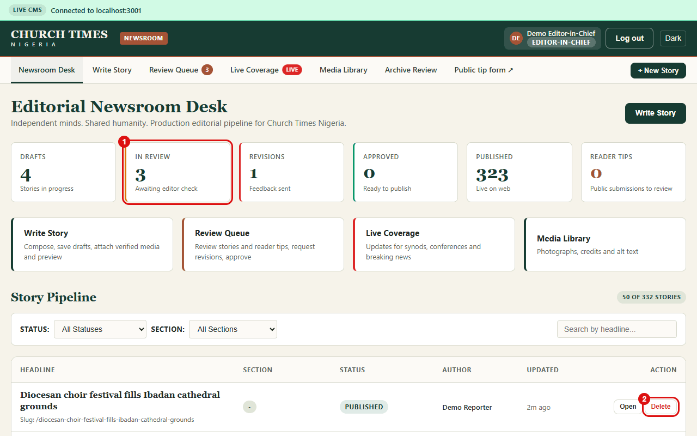

### Keyboard shortcuts

| Keys | What they do |
| --- | --- |
| Alt+1 | Newsroom Desk |
| Alt+2 | Write Story |
| Alt+3 | Review Queue |
| Alt+4 | Live Coverage |
| Alt+5 | Media Library |
| Alt+6 | Archive Review |
| Ctrl+S | Save Draft (inside the story editor) |

---

## 3. Roles, and what each person can do

An admin gives each person one **role**. It shows under your name at the top right. A **section** is a category such as News, Opinion or Youth. Editors and trusted publishers are given **sections** too, and their powers apply only in those sections.

| Role | In plain words |
| --- | --- |
| **Reporter** | Writes drafts and sends them for review. Cannot approve, publish, schedule or archive, not even their own story. |
| **Trusted publisher** | A reporter who may **publish or schedule their own stories**, only in the sections the admin gave them. Cannot approve other people's work. |
| **Section editor** | Edits one or more sections. Reviews, approves, sends back, publishes and archives stories **in those sections only**. |
| **Editor-in-chief** | Does what a section editor does, in **every** section. Also deletes stories, manages ads and redirects, and reads the audit log. |
| **Admin** | Everything the editor-in-chief can do, plus staff accounts and newsletter subscribers. |

### What each role can do

"Own" means only stories you wrote. "Their sections" means the sections the admin assigned.

| Action | Reporter | Trusted publisher | Section editor | Editor-in-chief | Admin |
| --- | --- | --- | --- | --- | --- |
| Start a story, upload photos | Yes | Yes | Yes | Yes | Yes |
| Edit a story | Own, while Draft or Changes Requested | Own, in their sections | Any story in their sections | Any | Any |
| Submit for review | Own | Own | Yes | Yes | Yes |
| Approve or Request Changes | No | No | Their sections | Yes | Yes |
| Publish or schedule | No | Own, in their sections | Their sections | Yes | Yes |
| Archive (take down) a published story | No | No | Their sections | Yes | Yes |
| Delete a story | No | No | No | Yes | Yes |
| Post a live update | Yes (needs approval) | Yes | Yes | Yes | Yes |
| Create and run live events | No | Their sections | Their sections | Yes | Yes |
| See reader tips | No | No | Yes | Yes | Yes |
| Archive Review screen | No | No | Yes | Yes | Yes |
| Hide or restore old comments | No | No | Their sections | Yes | Yes |
| Ads, advertisers, redirects, contact messages | No | No | No | Yes | Yes |
| Read the audit log (who did what) | No | No | No | Yes | Yes |
| Add or change staff accounts | No | No | No | No | Yes |
| Newsletter subscribers | No | No | No | No | Yes |

The newsroom app hides buttons you may not use. If a button shows but the system still refuses, you see a message such as "Not permitted". That is normal. Ask your editor.

*Verified in the practice copy:* a trusted publisher in the Opinion section wrote an Opinion story, and the editor showed **Submit for Review** and **Publish Story** (no Approve button). Publishing worked at once.

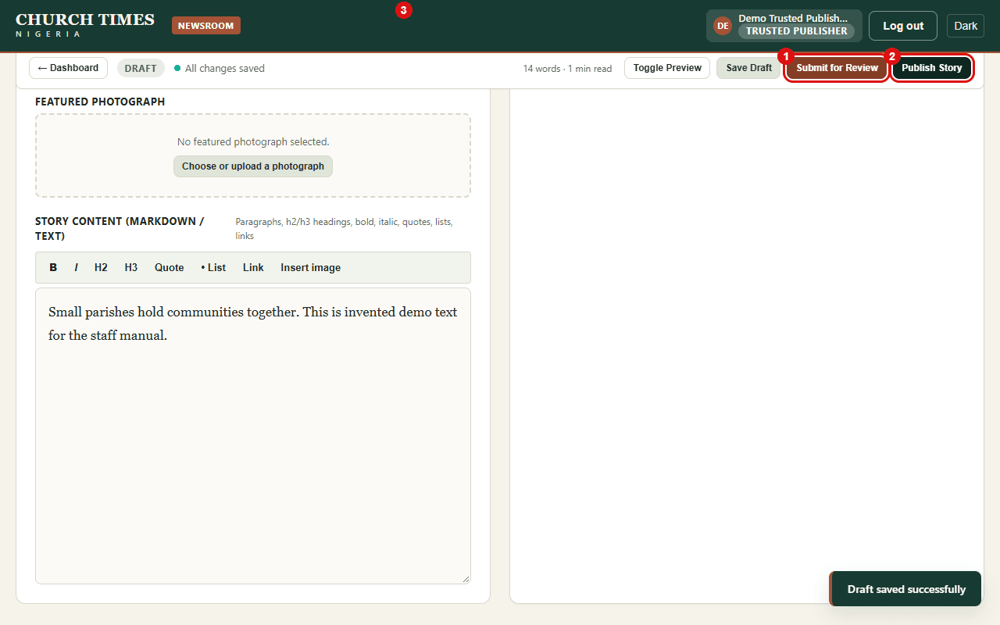

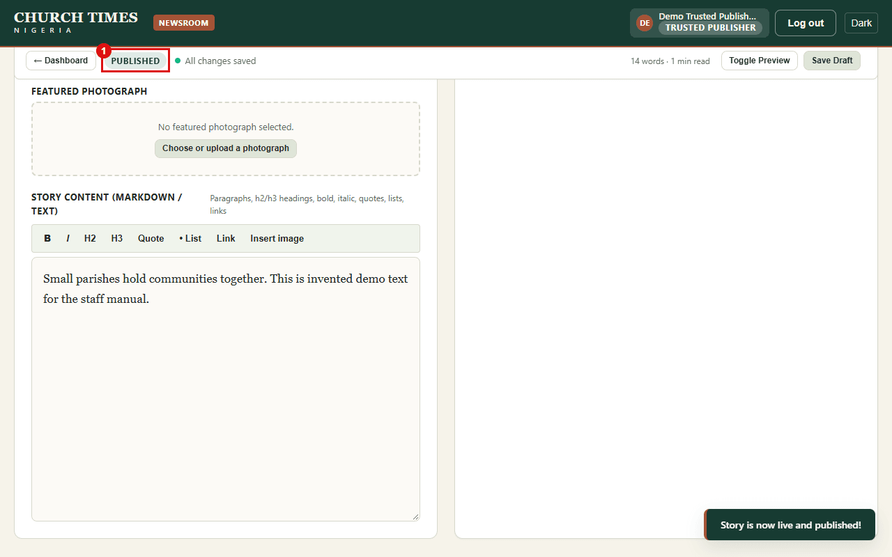

### The four-eyes rule

"Four eyes" means two different people look at something before it goes public. What the system **enforces**:

- **Reporters never publish.** A reporter cannot approve, publish, schedule or archive anything, so a second person always publishes.
- **Recovered archive stories** (section 8): the editor who **approves** a recovered story **cannot** also publish or schedule it. A different editor must. An admin may do both. We tested this: the section editor approved a recovered story and then saw the Publish button greyed out with the note "You approved this recovered archive story, so a different editor must publish or schedule it." The admin could publish it.
- **Ordinary stories:** an editor in the right section who approves a story **may also publish it**. If your newsroom wants a stricter habit, that is a house rule, not a locked button.

---

## 4. Writing a story

### Start a new story

1. Click **+ New Story** (top right) or **Write Story** on the Desk.
2. You see an empty editor with **Not saved yet** at the top.

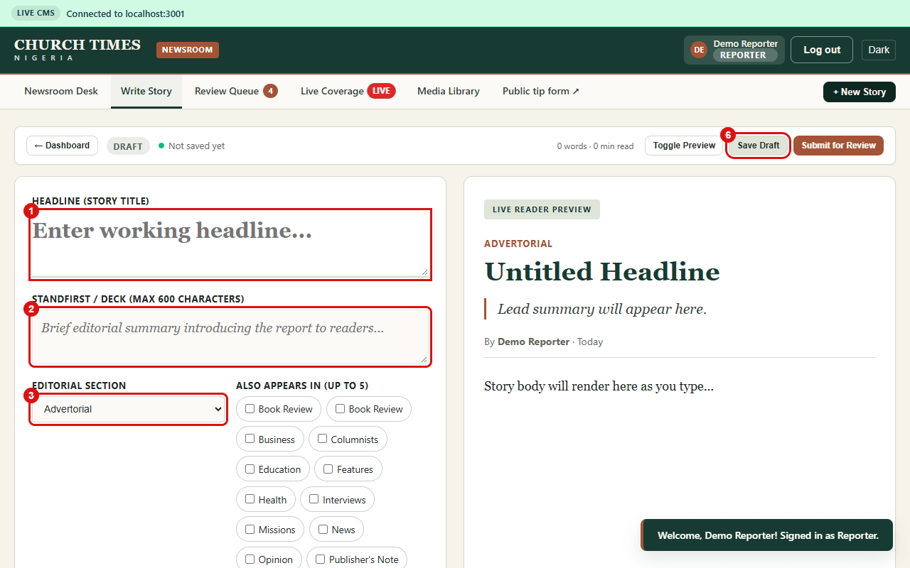

### Fill in the fields

| Field on screen | What to do |
| --- | --- |
| **Headline (Story Title)** | Up to 240 characters. Clear and true. Required. |
| **Standfirst / Deck (max 600 characters)** | One or two sentences under the headline. The **standfirst** is the short intro readers see first. |
| **Editorial Section** | The main section. It decides which editors can approve the story. In the practice copy the choices were Advertorial, Book Review, Business, Columnists, Education, Features, Health, Interviews, Missions, News, Opinion, Publisher's Note, Special Report, Worship and Music, Youth. |
| **Also appears in (up to 5)** | Tick up to five extra sections. |
| **URL Slug** | The last part of the web address. It is made from the headline if you leave it empty. |
| **Byline shown to readers (optional)** | Leave empty to use your own name. Up to 200 characters. |
| **Featured Photograph** | The main picture (see "Photos" below). |
| **Story Content** | The body of the story. |

Steps to fill them:

1. Click the **Headline** box and type the headline.
2. Click **Standfirst / Deck** and type the intro.
3. Open **Editorial Section** and choose the main section, for example **News**.
4. Under **Also appears in**, tick extra sections, for example **Features** and **Worship and Music**. The main section is not offered twice.
5. Check **URL Slug** (see below).
6. Click **Byline shown to readers** if you want a name other than your own.
7. Click the big body box and write the story.

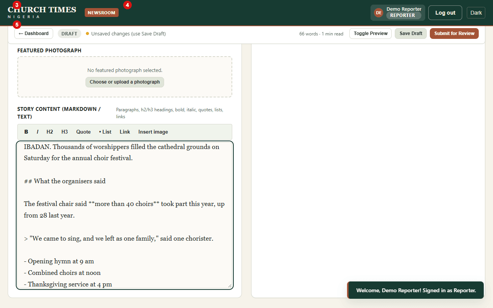

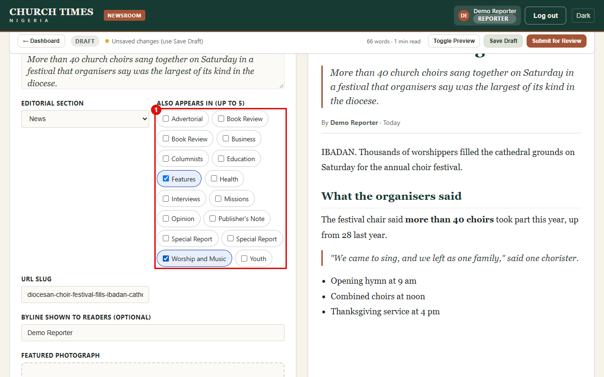

*Good to know.* On the right you see a **Live Reader Preview**. Click **Toggle Preview** to show or hide it. A counter shows words and reading time.

### The URL Slug

The slug becomes the public address: `https://www.<your-domain>/<slug>/`. Example: `https://www.<your-domain>/diocesan-choir-festival-fills-ibadan-cathedral-grounds/`.

- Use letters, numbers and hyphens. Up to 160 characters.
- Some words are reserved by the system (for example `admin`, `api`, `search`, `contact`, `newsletter`, `login`). The system refuses them.
- **Every slug must be unique.** If another story already uses it, saving fails with a red message **"slug: Value must be unique"**. Change the headline a little, or type a different slug, then save again.
- **After a story is published the slug is locked** in the newsroom app. Only the editor-in-chief or an admin can change it. The system then creates a redirect from the old address, so old links keep working.

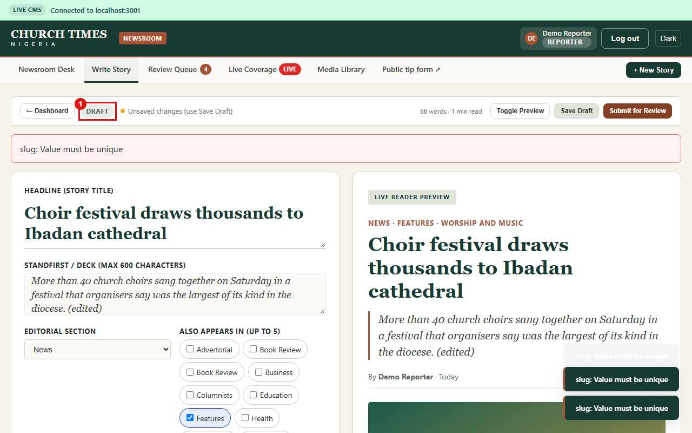

### Formatting the body

Above the body are these buttons: **B** (bold), **I** (italic), **H2** (section heading), **H3** (sub-heading), **Quote**, **List** (bullets), **Link** and **Insert image**.

1. Select the words you want to change.
2. Click a button.
3. The body shows simple marks (for example `**bold**` and `## Heading`). Readers see the proper formatting. Check the **Live Reader Preview**.

*Tip.* Links must start with `http://`, `https://` or `mailto:`.

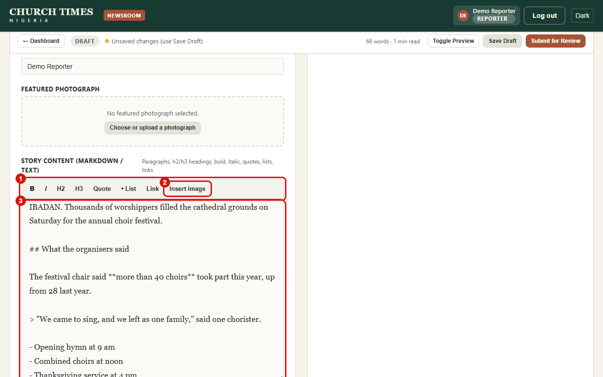

*Warning.* Some stories cannot be edited in the newsroom body box. They contain things the box cannot show, such as embedded video, tables or special formatting. Most recovered old stories are like this. A notice tells you. You can still change the headline, standfirst and other fields. The body can only be edited in the CMS admin. This protects the story from being damaged.

### Photos

**Add the main (featured) photo**

1. Scroll to **Featured Photograph**. It says "No featured photograph selected."
2. Click **Choose or upload a photograph**.
3. A window called **Select Featured Photograph** opens. You see the library of photos. Use the search box (it searches the alt text).
4. To use a photo already in the library, click it.
5. To add a new one, click **Upload a new photograph** and follow the next steps.

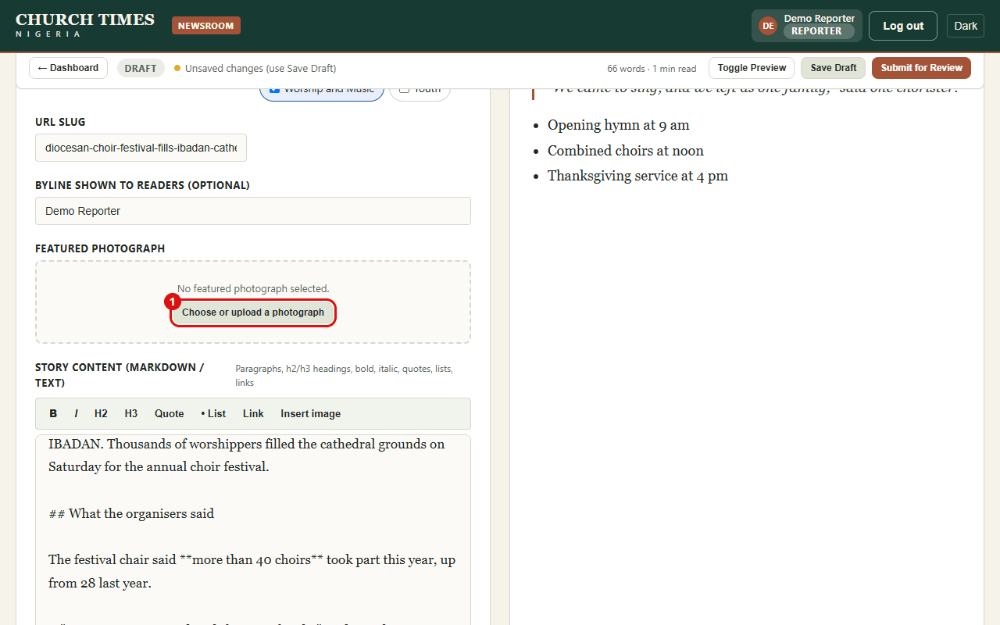

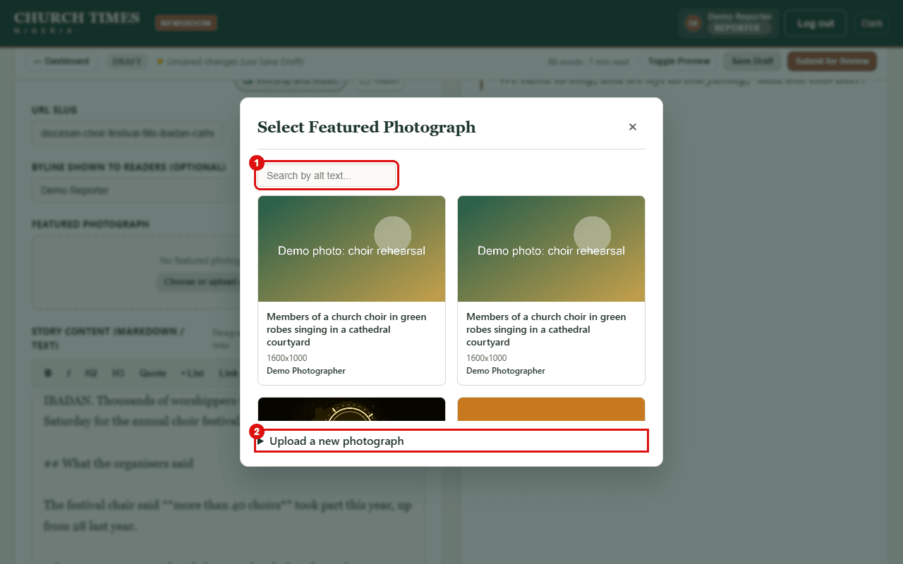

**Upload a new photograph**

1. Click **Choose File** and pick a **JPEG, PNG or WebP** picture.
2. In **Alt text (describe the image)**, describe what is in the picture. This is required. Up to 300 characters. **Alt text** is a short description for readers who cannot see the picture and for search engines. Example: "Members of a church choir in green robes singing in a cathedral courtyard".
3. In **Photographer / credit**, type who took it. Please always fill this in.
4. In **Caption**, type the caption readers should see.
5. Click **Upload to Media Library**.
6. The window closes and the photo shows in the Featured Photograph box. Click **Change Image** or **Remove** if you change your mind.

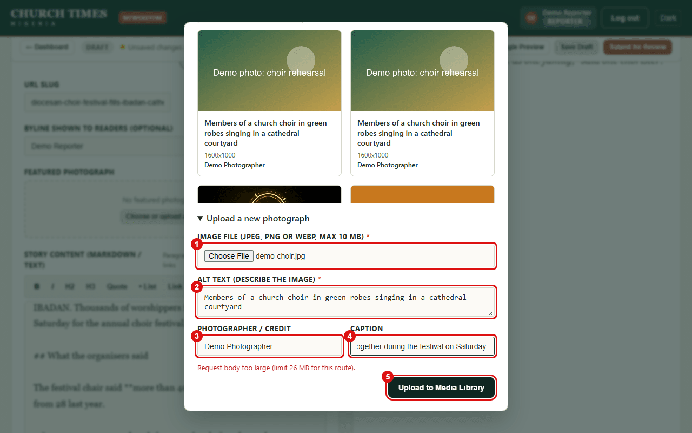

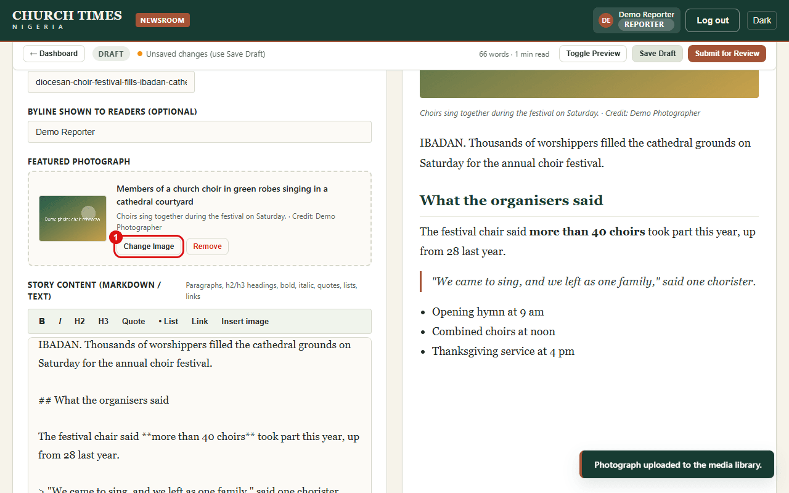

**Picture size limits (verified)**

- The upload form says **"max 10 MB"**. Keep pictures under 10 MB.
- We uploaded a very large picture (about 80 MB). The system refused it with the red message **"Request body too large (limit 26 MB for this route)."** So nothing above about 26 MB can ever go through.
- The CMS has its own picture limit (default 25 MB) and says "Images must be at most N MB" when a file is over it. **Not verified:** what happens to a file between 10 MB and 25 MB, and which number your production system uses. Treat 10 MB as the safe limit.
- Phone camera photos are usually well under 10 MB. If a picture is too big, shrink it (section 13).
- Hidden location and camera data is removed from pictures when you upload.

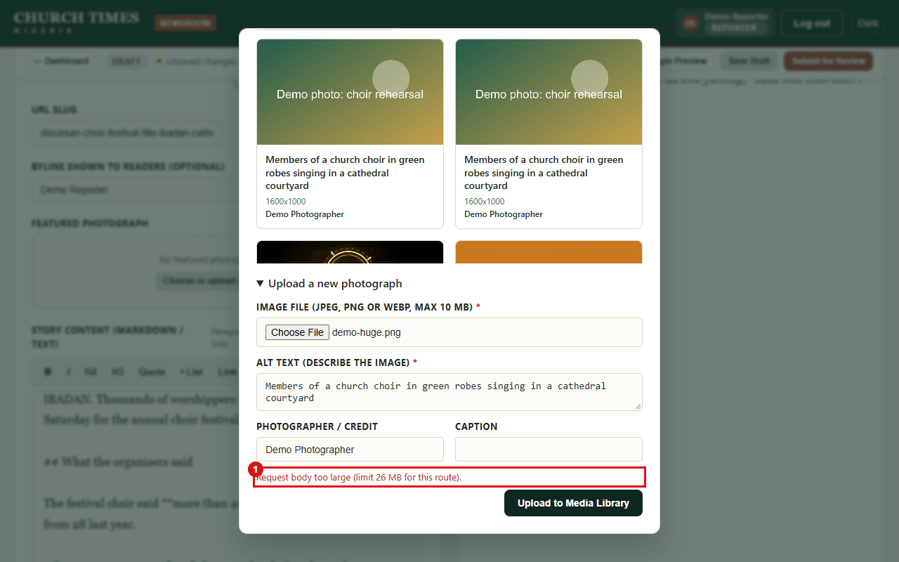

**Put a photo inside the story**

1. Click in the body where the photo should go.
2. Click **Insert image**.
3. Choose or upload a photo as above.
4. A line such as `` appears. Leave it as it is.
5. Below the body, a list called **Images in this story** shows each picture with a **Remove** button.

*Warning.* If a picture was deleted from the library you see **Missing image**. The system will not save the story until you click **Remove** on it.

### Audio and video

This is done in the **CMS admin**, not in the newsroom app. The newsroom upload box accepts photos only. We tested it with an audio file.

**Step A: upload the audio or video file**

1. Open the CMS admin (`https://cms.<your-domain>/admin`) and sign in.
2. Click **Media** in the list, then **Create New**.
3. Click the file area and choose your file. Allowed files: **MP4 or WebM** (video), **MP3, M4A or OGG** (audio). The default size limit is **100 MB** per file.
4. Fill **Alt** (a short description, required), **Caption** and **Credit**.
5. Click **Save**. You see "Media successfully created."

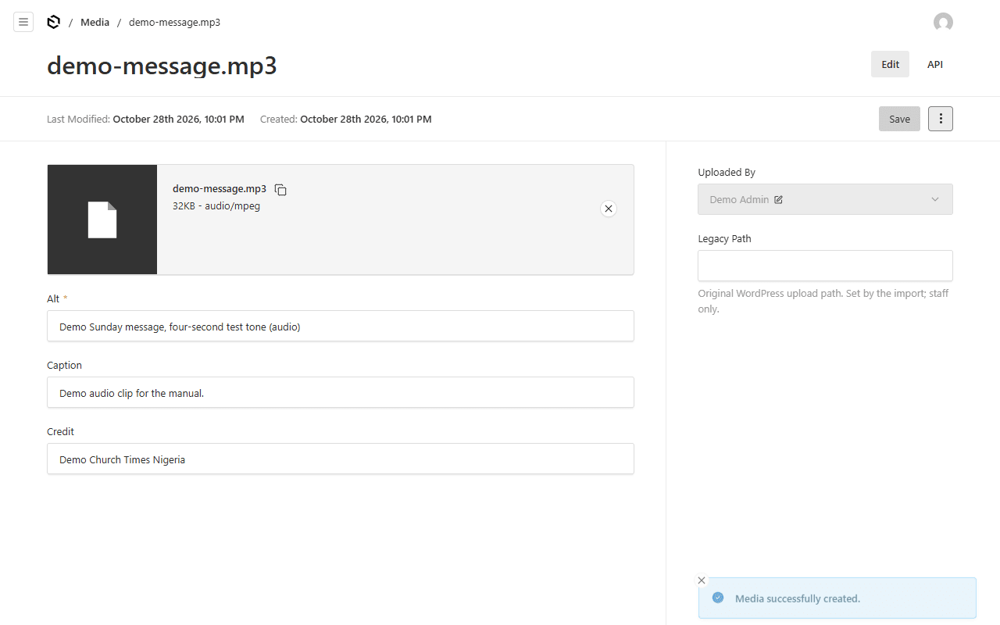

**Step B: add it to a story**

1. In the CMS admin open **Articles**, then open your story (or click **Create New**).
2. Click in the **Content** box where the audio or video should go.
3. Type `/audio`. A small menu called **Blocks** appears with **Audio or video**.
4. Press Enter (or click it). A block appears.
5. Set **Kind** to **Video** or **Audio**.
6. Under **Media** click **Choose from existing** and pick your file.
7. Fill **Title** (required) and, if you like, **Caption**, **Poster** (the still picture shown before a video plays), **Transcript Url** and **Duration**. Leave **Source Url** empty; it is only for old imported stories.
8. Click **Save**.

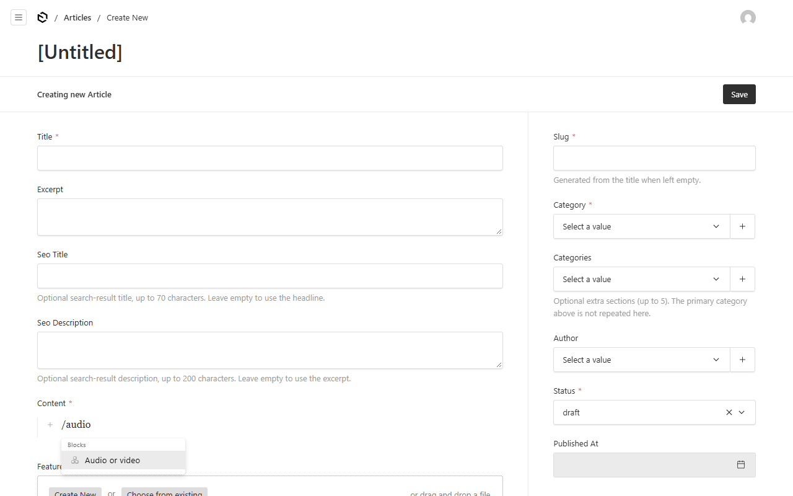

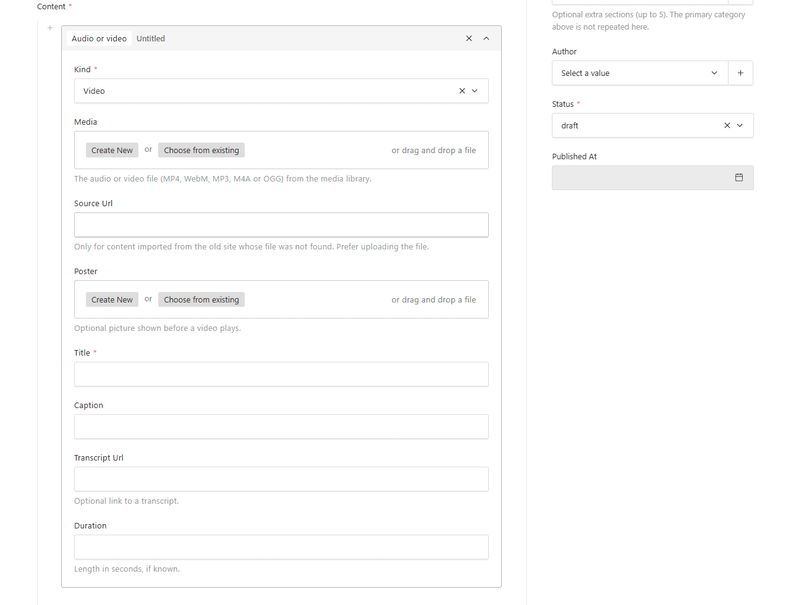

*Good to know.* YouTube videos use a separate YouTube block, also added in the CMS admin. A story that holds these blocks opens with a read-only body in the newsroom app. Edit the body in the CMS admin.

### Story details: kicker, story type, key points, "Updated", topics and author profile

Under the byline there is a box called **Story details**. Everything in it is optional.

| Field | What to do |
| --- | --- |
| **Kicker** | A short label above the headline, for example `Exclusive` or `Rebuilding Together`. Up to 60 characters, plain text. |
| **Story type** | News (the default), Analysis, Opinion, Sponsored, Explainer or Fact-check. Readers see the label. **Any paid or partner content must be "Sponsored".** |
| **Author profile** | Links the byline to the writer's public author page. Choose "None" to show only the text byline. A profile marked "(not public)" is never shown to readers. |
| **"Updated" date** | Only when the story changed in substance (new facts, a new development). Click **Now** to stamp it, **Clear** to remove it. It is never set automatically; do not use it for typo fixes. |
| **Key points** | The "What you need to know" box. One point per line, up to 5 points, up to 200 characters each. The counter under the box tells you when you are over. |
| **Topics** | Tick up to 10 topics readers can follow, for example **Religious freedom**. Topics marked "(not public)" are not shown to readers. Editors create topics in the CMS admin (Newsroom > Topics). |

Like the headline, a reporter can change these only while the story is a draft or sent back. Changing them on a published story does not need a correction note.

### Pull quotes and photo galleries

- **Pull quote.** Click **Pull quote** above the body. A line like `>> We will rebuild. -- Bishop A` appears. Type the exact words from the story after `>>` and the speaker's name after `--`. Up to 400 characters, plain text. The preview shows it as a large quote.
- **Photo gallery.** Click **Gallery image** and choose a photo (it needs alt text). A line like `[gallery](media:12)` appears. Keep the cursor on that line and click **Gallery image** again to add more, up to 12. Gallery photos become public when the story is published, like other photos.
- Per-photo gallery captions are added in the CMS admin. A story whose gallery has captions opens with a read-only body here (the notice says so).

### Save and send for review

1. Click **Save Draft** (or press Ctrl+S). You see "Draft saved successfully" and **All changes saved**.
2. Check headline, section, photo credit and alt text.
3. Click **Submit for Review**.
4. You see "Story submitted for editorial review! Moved to Review Queue." The badge says **IN REVIEW**.

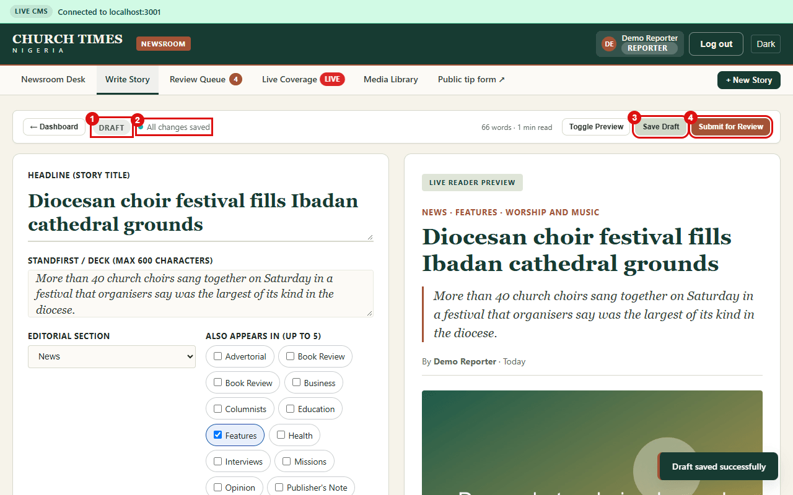

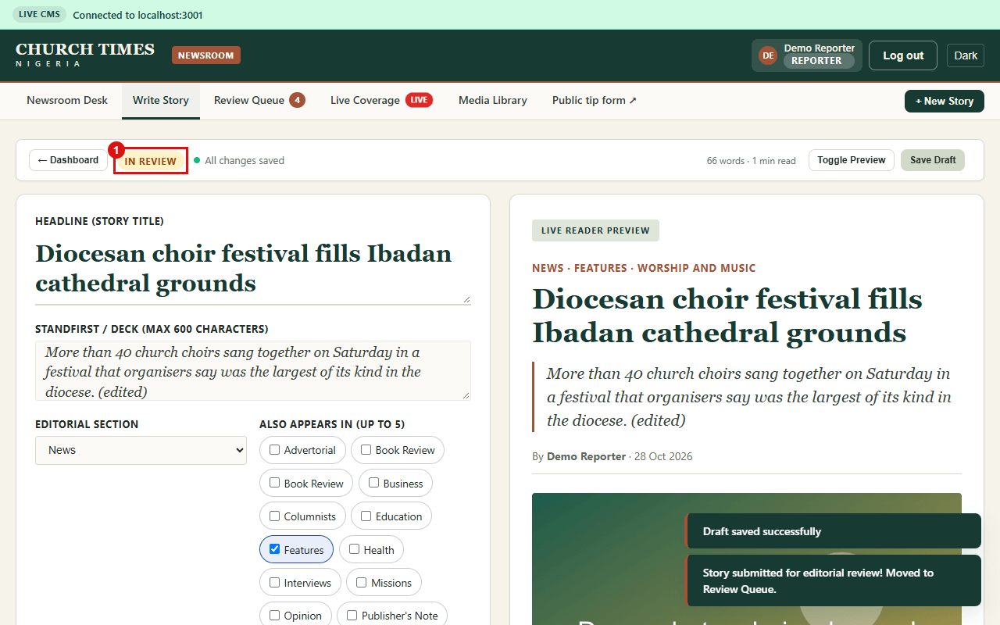

*Warning.* While a story is In Review a reporter cannot edit it. Ask the editor to send it back if you need a change.

---

## 5. Saving, autosave and the offline banner

At the top of the editor, next to the status badge, a small light shows the save state.

| What you see | What it means |
| --- | --- |
| **Not saved yet** | A brand new story. Click **Save Draft** once. |
| **Saved** or **All changes saved** | Everything is stored. |
| **Unsaved changes...** | You typed something. Autosave will store it soon. |
| **Autosaving...** then **Autosaved 10:42:05** | The app saved it for you. |
| **Unsaved changes (use Save Draft)** | Autosave is not allowed for this story. Click **Save Draft** yourself. |
| **Autosave failed (see message above)** | Read the red message, fix the problem, save again. |

Autosave only works on a story you already saved once, and only while it is **Draft** or **Changes Requested**. It never touches a published story.

### The offline banner

When your internet drops, or the CMS cannot be reached, a yellow banner appears at the very top:

**"You are offline or the CMS cannot be reached. Changes are not being saved. Your text stays on this page and in this tab; keep it open and it will retry when you save again."**

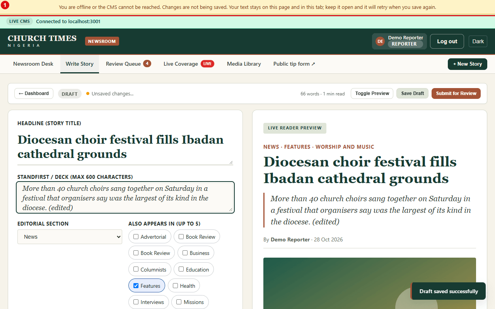

What to do:

1. Do **not** close the tab and do not press refresh.
2. Wait until the banner disappears.
3. Click **Save Draft**.
4. If it does not disappear, copy your text (select all in the body, Ctrl+C) into a Word file as a backup, then call IT (section 13).

If you open the story again and the app finds unsaved text from earlier, it asks **Restore my text** or **Discard it**. If the story changed on the server meanwhile, restoring may replace newer edits, so read first. If you try to leave with unsaved changes, the app warns you and offers **Leave without saving**.

### "Someone else changed this story"

If an editor saved the story while you were typing, you see a red message with **Copy my text** and **Reload story**. Click **Copy my text** first, then **Reload story**, then paste your changes back.

---

## 6. The workflow and scheduling

Every story has a **status**. You see it as a badge at the top of the editor and in the Desk list.

```
Draft --> In Review --> Approved --> Published
            |   ^                        |
            v   |                        v
     Changes Requested               Archived
Approved --> Scheduled --> Published (automatically)
```

| Status | Meaning | Who moves it on |
| --- | --- | --- |
| **Draft** | Being written. | The author clicks **Submit for Review**. |
| **In Review** | Waiting for an editor. | An editor clicks **Approve Story** or **Request Changes**. |
| **Changes Requested** | Sent back with notes. | The author fixes it and clicks **Submit for Review** again. |
| **Approved** | Editor is satisfied. Not public yet. | An editor (or a trusted publisher, for their own story) publishes or schedules it. |
| **Scheduled** | Will publish by itself at a set time. | The system. |
| **Published** | Live on the public site. | An editor may **Archive** it. |
| **Archived** | Taken off the public site. Not deleted. | An editor may publish it again. |

Shortcuts: an editor may publish straight from Draft, In Review or Approved. A trusted publisher may publish or schedule their own story straight from Draft. A reporter can only go from Draft to In Review.

### When an editor sends your story back (reporter steps)

1. Look at your Desk. Your story's status says **Changes Requested**.
2. Open the story (Desk, then **Open**).
3. A yellow box called **Editorial Review Notes** shows what the editor wants.
4. Change the story. Click **Save Draft**.
5. Click **Submit for Review** again.

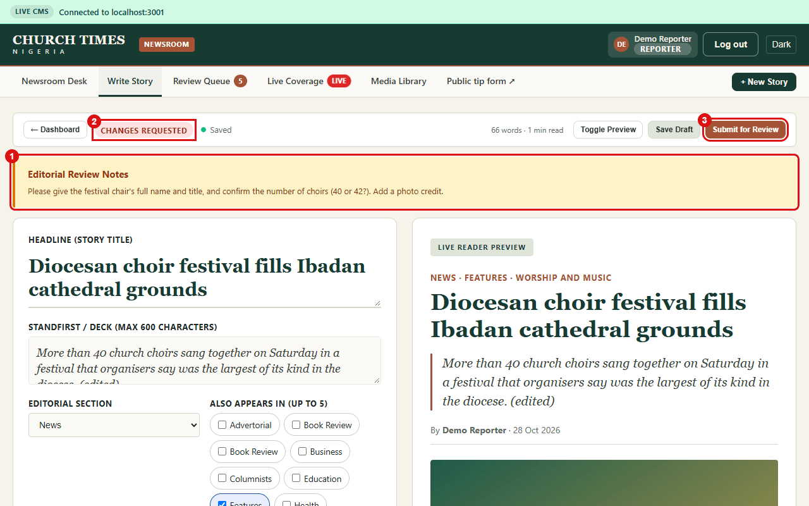

### When your story is approved

An approved story is read-only for a reporter. You see "You can read this story but not edit it in its current status." and no Publish button. An editor publishes it.

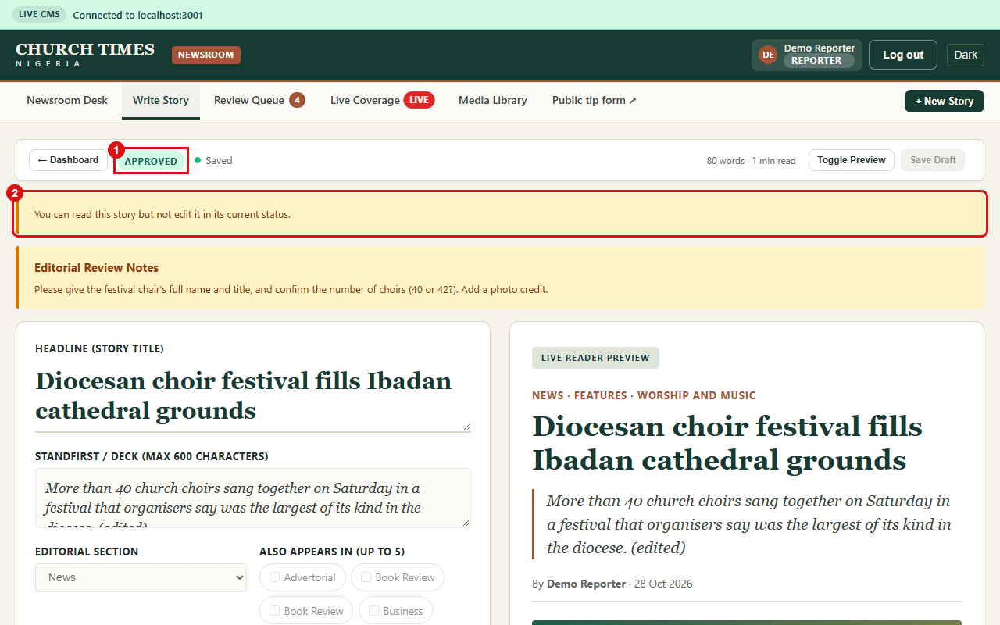

### Schedule a story (editors and trusted publishers)

**Scheduling** means "publish this later, by itself."

1. Open the story. Save it first if it is new.
2. Scroll to the yellow **Schedule publication** box.
3. Next to **Publish at (your local time)** pick a date and time. It starts at one hour from now.
4. Click **Schedule**.
5. You see "Story scheduled for 28 Oct 2026, 21:52:38." The badge says **SCHEDULED** and the box says "Scheduled to publish automatically on ...".
6. To change the time, set a new one and click **Reschedule**.

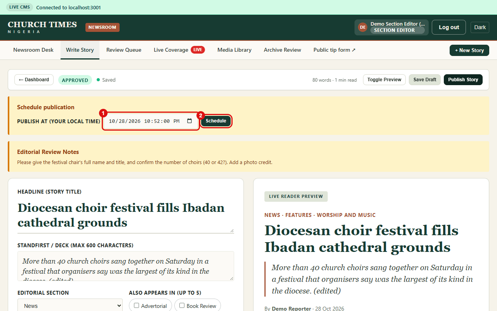

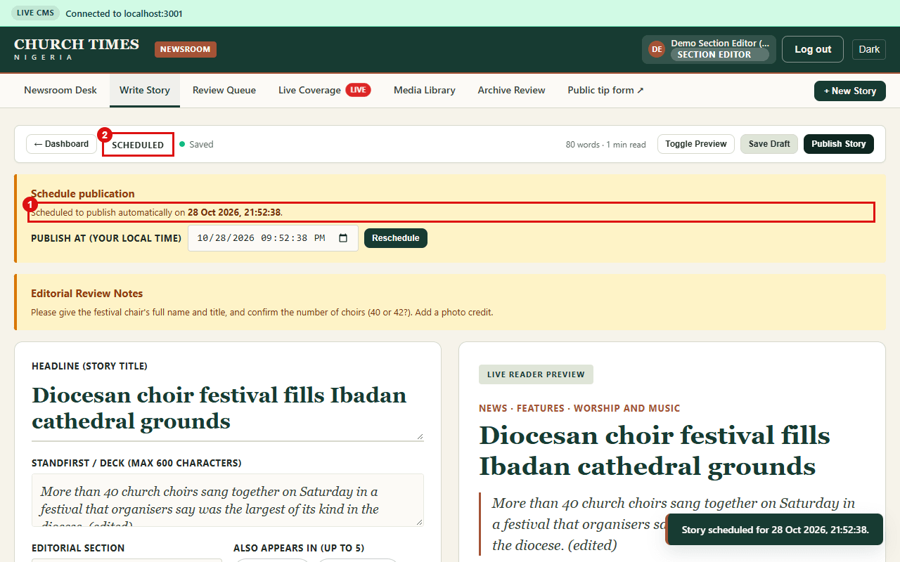

*Good to know (verified).* We scheduled a story 45 seconds ahead. It went live about **12 seconds after** the chosen time. Allow up to about **a minute** after the time you pick. How often your production system checks is **not verified**.

*Warning.* The time must be in the future, otherwise the system says "scheduledFor must be in the future." Check your computer's clock. A scheduled story still has a **Publish Story** button, so an editor can publish it earlier.

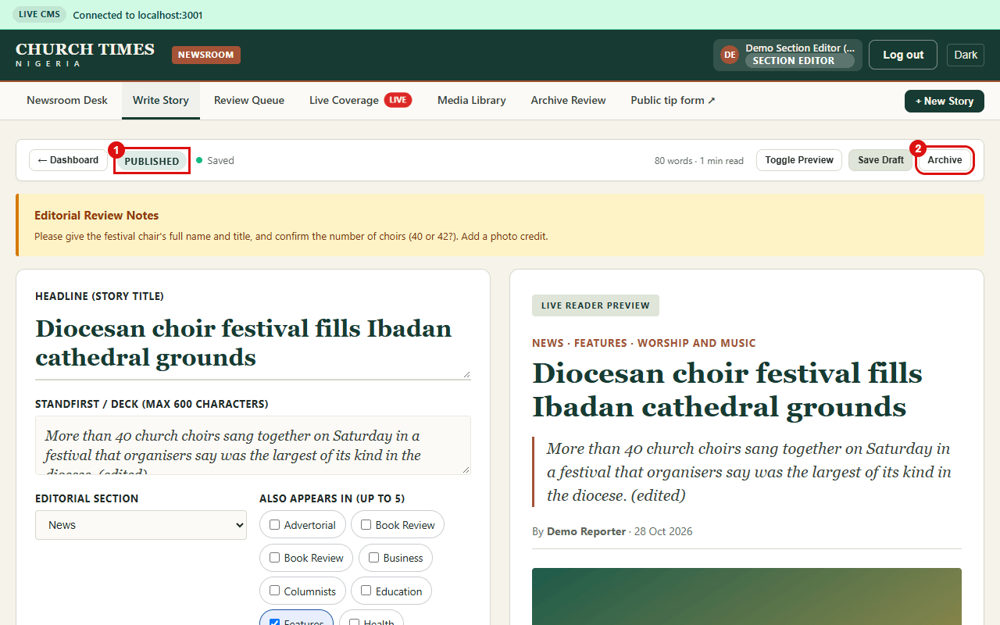

---

## 7. For editors: review, approve, publish, correct, take down

This section is for section editors, the editor-in-chief and admins. A section editor sees and acts only on stories in their own sections.

### The Review Queue

1. Click **Review Queue** in the menu.
2. You see four tabs, each with a count: **In Review**, **Reader Tips & Submissions**, **Revisions Requested**, **Approved Ready**.
3. A link at the top, **Recovered archive drafts: open Archive review**, goes to section 8.

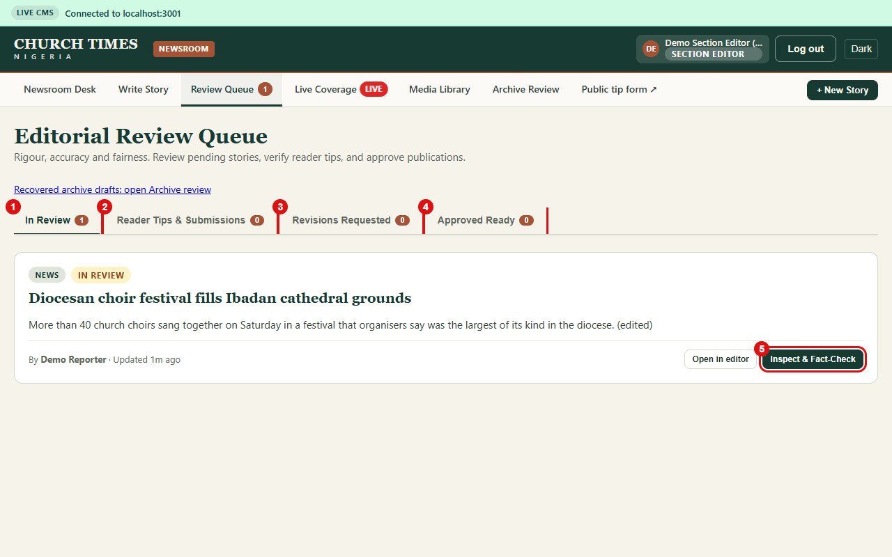

### Review a story

1. On the **In Review** tab, click **Inspect & Fact-Check** on a story. (Or click **Open in editor** for the full editor.)
2. A window called **Editorial Story Inspection** opens. Read the headline, standfirst, photo (with caption and credit) and body.
3. Scroll down. A **fact-check checklist** helps you think: named sources corroborated and dates confirmed; dignity and consent checked, right of reply given; image rights cleared and alt text given. It is an aid only. The system does not require it.
4. Choose one of the buttons at the bottom (next sections).

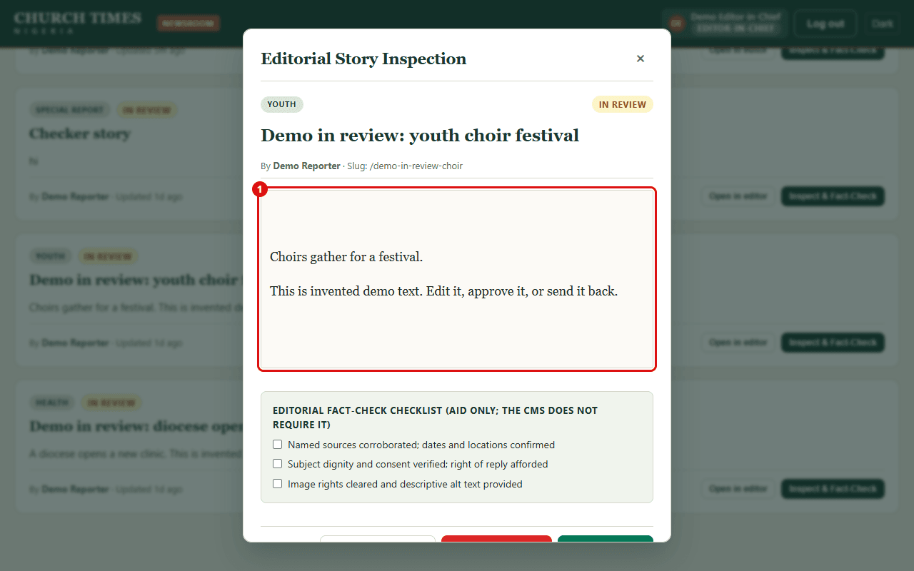

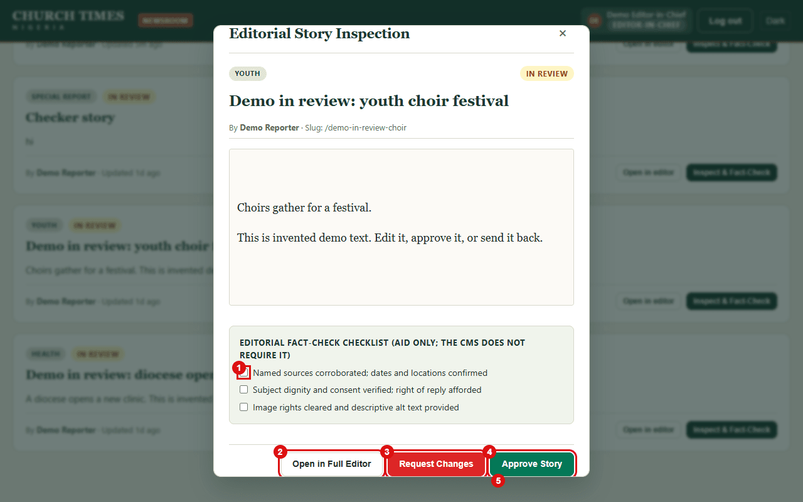

*Warning.* If a story has video or table content the window cannot show, a warning says so. Open it in the CMS admin before approving. If you click Approve anyway, the app asks you to confirm.

### Request changes

1. In the inspection window click **Request Changes**.
2. A box asks "Feedback and revision guidance for the reporter:". Write clear notes.
3. Click **Send Revision Request**.
4. You see "Changes requested from reporter." The story moves to the **Revisions Requested** tab.

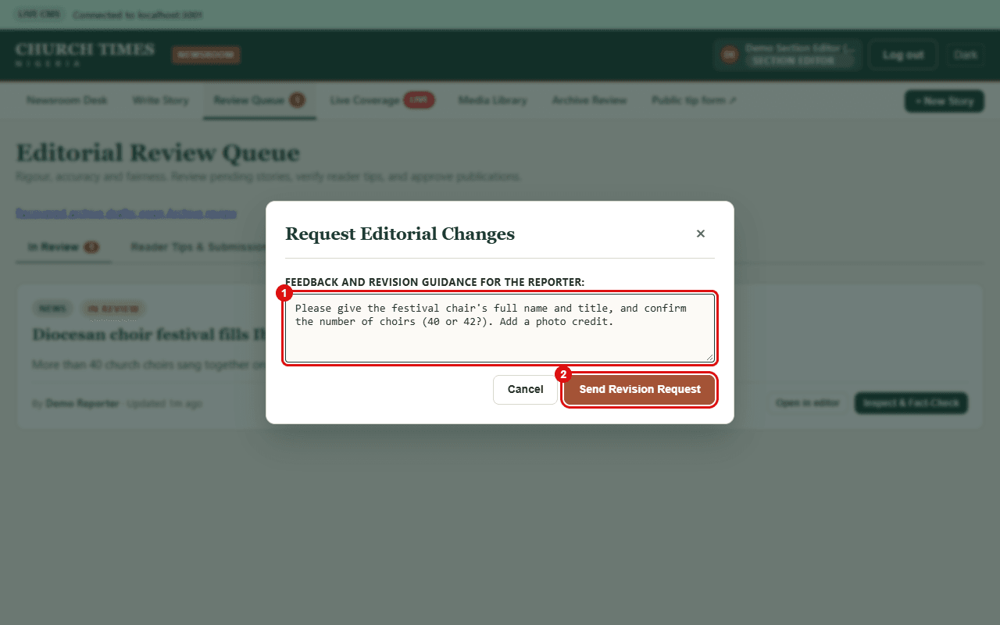

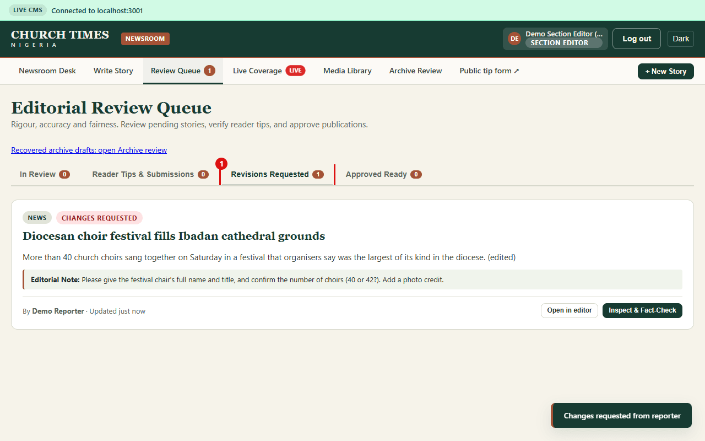

### Approve

1. In the inspection window click **Approve Story**.
2. You see "Story approved for publication!" The story moves to **Approved Ready**.

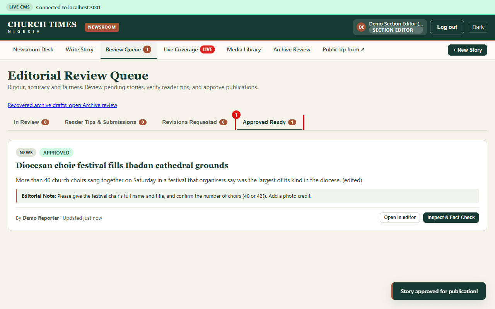

### Open a story in the full editor

You can also open any story from the Desk (**Open**) and use the buttons at the top: **Request Changes**, **Approve Story**, **Publish Story**, **Save Draft**, and **Archive** for a published story.

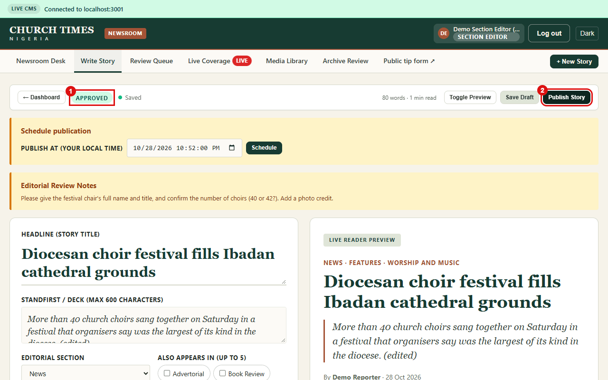

### Publish

1. Click **Publish Story** (in the editor) or **Publish Live** (in the inspection window).
2. A box asks "Publish this story to the Church Times Nigeria live web feed now?"
3. Click **Publish now**.
4. You see "Story is now live and published!" (or "Story published to live feed!").
5. The story is on the public site at `https://www.<your-domain>/<slug>/`.

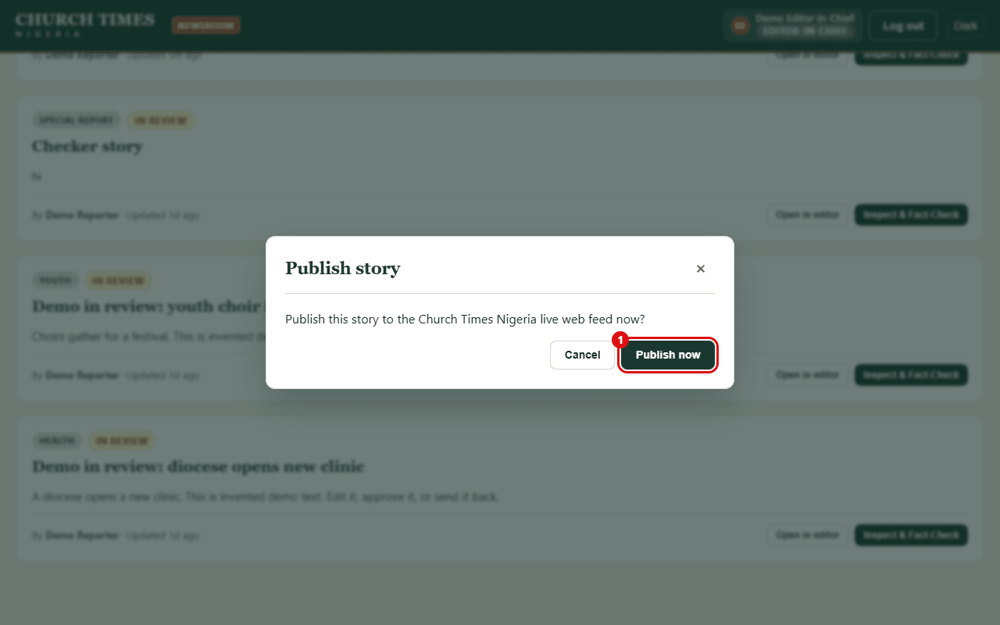

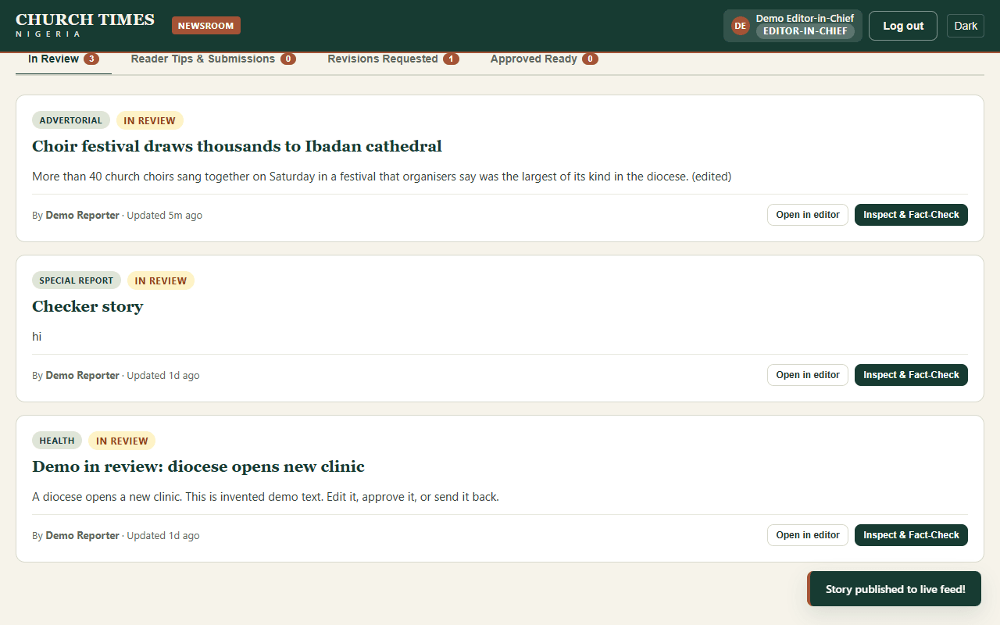

*Warning.* If **Publish Story** is grey, read the short note under it. The usual reason is a recovered archive story (section 8).

*Good to know.* If someone else changed the story while you looked at it, the app reloads it and says so. Read the new version and try again. This stops you approving something that changed after you read it.

### Correct a published story

The system will not save a change to a published headline, standfirst or body without a note. Corrections are kept on record and are not removed. Only the editor-in-chief or an admin can amend an existing correction note.

1. Open the published story. Change the text.
2. Click **Save Draft**.
3. A box called **Add a correction note** opens: "This story is published. The CMS requires a correction note describing what changed."
4. Type the note, for example: "The number of choirs was corrected from 'more than 40' to 42 after organisers confirmed it."
5. Click **Save with correction**.

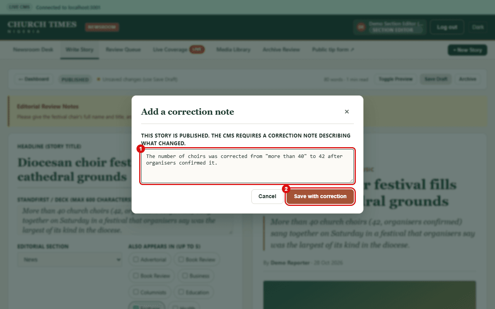

*Good to know.* Autosave never changes a published story. You must click **Save Draft**.

### Take a story down (unpublish)

There is no button called Unpublish. Use **Archive**. Only editors in the right section (and the editor-in-chief and admin) have it.

1. Open the published story.
2. Click **Archive**.
3. A box asks "Archive this story and remove it from the public site?" Click **Archive**.
4. You see "Story archived." The badge says **ARCHIVED**. The story is off the public site but not deleted.
5. To bring it back, click **Publish Story** on the archived story.

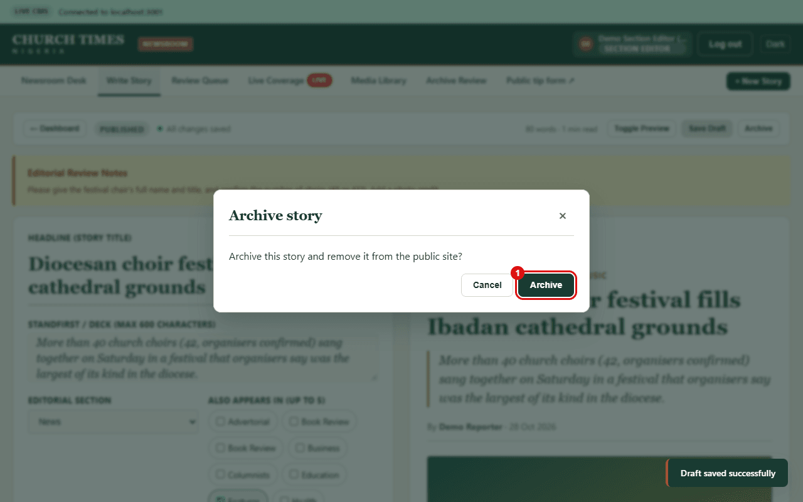

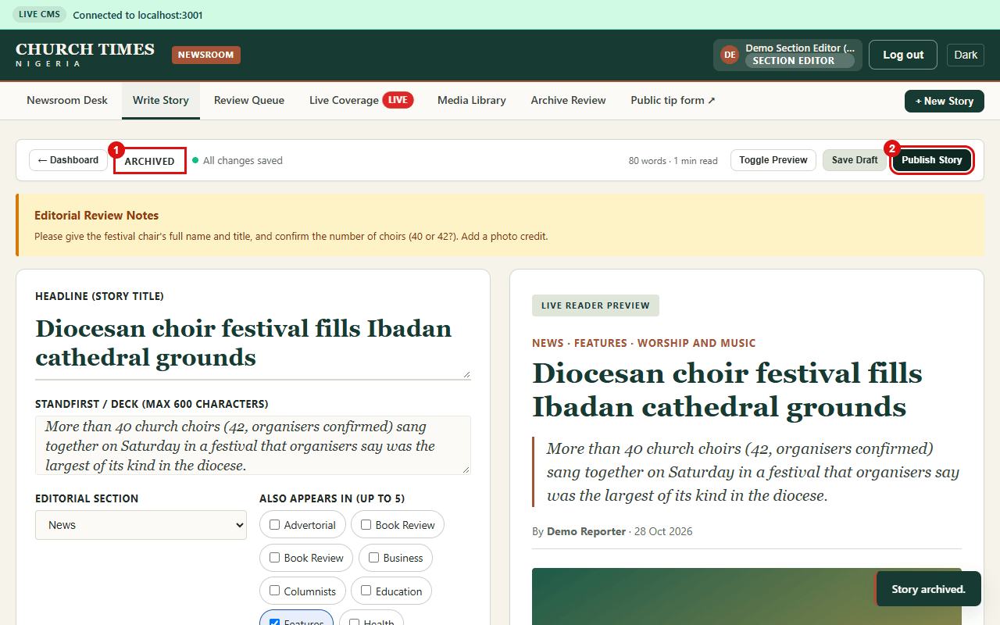

**Delete** (editor-in-chief and admin only, button on the Desk) is permanent and is for mistakes. Prefer **Archive**. A story that still has old reader comments attached cannot be deleted.

### Reader tips

Readers send tips through the public site ("Submit a story"). They arrive in the Review Queue.

1. Open **Review Queue** and click **Reader Tips & Submissions**.
2. Read the yellow note: tips are **never** published automatically. A reporter must check them, convert them to a draft, and take them through the normal workflow. The reader's name is put in the byline. Email and phone are never copied. Clear the byline if the source must stay anonymous.
3. Use **Show:** to filter the tips.
4. To use a tip, click **Convert to Draft Story**, choose **Section for the new story**, and click **Create draft story**. The editor opens with a new draft.
5. To refuse a tip, click **Dismiss Tip** and give a reason. The reason is kept on record.
6. A converted tip shows **Open story**.

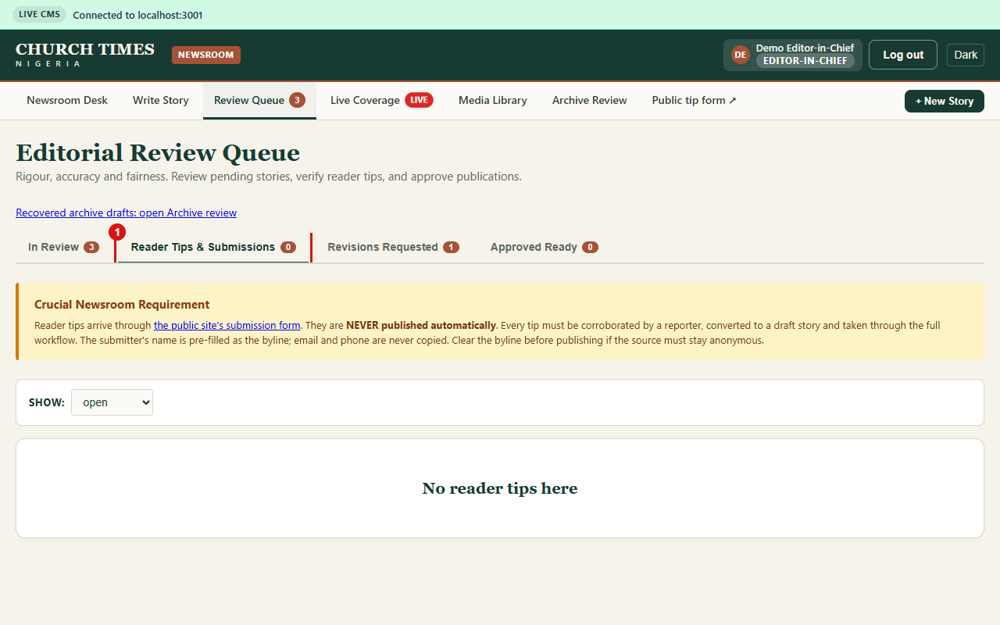

**Not verified:** converting a tip. The practice copy had no tips, and its public form cannot send (section 11), so we could not click through it. The buttons above are from the program's code.

### Push notifications

Push notifications (alerts on readers' phones and browsers) are **not switched on**. The feature is built but off, and no staff button sends one. Please ask the owner before promising readers alerts. For breaking news today, use Live Coverage (section 9) and your social media.

### Media Library

1. Click **Media Library**.
2. Use the search box (it searches alt text).
3. Click a photo to see its **Accessible Alt Text**, **Caption** and **Credit / Photographer**.
4. Anyone can click **Upload Photograph**. Fixing a wrong credit or alt text on an old photo is done in the CMS admin by an editor.

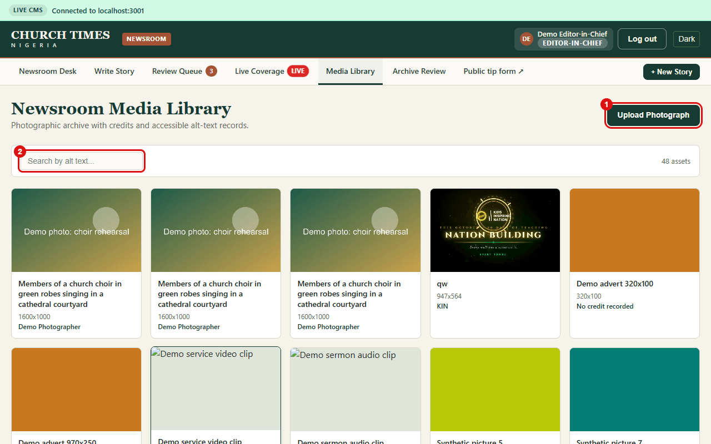

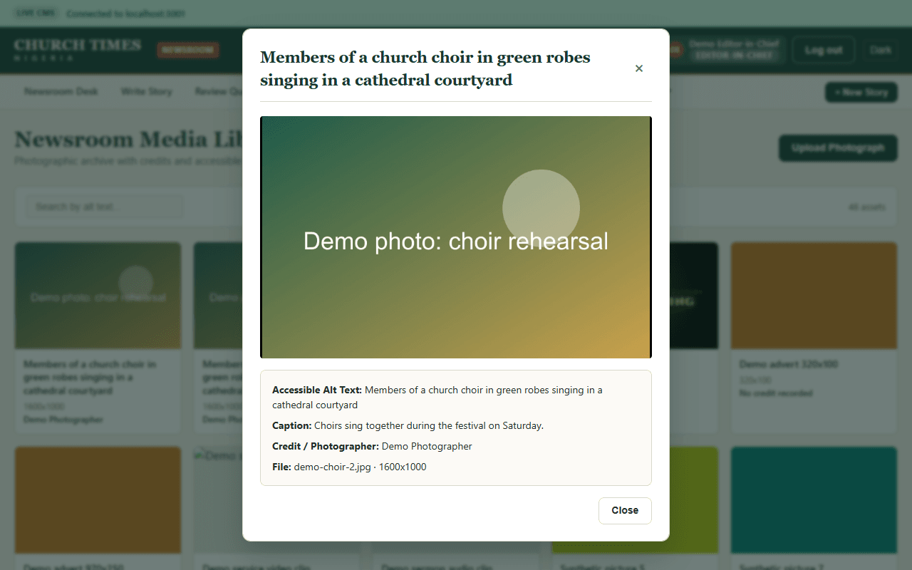

---

## 8. Archive review (recovered old stories)

Old stories from the previous website were recovered and loaded as **drafts**. They are not public. Editors check each one before it can be published. Reporters do not see this screen.

### Find stories to check

1. Click **Archive Review** (or press Alt+6).
2. Use the filters: **Review status** (pending, reviewed, rejected), **Recovery confidence** (partial, citation-only, missing) and **Import batch**. Counts show beside each choice.
3. Each row shows the title, the date the old page claimed, the old website and a confidence badge. Click **Review** on a row.

**Confidence** means how much of the story was recovered. **Partial:** some text. **Citation-only:** only a reference, not the text. **Missing:** little or nothing.

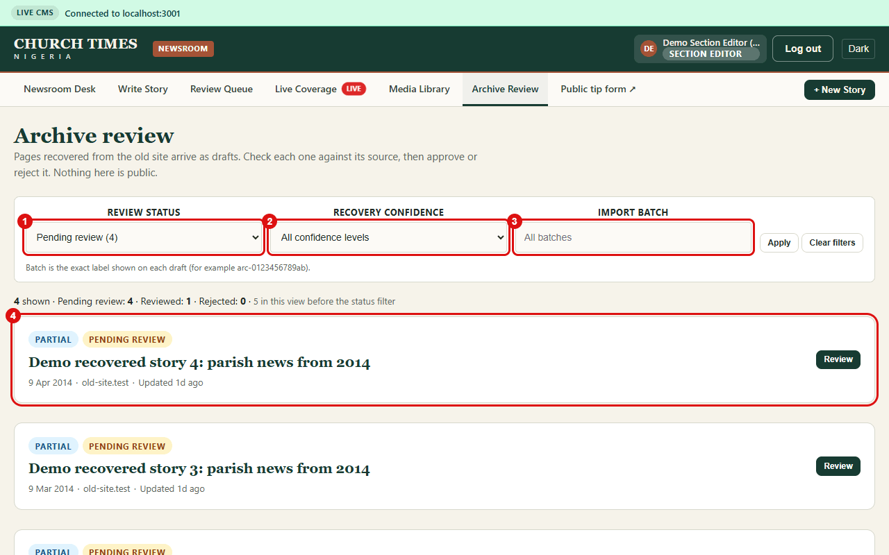

### Review one story

1. The page shows a yellow note "Publishing is blocked. This recovered archive story has not been reviewed yet, so it cannot be published or scheduled. An editor must approve it in Archive review first."
2. On the left is the **Recovered body**. On the right is **Provenance (staff only)**: source address, source host, the date the old page claimed (not verified), when it was captured, a fingerprint (SHA-256), confidence and batch.
3. The source address is shown as text with a link, **Open the old page in a new tab**. It opens **only when you click it**. The app never loads the old page itself.
4. If the story contains links to websites the newsroom does not know, a box lists them. Check them, then tick **I checked the links**. Approve stays grey until you do.

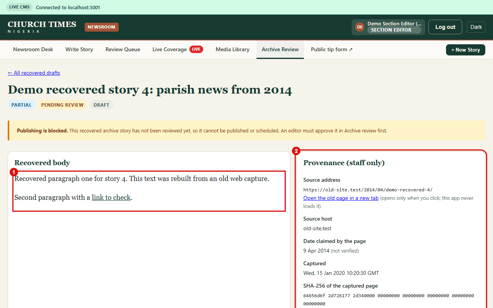

### Approve or reject

1. Scroll to the bottom. You see **Open in editor**, **Reject** and **Approve**.
2. Click **Approve** (or **Reject**). A box asks you to confirm. Approving records your name and the time.
3. You see "Approved. The story is still a draft."

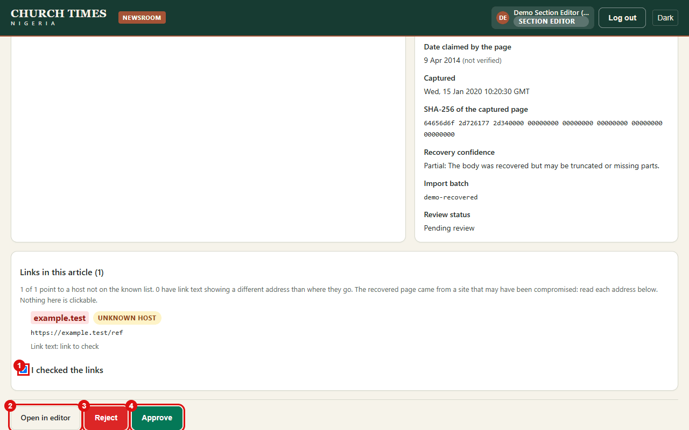

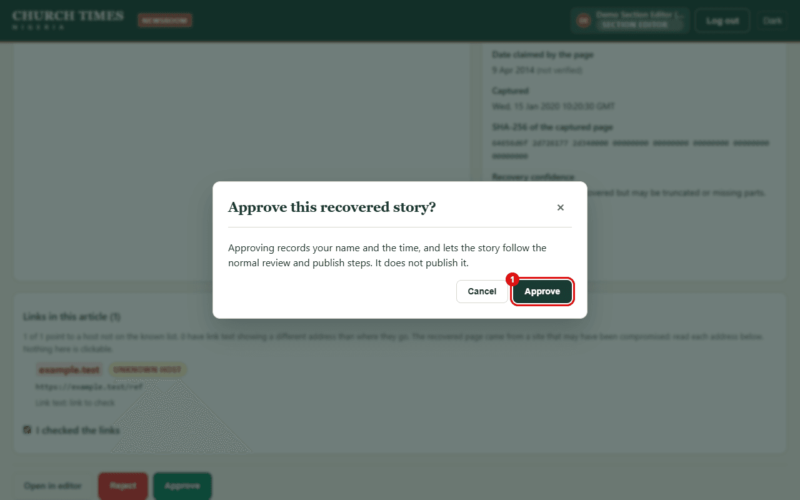

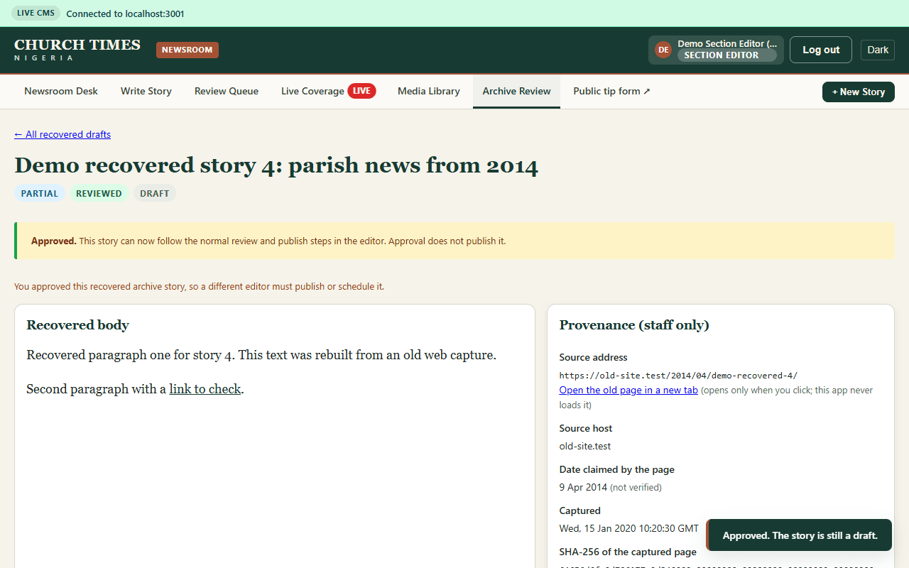

Who may approve or reject: admin, editor-in-chief, or the section editor of that story's section.

### Approval does not publish, and four eyes applies

1. Click **Open in editor** to see the story in the normal editor.
2. If **you** approved it, **Publish Story** is grey and **Schedule** is grey. The notes read "You approved this recovered archive story, so a different editor must publish or schedule it." with a link **Go to Archive review**.
3. A different editor, or an admin, opens the same story. **Publish Story** is available. Click it and confirm as in section 7.

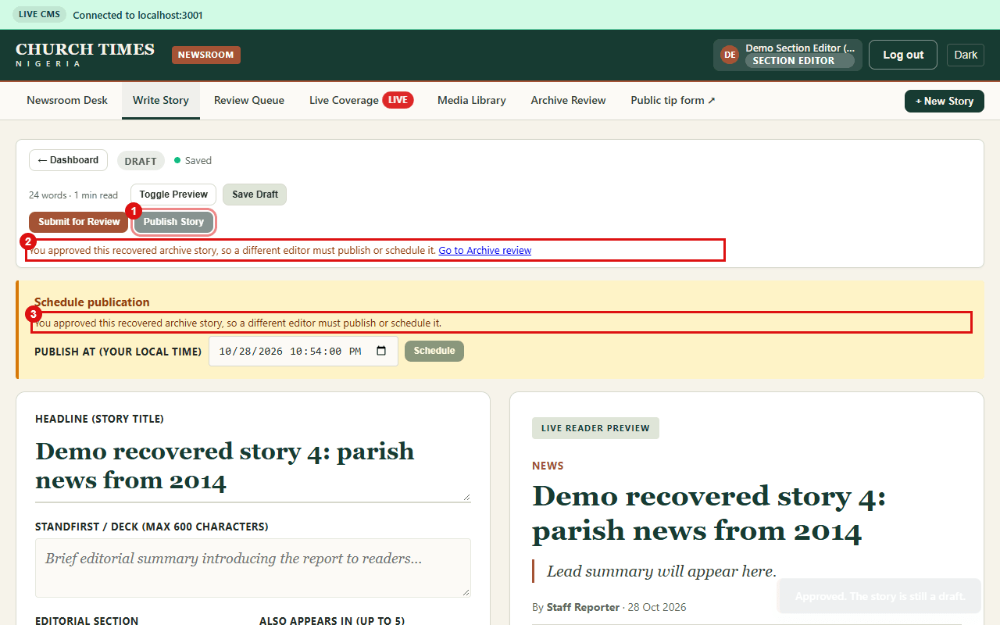

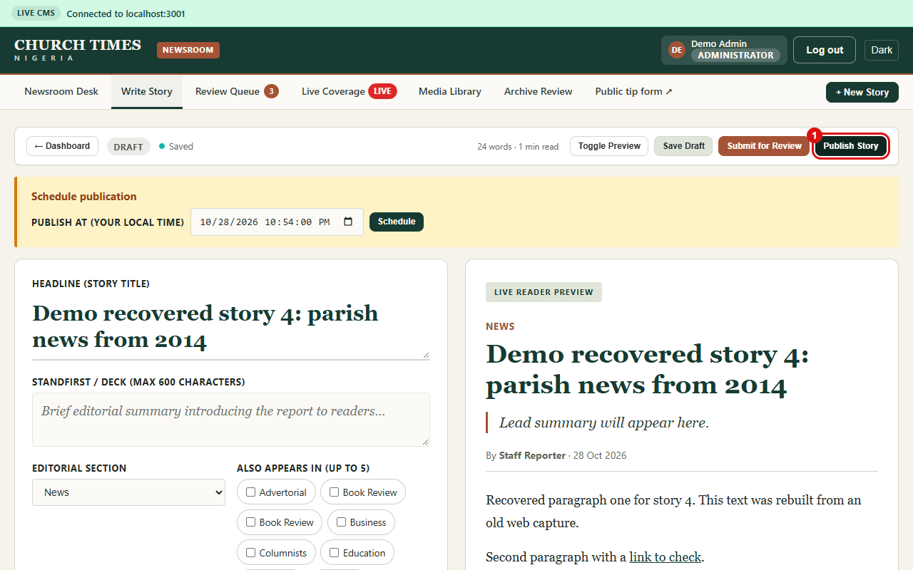

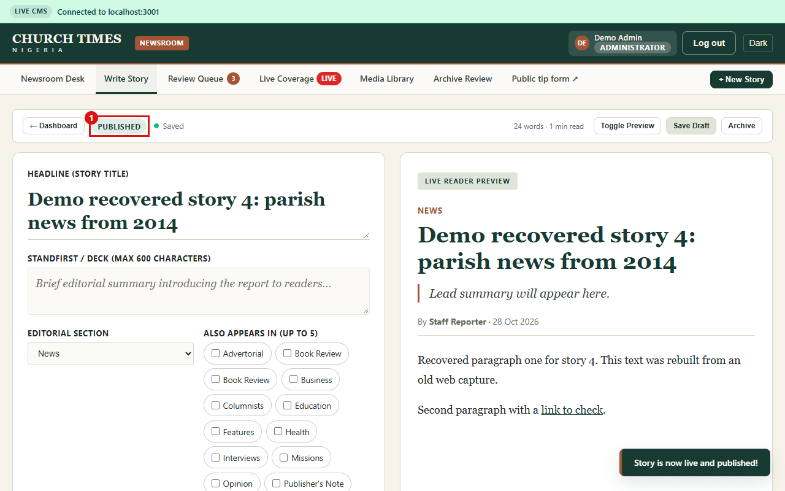

*Good to know.* The review screen also shows "Approved by <name> on <date>" to editors. If the screen says the story changed and reloads, someone else touched it. Look again and retry.

---

## 9. Live coverage

Live coverage is for events such as a synod, where you post short updates through the day. Open **Live Coverage** in the menu.

### Create an event (editors, trusted publishers in their sections, editor-in-chief, admin)

1. Click **+ New Event** (top right).
2. Type the **Event Title**, choose a **Section**, and write a **Summary**.
3. Click **Create event (draft)**. You see "Live event created as a draft. Use Go Live when ready."
4. When you are ready for readers, click **Go Live**. You see "Event is now LIVE".
5. When finished, click **End Coverage**.

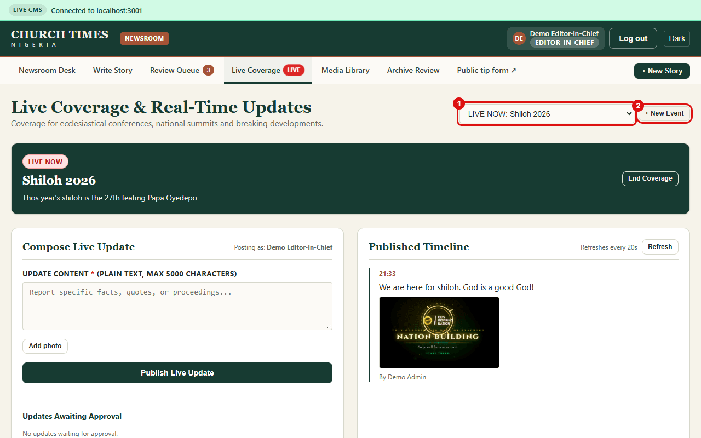


### Post an update

1. Pick the event in the box at the top right (it says **LIVE NOW: ...**).
2. Type in **Update Content** (plain text, up to 5000 characters).
3. Optional: click **Add photo** to attach one picture. Click **Remove photo** to take it off.
4. Click the button at the bottom.
   - If you may approve updates (editors, or a trusted publisher in that section) it says **Publish Live Update**. You see "Live update published to public timeline!"
   - Everyone else (for example a reporter) sees **Submit Update for Editorial Review**. You see "Update submitted for editor approval."


### Approve a waiting update (editors)

1. Under **Updates Awaiting Approval** you see each waiting update.
2. Click **Approve & Push Live**, or **Reject**.
3. The approved update appears in **Published Timeline**, on the right. The timeline refreshes every 20 seconds. Click **Refresh** to refresh now.


---

## 10. Comments, ads, redirects, staff accounts and the other admin tasks

These are in the **CMS admin** (`https://cms.<your-domain>/admin`). Sign in with your normal email and password. The first screen lists the collections: Users, Categories, Media, Articles, Submissions, Contact Messages, Subscribers, Live Events, Live Updates, Redirects, Advertisers, Ad Campaigns, Legacy Comments, Audit Logs. You only see what your role allows.


### Comments (hide and restore)

**New comments are not open on the public site.** The comments in the system are **archived comments from the old website**. They are read-only. Staff can only hide or restore them. Editor-in-chief and admin can do this for all comments. A section editor can do it for stories in their sections. Only an admin can delete one.

1. In the CMS admin click **Legacy Comments**.
2. Search by commenter name or text. Click a comment.
3. You see the comment's details, greyed out because they cannot be edited. At the bottom is **Status** with the value **Approved**.
4. Click **Status** and choose **Hidden**.
5. Click **Save** (top right). You see "Updated successfully." Readers no longer see the comment.
6. To bring it back, set **Status** to **Approved** and click **Save**.
7. Every hide and restore is logged. In **Audit Logs** you see `legacy-comment.hide` and `legacy-comment.restore`.


Hide comments that break your house rules, for example abuse, private details or false claims.

### Advertising (editor-in-chief and admin)

There are two lists: **Advertisers** (who is paying) and **Ad Campaigns** (the placements). Never type card or bank details.

1. Click **Advertisers**, then **Create New**, and add the advertiser first.
2. Click **Ad Campaigns**, then **Create New**.
3. Choose the **Advertiser**. Type the **Sponsor** (the public name) and the **Alt** (describe the ad, public).
4. Type the **Destination Url**. It must be a full `https://` address.
5. Choose the **Placements**. Each one needs its own picture size. In the practice copy these were: `homepage-billboard` (desktop 970 by 250, mobile 320 by 100), `article-inline` (desktop 728 by 90, mobile 320 by 100), `mobile-banner` (mobile 320 by 50). Pictures must be **JPEG, PNG or WebP**, **at most 500 KB**, **not animated**, and **exactly** those sizes.
6. Set **Starts At** and **Ends At**, and a **Priority**.
7. Tick **Rights Confirmed**. This means a person has checked the creative's rights and the advertiser's permission.
8. Set **Status** (draft, pending_approval, approved, paused, cancelled) and **Payment Status** (unpaid, invoiced, paid, waived). Only an admin can set **waived** (free).
9. Click **Save**.

An ad is shown to readers **only** when all of these are true: **approved**, **paid or waived**, and **inside its dates**. If an ad does not show, check each one.


### Redirects (editor-in-chief and admin)

A **redirect** sends a reader from an old web address to a new one so old links do not break.

1. Click **Redirects**, then **Create New**.
2. **From:** the old path, for example `/old-choir-festival/`.
3. **To:** the new path, for example `/diocesan-choir-festival-fills-ibadan-cathedral-grounds/`. Leave it empty only for "gone".
4. **Status:** **301** moved permanently, **302** temporary, **410** gone (removed on purpose).
5. **Source:** leave as **manual**. Add a **Note** if you like.
6. Click **Save**. The system refuses redirects that loop or chain.

When you change the slug of a published story, the system creates the redirect for you.


**Not verified:** following a redirect in a browser. The practice copy's public site does not apply redirect rules.

### Staff accounts (admin only)

1. Click **Users**. You see each person's name, email and role.
2. To add a person, click **Create New**. Fill in **Email**, **Name**, **Role** and **Password**. For a **section editor** or **trusted publisher** also choose their **Sections** (the help text says: "Categories this user edits (section-editor) or may publish in (trusted-publisher)"). Without sections they cannot act on any story. Click **Save**.
3. To change a role or sections, click the person's name, change **Role** or **Sections**, and click **Save**. Role changes are logged.
4. Rules: a new admin cannot sign up by themselves. Passwords must have at least 12 characters.


### Password help

- **You know your password and want a new one.** Open **Users**, click your own name, click **Change Password**. The system asks for your **Current Password** first when you change your own password or email.
- **You forgot your password.** The CMS login page has a **Forgot password?** link. **Not verified:** the email that follows, because email is switched off in the practice copy. If it does not arrive, ask an admin to set a new password for you with **Change Password** on your user record. A reset link, when it works, lasts **1 hour**.
- **Your account is locked** (5 wrong tries). It frees itself after 10 minutes. An admin can click **Force Unlock** on your user record. **Not verified:** the result of clicking it.


### Contact messages (editor-in-chief and admin)

The public **Contact** form sends messages to **Contact Messages**. Open a message, reply by email, and change its status as you go.


### Newsletter subscribers (admin only)

The list of people who signed up. You may mark someone as unsubscribed or bounced. You cannot add people by hand, because people confirm their own sign-up by email.


### Audit logs (editor-in-chief and admin)

**Audit Logs** is a read-only record of who did what and when: status changes, live updates, comment hides, role changes and more. Use it to answer "who published this?"


### Author profiles and topics (editors)

In the CMS admin, under **Newsroom**:

- **Author profiles** are the public byline pages (`/author/<slug>/`). They are separate from log-in accounts. Fill in name, role (for example "Senior Correspondent, Abuja"), a short bio (up to 600 characters) and links (X, Facebook, Instagram, LinkedIn, website; full `https://` addresses). Tick **isPublic** to show the profile. Until then it is hidden everywhere, also when a story points at it.
- **Author photo.** Upload a clear head-and-shoulders photo, square if you can, at least 600 by 600 pixels, JPEG or PNG, with alt text such as "Ada Okafor, Senior Correspondent". Use a photo the person agreed to publish. The photo becomes public only while the profile is public.
- **Topics** are what readers follow (`/topic/<slug>/`): a topic, a denomination, a series or a ministry. Tick **isPublic** to show it. Deleting a topic removes it from every story.
- Section editors, the editor-in-chief and admins can create and edit both; only the editor-in-chief or an admin can delete them.

### Site trust pages (editor-in-chief and admin)

**Newsroom > Site trust pages** holds the text of Editorial standards, Ownership and funding, and Ethics and corrections, plus how to contact the editors. Use headings, paragraphs, lists and links only. Tick **published** to show the pages to readers; untick it to take them down. The corrections log on `/corrections/` is built automatically from the correction notes on published stories.

### Donations and newsletter issues (read-only records)

- **Giving > Donations** lists every giving attempt: reference, status, amount (in kobo, pence or cents), currency and cause. Nobody can edit a row. Admins also see the giver's name and e-mail; the editor-in-chief does not. **Download CSV** above the list gives a file for reconciliation; it contains names and e-mails only when an admin downloads it. Store it securely and delete it after use.
- **Giving > Giving settings** (admin only to change) holds amounts and causes. Giving stays off until **enabled** is ticked and the payment keys are set on the server.
- **Newsletter > Newsletter issues** lists the digests the system prepared or sent. Only the subject can be changed, and only while the issue is a draft. **Newsletter > Newsletter settings** holds the send time and the hard daily cap.

---

## 11. What readers see on the public site

### Stories and addresses

- Each published story has its own page at `https://www.<your-domain>/<slug>/`. Example: `https://www.<your-domain>/diocesan-choir-festival-fills-ibadan-cathedral-grounds/`.
- A story page shows the section, headline, date, a **Listen** button, the photo with its caption and credit, and the body. Audio and video play on the page.
- Old addresses that you set up in **Redirects** forward to the new page.


### Home page and sections

- The top of every page has the Church Times Nigeria name, **Stay connected**, and a menu: **Latest**, **Live coverage**, **News**, **Features**, **Interviews**, **Business**, **Health & education**, **Opinion**, **Publisher's note**. The search and saved-stories (bookmark) icons are at the right.
- The home page has a **From the newsroom** area. In the practice copy, stories we had just published appeared there.
- Section pages have addresses like `https://www.<your-domain>/#section/news`.


### Search

Readers click the magnifying-glass icon, type words and press **Search**. **Not verified / surprising:** in the practice copy the search page said "0 stories found" even for words in stories we had just published (for example "Demo"), and its text says "Explore headlines, topics and contributors from the current publication." The system has a search service that finds published stories (it returned our stories when we asked it directly), but this public page may not use it yet. Check search on your real site before you promise readers that it finds new stories.


### The privacy choices (consent prompt)

At the bottom of every page, **Privacy & reading list** opens a window titled **A considered approach to your privacy**. Under **Optional services — off unless you choose** are two tick boxes, both **off** at the start:

- **Allow configured audience analytics** (counts of visits).
- **Allow Cloudflare spam protection for online forms** (needed before the contact, tip and newsletter forms can send).

A third box, **Allow optional push notifications**, only appears if push is switched on (it is not). Choices are saved in the reader's browser. If a reader says a form will not send, ask whether they allowed the spam protection.


### Newsletter

Readers type their email, receive a confirmation email and are on the list only after clicking the link. Every email has an unsubscribe link. **Not verified:** the newsletter box did not show in the practice copy (it needs configuration and the spam-protection key), so we could not click through it.

### Contact and "Share a story"

- **Contact the newsroom** has a "Let's start a conversation" form. **Submit a story** has "Help us follow the story." Both say that every public submission needs editorial review and nothing is published automatically.
- The tip form asks for **Your name**, **Email address**, **Phone number**, a headline, location, a section, the message and a tick box for consent. If the form is not ready, it says "Online sending is not available yet" and shows the newsroom email address.
- In the practice copy the tip form refused to send and showed "Please check your submission" because the spam-protection challenge was not done. So we could not watch a tip arrive. **Not verified:** the full path from the public form to the Reader Tips tab.


### Comments

Readers see only **Archived comments** under some old stories, and the page says "This archive is read-only; new comments are not accepted." **Not verified:** how that section looks. It did not appear on the story we opened in the practice copy.

### What readers never see

Drafts, In Review, Approved but not published, Scheduled before the time, and Archived stories. Also review notes, reader tips, tip contacts, and all information about where recovered stories came from.

---

## 12. Glossary

| Word | Meaning |
| --- | --- |
| **Admin** | The role that manages staff accounts and everything else. Also the name of the CMS back office (CMS admin). |
| **Alt text** | A short description of a picture for readers who cannot see it. Required on every uploaded photo. |
| **Approve** | An editor says a story is ready. It is not public until it is published. |
| **Archive** | Take a published story off the public site without deleting it. |
| **Archive review** | The screen where editors check recovered old stories. |
| **Audit log** | A list of who did what and when. |
| **Autosave** | The app saving your draft by itself. |
| **Byline** | The author's name shown on the story. |
| **Caption** | The line under a photo. |
| **CMS** | Content management system: where stories and files are stored. |
| **Consent prompt** | The privacy window readers use to allow or refuse optional services. |
| **Correction note** | The note you must add when you change a published story. |
| **Draft** | A story that is still being written. |
| **Extra sections** | The tick boxes "Also appears in". |
| **Four eyes** | Two different people check before something goes public. |
| **Live coverage** | A running list of short updates from an event. |
| **Provenance** | Where a recovered story came from. |
| **Publish** | Make a story visible to readers. |
| **Redirect** | Sending a reader from an old address to a new one. |
| **Role** | What kind of staff member you are, which decides what you can do. |
| **Schedule** | Publish later, automatically, at a time you choose. |
| **Section** | A category such as News or Opinion. |
| **Slug** | The last part of a story's web address. |
| **Standfirst** | The short intro under the headline. |
| **Status** | Where a story is in the workflow: Draft, In Review, and so on. |

---

## 13. Troubleshooting, who to call, and what is not verified

### Quick answers

**"Cannot reach the CMS" (with a Try again button).** The app cannot talk to the back office.
1. Click **Try again**.
2. Check your internet. Open another website.
3. If other sites work and it still fails, the CMS may be down. Call IT. Do not keep clicking.

**Yellow banner "You are offline or the CMS cannot be reached. Changes are not being saved."** See section 5. Keep the tab open. Do not refresh. Save when it clears.

**"Your session has ended. Please sign in again."** Sign in again. You return to the same page.

**I cannot sign in.**
1. Check that Caps Lock is off and your email is typed correctly.
2. After 5 wrong tries wait 10 minutes, or ask an admin to use **Force Unlock**.
3. Still stuck: ask an admin to set a new password.

**I cannot publish my own story.** If you are a **reporter**, that is the rule. Click **Submit for Review** and an editor publishes it. If you are a **trusted publisher** and still cannot: the story must be in one of **your** sections and you must be its author. Ask an admin to check your sections.

**I cannot approve and then publish a recovered archive story.** That is the four-eyes rule (section 8). Ask a different editor or an admin.

**I do not see Archive Review, Approve or Publish.** Your role or sections do not allow it. See the table in section 3.

**I cannot edit a story.** A reporter can only edit their own stories while Draft or Changes Requested. Once it is In Review, only an editor can edit it. A story with video, tables or special formatting has a read-only body. Use the CMS admin.

**"Not permitted" or "Not permitted to move an article from ... to ...".** Your role cannot do that step. Ask an editor.

**"slug: Value must be unique".** Another story has the same slug. Change the headline a little or type a different slug.

**Image too large.** You see "Request body too large (limit 26 MB for this route)." or "Images must be at most N MB."
1. Open the photo on your computer or phone.
2. Use "Resize" or "Export" and choose a medium or web size. About 2000 pixels wide is plenty.
3. Or save it as JPEG at lower quality. Keep it under 10 MB.
4. Upload again. Send a copy to your editor if you cannot shrink it.

**"Unsupported or corrupt file."** The file is not a real JPEG, PNG or WebP. Do not just rename a file. Re-export it from a photo app. For audio and video use MP4, WebM, MP3, M4A or OGG.

**"Alt text is required."** Type a short description of the picture.

**The system asks for a correction note.** You are changing a published story. Describe what changed (section 7).

**"This story was changed by someone else."** Click **Copy my text**, then **Reload story**, then paste your changes in again.

**My scheduled story did not appear.** Open it. If it says Scheduled with a time in the future, wait. If the time has passed by more than a few minutes, tell IT. Check your computer's time zone.

**The slug cannot be changed.** The story is published. Ask the editor-in-chief or an admin.

**A reader says they cannot send a form.** They may not have allowed "Cloudflare spam protection for online forms" in the privacy window, or the service is busy. Ask them to try later or email the newsroom.

### Good habits

- Save often. Use Ctrl+S.
- Fill in the credit and alt text for every photo.
- Do not paste passwords into stories or messages.
- Log out on shared computers.
- Do not share your account. The audit log records your name against every action.

### Who to call

Fill this in before training and print it.

| Problem | Contact | Phone / WhatsApp |
| --- | --- | --- |
| Cannot sign in, password reset, change of role or sections | Admin: ____________ | ____________ |
| Story questions, approvals, corrections | Your section editor: ____________ | ____________ |
| Publishing policy, ads, redirects | Editor-in-chief: ____________ | ____________ |
| "Cannot reach the CMS", site down, errors that will not clear | IT / technical contact: ____________ | ____________ |
| Suspected hacking, lost phone or laptop | Admin and IT at once | ____________ |

When you report a problem, say: your name, the screen you were on, what you clicked, and the exact words of any red message. A screenshot helps.

### Not verified (please check on your real system)

1. **Picture size.** The upload form says 10 MB. The system refused 80 MB at "26 MB for this route". The CMS default is 25 MB. A file between 10 and 25 MB was not tested, and your production limit is not known.
2. **Audio and video size.** The default is 100 MB. The production value is not known. We only uploaded a small MP3.
3. **Forgot password email and Force Unlock.** Email is off in the practice copy.
4. **Reader tips.** Converting or dismissing a tip, and the whole path from the public tip form, could not be tested.
5. **Public search.** The public search page returned no results for new stories in the practice copy.
6. **Public newsletter box and archived comments section.** Neither appeared in the practice copy.
7. **Redirects in a browser.**
8. **Scheduler speed in production.** Verified about 12 seconds in the practice copy only.
9. **Section names, web addresses and the exact CMS address** shown in this manual are the practice copy's or placeholders.
10. **Trusted publisher and other people's stories.** In our test a trusted publisher's Desk search did not find a reporter's story in another section. We did not confirm the rule behind this.

---

## 14. Quick-reference cards

Cut out or print one per role.

### Card: Reporter

- **Sign in:** newsroom address, email, password (12+ characters).
- **Write:** **+ New Story**, then headline, standfirst, section, body, then **Save Draft** (Ctrl+S).
- **Photos:** **Choose or upload a photograph** or **Insert image**. JPEG, PNG or WebP, under 10 MB. Always add alt text and credit.
- **Send:** **Submit for Review**. Then wait.
- **Sent back?** Read **Editorial Review Notes**, fix, **Submit for Review** again.
- **You cannot:** approve, publish, schedule, archive, or edit once it is In Review.
- **Live Coverage:** post updates with **Submit Update for Editorial Review**. An editor approves them.
- **Yellow offline banner?** Keep the tab open. Save when it clears.
- **Stuck?** Your section editor. Sign-in trouble: the admin.

### Card: Trusted publisher

- **Everything a reporter does, plus:**
- **Publish your own story** in **your sections**: **Publish Story**, or set a time and click **Schedule**.
- **Not allowed:** approving or publishing other people's work, or publishing outside your sections.
- **Live Coverage:** create events and approve updates in your sections (**Publish Live Update**).
- **Corrections:** changing a published story needs a correction note.
- **Remember:** the slug is locked after publishing. You cannot **Archive**.

### Card: Section editor

- **Your sections only.**
- **Queue:** **Review Queue**, **In Review**, **Inspect & Fact-Check**.
- **Decide:** **Request Changes** (write notes, **Send Revision Request**), **Approve Story**, **Publish Live**.
- **Schedule:** **Schedule publication** box, then **Schedule**.
- **Take down:** **Archive** (not Delete).
- **Corrections:** **Save Draft**, write the note, **Save with correction**.
- **Tips:** **Reader Tips & Submissions**, **Convert to Draft Story** or **Dismiss Tip**.
- **Archive Review (Alt+6):** tick **I checked the links**, then **Approve** or **Reject**. If you approved, a different editor publishes.
- **Comments:** hide or restore old comments in the CMS admin.
- **Live Coverage:** **+ New Event**, **Go Live**, **End Coverage**, **Approve & Push Live**.

### Card: Editor-in-chief

- **All sections.** Everything a section editor does, plus:
- **Delete** a story (mistakes only, button on the Desk).
- **Change the slug** of a published story (a redirect is added for you).
- **CMS admin:** Advertisers, Ad Campaigns, Redirects, Contact Messages, Audit Logs.
- **Ads show only when** approved, paid or waived, and inside their dates.
- **Redirects:** 301 moved, 302 temporary, 410 gone.
- **Push notifications:** not switched on.
- **Archive Review:** approve or reject. A different editor publishes.

### Card: Admin

- **Everything the editor-in-chief does, plus:**
- **Staff accounts:** CMS admin, **Users**, **Create New** or open a person. Set **Role**. Set **Sections** for section editors and trusted publishers.
- **Password help:** **Change Password** and **Force Unlock** on the user record.
- **Newsletter subscribers:** view, mark unsubscribed or bounced.
- **Archive Review:** may approve and publish the same story.
- **Delete** old comments (only admins).
- **Audit Logs:** check who did what.
- **Keep safe:** never share admin logins. Remove accounts of people who leave.
